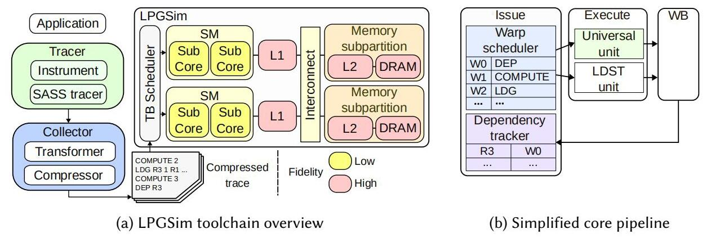
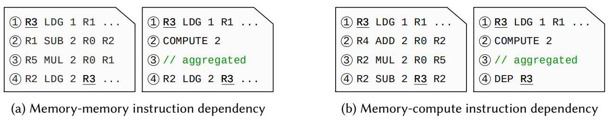
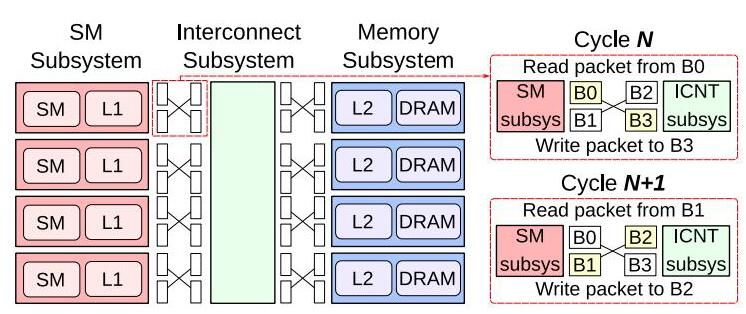
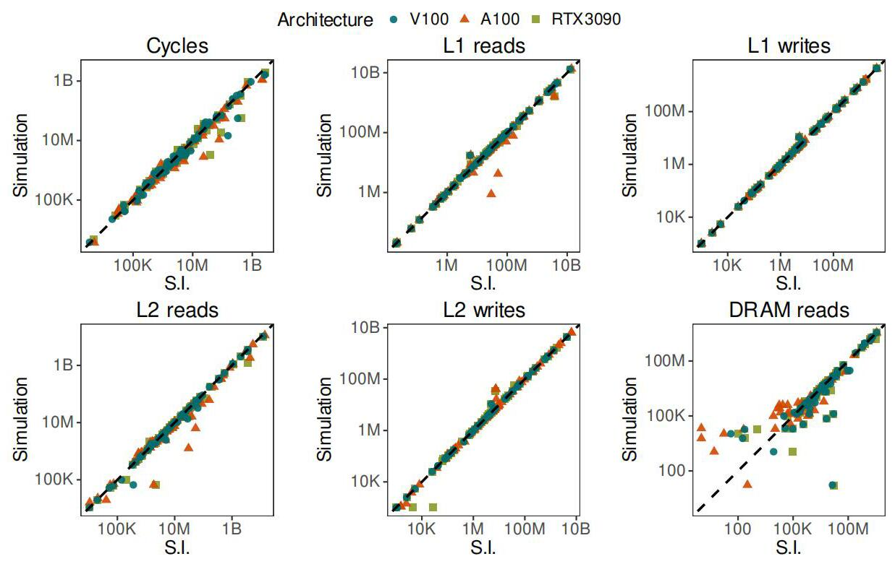
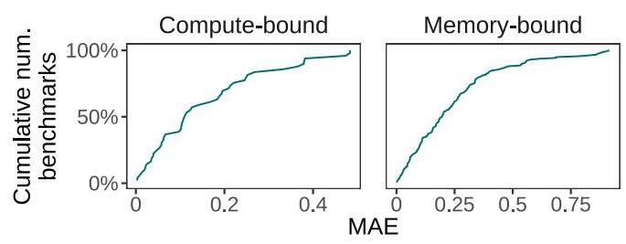
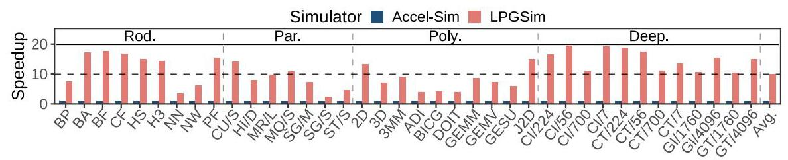
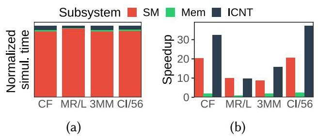
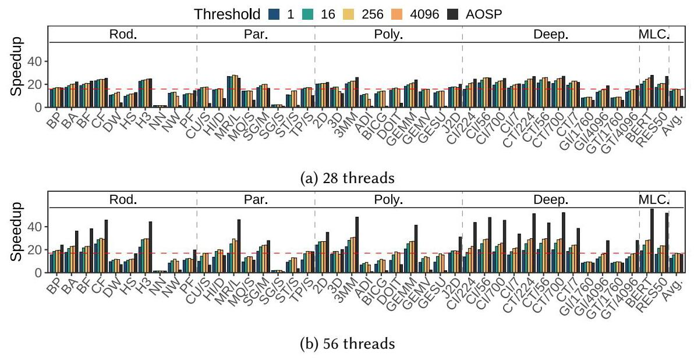
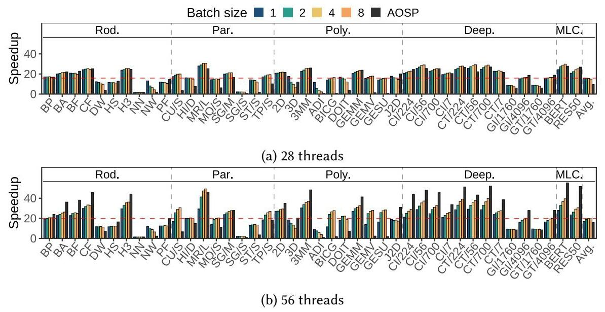

# LPGSim: A Lightweight Parallel GPU Simulator Maximizing Speed with Trustworthy Simulation

HYUNWOO NAM, Yonsei University, Republic of Korea

JAY HWAN LEE, Yonsei University, Republic of Korea

YEONSOO KIM, Yonsei University, Republic of Korea

MENGZHAO ZHANG, Yonsei University, Republic of Korea

JEONGGEUN KIM, Kyungpook National University, Republic of Korea

BERND BURGSTALLER, Yonsei University, Republic of Korea

The demands of large-scale workloads have driven the evolution of GPUs, placing them in the mainstream scope of computing architectures. To design an effective GPU for large-scale workloads, a trustworthy simulator is required to evaluate performance and explore the design space. Additionally, GPU simulators must be fast enough to evaluate architectural modifications for large-scale workloads within a reasonable time. However, existing GPU simulators suffer from long execution times due to detailed component simulation, limiting their utility for evaluating the effects of architectural modifications on large-scale workloads. It is necessary to improve the performance of a GPU simulator such that quick architecture exploration and evaluation for large-scale workloads are available, at the expense of accuracy.

This paper presents LPGSim, a trace-driven and cycle-level GPU simulator. LPGSim aims to provide fast and accurate GPU simulation. To this end, LPGSim first eliminates instruction metadata that has minimal impact on simulation accuracy. This approach enables coalescing compute instructions while preserving the dependencies to the preceding memory instruction. As a consequence, the core pipeline is simplified, improving simulation speed at a marginal cost in accuracy. Next, LPGSim parallelizes GPU simulation. LPGSim partitions a GPU architecture into three parallelizable subsystems and introduces local-clock-based parallelization to reduce the overhead of global synchronization and sequential execution paths in existing methods. LPGSim further employs parallelization methods to achieve scalability on NUMA systems with an acceptable trade-off in accuracy. Our evaluation shows a modest decrease in simulation accuracy in return for a substantial improvement in simulation speed. In terms of accuracy, LPGSim achieves 21.4%, 23.3%, and 22.7% errors across three different GPU architectures. In terms of speed, the single-threaded LPGSim simulation yields a ${9.97} \times$ speedup over the state-of-the-art GPU simulator. Parallelization achieves a ${19.8} \times$ speedup on a two-socket 56-thread system, for a total 197.4 x speedup over the state-of-the-art simulator. Parallelization incurs an additional accuracy loss, but our experiments indicate that simulation is still reliable for large-scale workloads.

CCS Concepts: - Computing methodologies $\rightarrow$ Massively parallel and high-performance simulations.

Additional Key Words and Phrases: GPU simulation; large-scale workloads; parallelism; multi-core

This work is licensed under a Creative Commons Attribution 4.0 International License.

© 2026 Copyright held by the owner/author(s).

ACM 2476-1249/2026/6-ART44

https://doi.org/10.1145/3805642

Proc. ACM Meas. Anal. Comput. Syst., Vol. 10, No. 2, Article 44. Publication date: June 2026.

---

Authors' Contact Information: Hyunwoo Nam, Yonsei University, Seoul, Republic of Korea, ae04071@yonsei.ac.kr; Jay Hwan Lee, Yonsei University, Seoul, Republic of Korea, jlee758@yonsei.ac.kr; Yeonsoo Kim, Yonsei University, Seoul, Republic of Korea, yeonsoo.kim@yonsei.ac.kr; Mengzhao Zhang, Yonsei University, Seoul, Republic of Korea, mzzhang@yonsei.ac.kr; Jeonggeun Kim, Kyungpook National University, Daegu, Republic of Korea, jeonggeun.kim@knu.ac.kr; Bernd Burgstaller, Yonsei University, Seoul, Republic of Korea, bburg@yonsei.ac.kr.

---

## ACM Reference Format:

Hyunwoo Nam, Jay Hwan Lee, Yeonsoo Kim, Mengzhao Zhang, Jeonggeun Kim, and Bernd Burgstaller. 2026. LPGSim: A Lightweight Parallel GPU Simulator Maximizing Speed with Trustworthy Simulation. Proc. ACM Meas. Anal. Comput. Syst. 10, 2, Article 44 (June 2026), 27 pages. https://doi.org/10.1145/3805642

## 1 Introduction

Contemporary workloads, including high-performance computing (HPC) and machine learning (ML), demand enormous computing and memory throughput to process large, complex datasets. These increasing demands have driven the advancement of GPUs as high-throughput, data-parallel architectures and have placed them as the mainstream computing platform for workload acceleration. The ongoing trend towards more complex ML models and larger datasets requires an architectural evolution of GPUs that can only be accomplished if architects are provided with the tools to identify bottlenecks, explore the design space, and evaluate new designs for large-scale workloads.

Simulators are indispensable tools for identifying performance bottlenecks and guiding architecture improvements. Numerous GPU simulators have been proposed to offer these capabilities [4, 6, 7, 14, 17, 19, 20, 24, 29, 35, 59]. Existing GPU simulators have achieved high accuracy by implementing detailed component models. However, the slow simulation speed hinders contemporary large-scale workload evaluation, where comprehensive design-space exploration is required to improve performance. Two primary approaches exist for GPU simulator speedup: (1) lightening the simulator by simplifying components, and (2) parallelizing the simulator to leverage many-core CPUs. Regardless of the strategy, a trade-off between accuracy and speedup is required: simplifying components inherently reduces simulation accuracy. Parallelization can improve simulation speed without sacrificing accuracy when strict synchronization is applied, but this eventually limits scalability. Consequently, both lightening and parallelizing a simulator must accept some degree of accuracy loss to achieve speedup.

To address the challenges in GPU simulations, we propose LPGSim. LPGSim is a trace-driven and cycle-level GPU simulator that aims to improve simulation speed with minimal accuracy loss. LPGSim first accelerates the simulation speed by simplifying the core pipeline model. This pipeline employs a universal compute unit to simulate all compute instructions uniformly, rather than implementing specialized units for each compute instruction class. On the other hand, memory instructions are simulated accurately using a detailed pipeline and memory system. In this simplified core pipeline, the metadata of compute instructions is redundant except for register dependencies on preceding memory instructions. Thus, compute instructions are transformed so that the traces retain only the dependencies on preceding memory instructions, coalescing other information. This lightweight core pipeline improves performance by eliminating instruction simulations that have a modest impact on accuracy. Next, we parallelize LPGSim to improve performance and scalability. Prior work [12, 28, 38, 43] has mainly focused on streaming multiprocessor (SM) simulation parallelization. In contrast, LPGSim partitions a GPU architecture into three parallelizable subsystems and introduces local-clock-based parallelization. Each subsystem is simulated in parallel on its own local clock and synchronized with its dependent subsystems, thereby involving all subsystems in the parallelization and eliminating the overhead of global synchronization. Furthermore, we identify parallelization bottlenecks on many-core, multi-socket NUMA systems and parallelize the interconnect simulation to mitigate the bottlenecks. LPGSim also relaxes synchronization between subsystems, tolerating accuracy loss to achieve further speedup.

To evaluate LPGSim, we conducted comprehensive experiments with five benchmark suites. The results demonstrate that LPGSim achieves cycle errors of 21.4%, 23.3%, and 22.7% compared to three different real architectures: NVIDIA V100, A100, and RTX 3090. Regarding performance, single-threaded LPGSim achieves an average speedup of ${9.97} \times$ over the state-of-the-art GPU simulator, Accel-Sim [35]. LPGSim parallelization achieves an 19.8 × average speedup on a two-socket system with 56 cores over single-threaded LPGSim, at the expense of accuracy, but remains reliable for large-scale workloads. The contributions of this paper are as follows.

- We identify the necessary metadata for compute instructions to retain simulation fidelity, while improving simulation speed with a lightweight core pipeline that removes operations that cause a marginal accuracy loss.

- We introduce parallelization methods for GPU simulators. These methods remove the sequential path and global synchronization overhead of prior methods. We identify scalability bottlenecks and apply parallelization and synchronization relaxation to accelerate simulation on NUMA systems, at a modest expense of accuracy.

- We performed a comprehensive evaluation of LPGSim. To validate its trustworthiness across different configurations, we evaluated LPGSim on three GPU architectures-NVIDIA V100, A100, and RTX 3090-using five benchmark suites. Next, we evaluated the simulation speed of LPGSim, comparing it with the state-of-the-art GPU simulator, Accel-Sim [35]. We demonstrated that lightening the core pipeline brings a significant speedup, and the proposed parallelization methods further improve simulation speed on many-core CPU architectures at a modest loss of accuracy, especially with large-scale workloads.

## 2 Background and Motivation

### 2.1 GPU Architecture Simulation

The massive computation demands of contemporary workloads, including ML and HPC, have placed GPUs in the mainstream of computing architecture. The high-performance and data-parallel computation capability of GPUs has attracted attention from both academia and industry, dominating the chipset market over the past decade [23, 25, 46, 69, 75, 78]. To improve GPU performance, architects require an accurate GPU architecture modeling tool that facilitates bottleneck identification and performance evaluation for proposed architectures.

The need for architectural enhancements has led to the development of various architectural modeling techniques. These techniques can be categorized into either analytical modeling [2, 5, 24, ${26},{37},{48},{73},{77},{80}\rbrack$ or cycle-level simulation [4, 6, 7, 14, 17, 19, 20, 24, 29, 35, 59]. Analytical models estimate GPU performance based on the characteristics of workloads and architectures. These models benefit from shorter evaluation time but lack full architectural modeling, which complicates the assessment of microarchitecture changes. In contrast, cycle-level simulators provide detailed architecture modeling, analysis, and evaluation for new features. However, the slow simulation speed impedes their applicability to improving architectural performance for complex and large-scale workloads, including ML and HPC.

### 2.2 Trade-off between Accuracy and Simulation Speed

A primary concern in GPU simulator development is the ideal trade-off between accuracy and simulation speed that satisfies user requirements [70]. It has been observed that SM component simulation occupies the majority of the simulation time in a cycle-level GPU simulator [28] due to the large number of SMs and the detailed core pipeline implementation. To achieve speedup, improving SM simulation speed is mandatory. On the other hand, related work has revealed that the accuracy of the memory system is critical for retaining the fidelity of analytic models [73] and cycle-level simulators [29]. Considering contemporary workloads such as ML and HPC, which are predominantly memory-intensive [18, 22, 78] and sensitive to memory system accuracy [73] due to pressure on the memory system, GPU simulators must incorporate accurate memory systems for trustworthy simulation. These observations suggest that a simulator can be accelerated by simplifying the core models so that it preserves essential functionality while maintaining detailed memory system simulation to achieve accurate results for contemporary workloads, analogous to the simple interconnect model that only captures bandwidth and latency with minimal accuracy loss [70].

### 2.3 GPU Simulation Parallelization

The state-of-the-art GPU simulator, Accel-Sim [35], provides detailed GPU simulation, but its simulation time is significantly slower than wall-clock time, making it infeasible to simulate large-scale workloads. For instance, prior work reported that simulating a GPU was about 5 million times slower than wall-clock time [28]. This large discrepancy impedes the design and evaluation of new architectural features. One technique to achieve speedup is to parallelize GPU component simulations across multiple threads. Prior work on GPU simulation parallelization [12, 28, 38, 43] focused on parallelizing the simulation of SMs, as this is where the majority of simulation time is spent. However, these approaches suffer from scalability problems on many-core architectures. E.g., the fork-join parallelization scheme from [28] achieved an average speedup of only ${5.8} \times$ for 16 threads.

The scalability of prior fork-join-based parallelization is limited by two factors: the sequential execution path and the global synchronization overhead. In prior work, the simulation of the L2, DRAM, and interconnect models is on the sequential path. Although the sequential path's execution time is negligible with a small number of threads, it must be parallelized to achieve scalability. L2 and DRAM in different subpartitions can operate in parallel because requests to different subpartitions are independent, and resources are separate; no race conditions occur. The interconnect simulation for arbitrating requests can be independent of other component simulations, except for request communication between components. If these requests are synchronized without a race condition, the interconnect can be parallelized. Meanwhile, the SM count is typically not a multiple of the number of threads of the multicore CPU running the simulation, leading to an imbalance in the SM simulation distribution across threads. This imbalance causes idle threads to wait for other threads to complete their SM simulations at the global synchronization. However, request communication is only via the interconnect; synchronization among SMs is unnecessary if the interconnect synchronizes and arbitrates requests. This independence among SMs can guide developers in parallelizing SMs to remove the overhead from global synchronization.

## 3 LPGSim Toolchain

Fig. 1a provides an overview of the LPGSim toolchain. The tracer collects SASS traces from CUDA applications, transforms them for compatibility with the simplified core pipeline, and compresses them. Compressed traces are fed into trace-driven LPGSim. Components in LPGSim are implemented with different levels of fidelity. The SM cores have a simplified pipeline that tracks only memory instruction data dependencies and processes compute instructions as identical instructions using a universal compute unit. The interconnect model is simplified, focusing on bandwidth resemblance rather than the detailed packet-level simulation, as in prior work [70]. In contrast, memory components, including L1, L2, and DRAM, are implemented with high fidelity to accurately simulate memory system behavior. The architecture and core components of LPGSim are independently designed and implemented, while the base design structure of the memory subsystem was informed by prior GPU and memory simulation frameworks [9, 35, 36, 41, 70], partially adapted from the structure and workflows of their memory module and interfaces.



Fig. 1. (a) LPGSim toolchain overview. (b) LPGSim simplified core pipeline for issue, execute, and writeback stages.

### 3.1 Core Pipeline Simplification



Fig. 2. Instruction transformation examples for LPGSim's simplified core pipeline. (a) visualizes the case where the dependent instruction is a memory instruction, and (b) visualizes the case where the dependent instruction is a compute instruction.

The core pipelines in LPGSim contain (1) a memory instruction data dependency tracker, (2) a warp scheduler, and (3) universal and LDST execution units processing compute and memory instructions, respectively. Other components, such as register files and execution units for various compute instructions, are excluded. Fig. 1b illustrates the issue, execution, and writeback stages in LPGSim. Note that the read operands stage is omitted to lighten the core pipelines, along with the removal of register files.

The memory instruction data dependency tracker is a simplified scoreboard that maintains only the register usage of memory instructions. It monitors the destination register of memory instructions and stalls the warp when a subsequent instruction depends on registers recorded in the tracker. This tracker ignores the register usage of compute instructions except when the preceding instruction that incurs the register dependency is a memory instruction. The simplified core pipeline and the lightweight dependency tracker improve simulation speed by eliminating the computation for multiple execution unit simulations and full-register dependency tracking, at the expense of accuracy.

Along with the core pipeline simplification, traces collected from CUDA applications are transformed to be compatible with the core pipeline because the metadata of compute instructions is no longer required in LPGSim. In transformed traces, memory instructions remain intact, whereas compute instructions are coalesced and replaced with syntactic instructions: COMPUTE that only counts the number of compute instructions between two instructions, and DEP that retains the compute instruction register usage if the instruction has a data dependency on the preceding memory instruction.

Fig. 2 depicts two instruction transformation examples. Fig. 2a illustrates a transformation involving two dependent memory instructions enclosing compute instructions. Instruction ① loads data from the memory address stored in register R1 into register R3. The following two instructions, ② and ③, are compute instructions that have no dependencies on the preceding memory instruction. Consequently, these instructions are coalesced and replaced by a synthetic instruction, COMPUTE 2. Although a register dependency exists between instructions ② and ③ through register R1, it is omitted as LPGSim excludes such dependencies between compute instructions. The last instruction, instruction ④, is a memory instruction that has a data dependency on the prior memory instruction. Thus, LPGSim leaves this instruction unchanged.

The example in Fig. 2b visualizes the transformation when a compute instruction depends on a preceding memory instruction. This transformation is similar to the previous example, except for the compute instruction ④. Due to the register dependency on the preceding memory instruction ①, it is replaced by a syntactic instruction, DEP R3, to handle the register dependency on register R3. With the trace transformation and core pipeline simplification, LPGSim can reduce core pipeline complexity and trace size, yielding performance improvements with minimal accuracy loss.

The issue, execute, and writeback stages in LPGSim leverage different datapaths to process the transformed instructions. For COMPUTE instructions, the issue stage only decreases the counter representing the number of remaining compute instructions, and conveys a synthetic instruction to the universal execution unit. If the counter becomes zero after the counter is decremented, the next instruction is fetched; otherwise, the current instruction is retained for the next cycle. For memory instructions, the issue stage checks the dependency tracker to identify whether any pending instruction depends on the registers used by the current instruction. If such a dependency is detected, the warp is stalled, and another warp is scheduled according to the warp scheduling policy. Otherwise, the registers used by the current instruction are recorded in the dependency tracker, and the instruction is passed to the LDST unit. After the corresponding memory operations complete, the memory instruction proceeds to the writeback stage, and the recorded register usage entries in the dependency tracker are released. For DEP instructions, the datapath is identical to that of COMPUTE instructions except at the issue stage; the issue stage checks the register dependency as in the memory instruction datapath and stalls the warp if a register dependency is detected.

### 3.2 Detailed and Flexible Memory System Model

LPGSim implements detailed memory models to simulate divergent memory requests accurately. L1 caches adopt banked and sectored designs [65] to simulate the throughput-oriented high-bandwidth L1 caches. L1 caches implement an adaptive shared memory configuration [52], which dynamically allocates the shared memory size along with the data cache. L2 caches employ an irreducible polynomial hash function to reduce the partition camping effect [1, 35]. L2 caches are configurable to simulate the different transaction sizes introduced in recent GPU architectures such as the V100 and A100 [32, 68]. Moreover, the L2 cache partition employed with recent high-performance GPUs such as the NVIDIA A100 is implemented to accurately simulate the effect of data localization per partition [11, 33]. The DRAM in LPGSim is flexible to control the access latency with different timing parameters and other configurations to accurately simulate recent memory systems such as GDDR and HBM [30, 31]. All configurations explained above are reconfigurable to simulate various architectures.

### 3.3 Tracer

The tracer in the LPGSim toolchain is built on the dynamic binary instrumentation tool, NVBit [71], which instruments SASS instructions and collects traces. The raw traces generated by NVBit are transformed to be compatible with the simplified core pipeline, as explained in Sec. 3.1. These traces are then compressed to reduce their size and mitigate I/O overhead during simulation incurred by reading the large trace file. This compressor employs the compression technique that uses the address base and stride, as proposed in prior work [35], to reduce the size of memory instructions in traces, and then applies a standard compression algorithm to further minimize trace size.

## 4 Simulator Parallelization

Algorithm 1 Pseudocode for LPGSim parallelization

```
function CycleSubsystem(Subsystem s, cycle, bsize)
   for all dependent subsystems dep do
       busy-wait until dep.local_clock \( \geq \) cycle - threshold \( \vartriangleright \) Default threshold \( = 0 \)
   end for
   for \( i \leftarrow  1 \) to bsize do Default bsize \( = 1 \)
       for all components \( c \) in \( s \) do
          simulate cycle cycle \( + i \) of \( c \)
       end for
   end for
   s.local_clock \( \leftarrow \) cycle + bsize
end function

function RunThread(Thread t, bsize)
   for cycle \( \leftarrow  0 \) to \( \infty \) step bsize do - Simulation loop
       for all subsystems \( s \) assigned to \( t \) do - Static task assignment to a thread
          CycleSubsystem(s, cycle, bsize)
       end for
       for all subsystems \( s \) in the thread group of \( t \) and s.local_clock \( = \) cycle do
                                       \( \vartriangleright \) Dynamic task assignment within a thread group
          CycleSubsystem(s, cycle, bsize)
       end for
       if thread \( t \) is the last finishing cycle simulation and simulation completed then
          signal all threads to exit the simulation loop
       end if
   end for
end function

function Run(integer bsize)
   for all subsystems \( s \) do
       assign \( s \) to either a thread as a static task or a thread group as a dynamic task
   end for
   for all threads \( t \) do
       RunThread \( \left( {t,\text{ bsize }}\right) \)
   end for
end function
```

LPGSim employs parallelization techniques to improve the scalability on multi-core NUMA systems. Specifically, LPGSim achieves speedup through three primary strategies: (1) introducing a local-clock-based parallelization that eliminates the sequential path and reduces idle cycles caused by global synchronization, (2) grouping threads and subsystems while parallelizing interconnect simulation that mitigates cache coherence and data migration overhead due to redundant data transfer between threads and sockets, and (3) relaxing a synchronization condition that mitigates idle cycles resulting from large simulation time variance per cycle. Alg. 1 describes the LPGSim parallelization scheme in pseudocode.

### 4.1 Local-Clock-Based Parallelization



Fork-join based scheme

${T}_0$ - $S{M}_0$ Memo ICNT $S{M}_0$ Memo ICNT

${T}_1 - \; S{M}_1 \; {Me}{m}_1 \; S{M}_1 \; {Me}{m}_1$

${T}_2 - \; S{M}_2 \; {\text{ Idle }}_{s} \; S{M}_2$

${\text{ Idle }}_{a}$

${T}_3 - \; S{M}_3 \; S{M}_3$

Local-clock based scheme

${T}_0$ - ICNT $S{M}_3$ ICNT Memo

${T}_1 - \; S{M}_0$ Memo $S{M}_1 \; {Me}{m}_1$

${T}_2 - \; S{M}_1 \; {Me}{m}_1 \; S{M}_2$

${T}_3 - \; S{M}_2$ SMo SM3

(a) Subsystem-level LPGSim structure overview and example of buffer accesses between the interconnect and a cache (b) Example of subsystem execution time-

line

Fig. 3. (a) Subsystem-level LPGSim structure overview after partitioning components for parallelization and the example of buffer accesses at cycles $\mathrm{N}$ and $\mathrm{N} + 1$ with respect to the interconnect after applying the double-buffering mechanism. (b) Example of subsystem execution timeline with fork-join- and local-clock-based parallelization methods for two cycles.

To address the scalability limitations of the existing parallelization scheme, LPGSim organizes components into parallelizable subsystems and employs a local-clock-based parallelization method. LPGSim partitions components into three subsystem classes: (1) the SM subsystem consisting of the SM and its private L1 caches; (2) the memory subsystem comprising the L2 cache and DRAM within a memory subpartition; and (3) the interconnect subsystem between the L1 and L2 caches. Fig. 3a visualizes the subsystem-level structure partitioning. SM and memory subsystems are independent and therefore can be simulated in parallel. Yet, the interconnect is not isolated from other subsystems because its interaction with caches uses shared resources such as data ports and buffers to receive and forward packets generated by different caches. To enable parallel execution of the interconnect subsystem alongside other subsystems without data races caused by resource sharing, LPGSim implements a double-buffering mechanism at the communication points between subsystems to store requests being forwarded. In each cycle, the interconnect, L1, and L2 caches then write new requests to the current buffer while reading requests from the previous buffer to avoid data races between subsystems within a cycle, as depicted in Fig. 3a. This mechanism isolates subsystem simulations within a cycle, allowing parallel execution without data races. As a consequence, LPGSim eliminates the sequential path associated with interconnect, L2, and DRAM simulation.

In addition to eliminating the sequential path, LPGSim removes the global synchronization in the fork-join-based parallelization method by introducing local-clock-based parallelization. Synchronization between subsystems is required to ensure that dependent subsystems have completed their previous cycle simulations to process requests correctly. For example, to simulate the ${N}^{\text{ th }}$ cycle of an SM subsystem, all packets that have to be generated in the ${\left( N - 1\right) }^{\text{ th }}$ cycle are accessible. Without waiting for the simulation of cycle $N - 1$ of the interconnect, the SM subsystem may miss packets that should be handled in the ${N}^{\text{ th }}$ cycle. However, global synchronization across all subsystems is not required, as no communication with the others occurs; waiting only for dependent subsystems is sufficient. To exploit this observation, LPGSim places a local clock in each subsystem to monitor its simulation cycle. In this parallelization scheme, LPGSim sets subsystems to either a static task for an individual thread or a dynamic task of a thread group (lines 29-31 in Alg. 1). Static tasks are pinned to a specific thread, whereas dynamic tasks are assigned to a thread group. Next, LPGSim parallelizes the simulation. During simulation, a thread executes the pinned static tasks first (lines 15-17 in Alg. 1). Subsequently, the thread attempts to acquire a dynamic task assigned to the thread group to which it belongs and to simulate it if the local clock matches the current simulation cycle (lines 18-21 in Alg. 1). A subsystem simulation of a cycle proceeds as follows: (1) it checks whether the dependent subsystems have completed their previous cycle simulations by comparing local clocks (lines 2-4 in Alg. 1); (2) it simulates the cycles if all dependent subsystems have finished the previous cycle simulations (lines 5-9 in Alg. 1); and (3) it updates the local clock of the subsystem (Line 10 in Alg. 1).

Fig. 3b visualizes an example of the subsystem execution timeline for two cycles. Note that memory subsystems are already parallelizable in the fork-join-based method, and the sequential path is only for the interconnect subsystem simulation. We assume that all subsystems are dynamic tasks, and the simulation times are identical. The fork-join-based method introduces two idle times: ${idl}{e}_{gs}$ for global synchronization and ${idl}{e}_{seq}$ for sequential path execution. The proposed local-clock-based parallelization removes ${idl}{e}_{seq}$ by parallelizing all subsystems. Moreover, $S{M}_0$ can be simulated directly, although other threads are simulating the ${N}^{\text{ th }}$ cycle, as the dependent subsystem ICNT was completed; idle ${e}_{gs}$ is eliminated as well. Therefore, the local-clock-based parallelization effectively removes these idle times, which improves LPGSim performance.

### 4.2 Thread and Subsystem Grouping and Interconnect Parallelization

Local-clock parallelization achieves better performance than fork-join parallelization. However, scalability remains limited and even deteriorates on NUMA systems. Two major factors limit the scalability of local-clock-based parallelization. First, data communication overheads concentrated on a thread simulating the interconnect result in a bottleneck as more threads are added. These overheads arise from cache coherence and data movement associated with accessing requests stored in the L1 and L2 buffers for communication, as well as the local clocks of subsystems in the caches of other CPU cores. Second, thread migration incurs overhead due to dynamic subsystem assignment. In order to minimize idle cycles in local-clock-based parallelization, subsystems may be assigned as dynamic tasks and migrated to different threads at each cycle. However, this process reduces data locality and increases data migration overhead between threads. Both factors contribute to scalability limitations in multi-core systems, particularly degrading performance on NUMA systems due to the expensive data movement between sockets as shown in Sec. 6.2. This results in greater performance degradation on NUMA configurations compared to single-socket systems.

To mitigate these overheads, LPGSim creates multiple thread groups, rather than a single group containing all threads, and distributes dynamic tasks among these groups. Based on the user-configured number of thread groups, LPGSim evenly distributes threads and subsystems between the groups. In the thread distribution, each thread group contains threads on the same socket to reduce data communication between sockets. Dynamic tasks assigned to a thread group are simulated by any thread within that group, thereby avoiding data migration between threads and reducing cache coherence overhead by decreasing the number of sharers per subsystem. Once subsystems are assigned to thread groups, LPGSim divides the interconnect into sub-interconnect tasks for each group. Each sub-interconnect simulation processes packets from subsystems within its group and arbitrates independently with the other sub-interconnects. This approach, however, can introduce data races when different sub-interconnect tasks handle requests targeting the same destination subsystem. To address this issue, LPGSim replaces the communication buffers between components with concurrent queues, which use CAS operations to synchronize concurrent operations and avoid data races. Although this approach may sacrifice the accuracy of the interconnect simulation caused by divergent request arbitration orders, the resulting accuracy loss is minimal with substantial improvements in simulation performance.

### 4.3 Synchronization Relaxation for Performance Improvement as a Trade-off of Accuracy

Thread grouping and interconnect parallelization accelerate LPGSim simulation by mitigating cache coherence and data migration overhead. However, idle time resulting from rigid synchronization limits performance improvement. Table 1 displays the average and standard deviation of per-cycle simulation time for SM and memory subsystems across several benchmarks. The large variance is caused by per-cycle behavioral differences, such as distinct simulation paths for cache hits and misses. This divergence incurs per-cycle execution imbalance between dependent subsystems, causing threads with shorter simulation times to remain idle while waiting for the dependent subsystem simulation completion. Consequently, the accumulated idle time degrades overall simulation performance. Although strict synchronization between subsystems is necessary for accurate simulation, subsystems must be tolerant of the synchronization conditions to improve overall performance. To address this, LPGSim employs two techniques: First, LPGSim permits a local clock difference with dependent subsystems within a specified threshold by adjusting the threshold used in Line 3 of Alg. 1. This relaxation enables subsystems to proceed with their simulations without waiting for the simulation of the dependent subsystems, as long as the local clock difference remains within the threshold. Although local clock mismatch between interacting subsystems can cause some degree of accuracy loss, the observed performance improvement is substantial with marginal accuracy loss. Next, LPGSim improves the performance by batching multiple cycles in the simulation of a component, by changing bsize in Alg. 1. By simulating multiple cycles of a component at once, LPGSim can reduce the side effects caused by the variance of simulation time per cycle, as well as frequent thread switching. These approaches mitigate overhead caused by high variance in simulation time per cycle.

Table 1. Average simulation time and its standard deviation per cycle in $\mu \mathrm{s}$ .

<table><tr><td rowspan="2">Bench.</td><td colspan="2">SM</td><td colspan="2">Memory</td></tr><tr><td>Avg.</td><td>Stdev.</td><td>Avg.</td><td>Stdev.</td></tr><tr><td>CF</td><td>3.37</td><td>14.45</td><td>9.10</td><td>5.77</td></tr><tr><td>MR/L</td><td>1.77</td><td>2.06</td><td>1.22</td><td>2.47</td></tr><tr><td>3MM</td><td>3.25</td><td>12.50</td><td>4.82</td><td>2.70</td></tr><tr><td>CI/56</td><td>3.06</td><td>10.45</td><td>5.74</td><td>4.42</td></tr></table>

### 4.4 Implementation Details

Splitting subsystems into static and dynamic tasks necessitates a careful evaluation of task balance and data movement overhead. Our experiments indicate that the optimal assignment scheme was to evenly distribute subsystems as static tasks to threads as much as possible, while assigning the remaining subsystems as dynamic tasks to thread groups. LPGSim requires additional synchronization during instruction trace reading. Since the tracer produces a single trace file per kernel that contains instructions for all thread blocks, synchronization is necessary to prevent data races when multiple threads concurrently access the trace file. Parallelization without data races is available, but our observations indicate that trace reading time is negligible. Therefore, trace reading is not parallelized in LPGSim.

## 5 Experiment Setup

Table 2. Benchmarks used in the experiments. Due to time constraints, not all benchmarks are evaluated with all experiments. The experiment category shows the type of experiments conducted with each benchmark.

<table><tr><td>Benchmark suite</td><td>Experiment category</td><td>Benchmark</td></tr><tr><td rowspan="2">Rodinia (Rod.)</td><td>Acc.</td><td>gaussian, heartwall, huffman, lud, myocyte, particlefilter, streamcluster</td></tr><tr><td>Acc. + Comp. + Par.</td><td>b+tree (BP), backprop (BA), bfs (BF), cfd (CF), dwt2d (DW), hotspot (HS), hotspot3D (H3), nn (NN), nw (NW), pathfinder (PF)</td></tr><tr><td rowspan="3">Parboil (Par.)</td><td>Acc.</td><td>cutcp/large, lbm/short, mri-gridding/small, stencil/default, tpacf/large, tpacf/medium</td></tr><tr><td>Acc. + Par.</td><td>tpacf/small (TP/S)</td></tr><tr><td>Acc. + Comp. + Par.</td><td>cutcp/small (CU/S), histo/default (HI/D), mri-q/large (MR/L), mri-q/small (MQ/S), sgemm/medium (SG/M), sgemm/small (SG/S), stencil/small (ST/S)</td></tr><tr><td rowspan="2">Polybench (Poly.)</td><td>Acc.</td><td>2mm, atax, corr, covar, fdtd-2d, mvt, syr2k, syrk</td></tr><tr><td>Acc. + Comp. + Par.</td><td>2dconv (2D), 3dconv (3D), 3mm (3MM), adi (ADI), bicg (BICG), doitgen (DOIT), gemm (GEMM), gemver (GEMV), gesummv (GESU), jacobi2d (J2D)</td></tr><tr><td rowspan="2">DeepBench (Deep.)</td><td>Acc.</td><td>conv infer 341, conv train 341, gemm infer 1760×7000×1760, gemm infer 4096×7000×4096, gemm train 1760×7000×1760, gemm train 4096×7000×4096</td></tr><tr><td>Acc. + Comp. + Par.</td><td>conv infer 56 (CI/56), conv infer 224 (CI/224), <br> conv infer 700 (CI/700), conv infer 7 (CI/7), <br> conv train 224 (CT/224), conv train 56 (CT/56), <br> conv train 700 (CT/700), conv train 7 (CT/7), <br> gemm infer 1760×32×1760 (GI/1760), <br> gemm infer 4096×32×4096 (GI/4096), <br> gemm train 1760×32×1760 (GT/1760) <br> gemm train 4096×32×4096 (GT/4096)</td></tr><tr><td>MLPerf Inference (MLC.)</td><td>Acc. + Par.</td><td>bert (BERT), resnet50 (RES50)</td></tr></table>

Benchmarks. LPGSim was evaluated using a wide range of workloads from five benchmark suites: Rodinia [10], Parboil [67], PolyBench [21], DeepBench [63], and MLPerf inference 4.1 [62]. Table 2 lists the benchmarks used to evaluate the accuracy and performance of LPGSim. Due to time constraints, certain benchmarks were excluded from the performance comparison with the state-of-the-art GPU simulator and from the parallelization evaluation. The experiment category specifies the type of evaluation conducted for each benchmark: accuracy comparison against three real architectures (Acc.), performance comparison against Accel-Sim [35] (Comp.), and parallelization performance evaluation (Par.). Table 3 presents the average and maximum trace sizes per benchmark suite under three compression schemes: no compression (Base), address base and stride compression (Compressed (addr)), and address base and stride compression followed by a standard compression algorithm. Note that the standard compression algorithm we used was Zstandard [45].

Table 3. Average and maximum trace sizes per benchmark suite under three schemes: no compression (Base); address base and stride compression (Compressed (addr)); and address base and stride compression followed by a standard compression algorithm (Compressed (addr + standard)), described in Sec. 3.3.

<table><tr><td rowspan="2">Benchmark suite</td><td colspan="2">Base</td><td colspan="2">Compressed (addr)</td><td colspan="2">Compressed (addr + standard)</td></tr><tr><td>Avg. (GB)</td><td>Max (GB)</td><td>Avg. (GB)</td><td>Max (GB)</td><td>Avg. (GB)</td><td>Max (GB)</td></tr><tr><td>Rodinia</td><td>55.67</td><td>464.66</td><td>13.49</td><td>110.19</td><td>0.67</td><td>7.52</td></tr><tr><td>Parboil</td><td>98.83</td><td>2,275.40</td><td>20.85</td><td>455.25</td><td>1.16</td><td>24.72</td></tr><tr><td>Polybench</td><td>34.13</td><td>256.91</td><td>7.16</td><td>58.72</td><td>0.48</td><td>6.81</td></tr><tr><td>Deepbench</td><td>18.16</td><td>111.07</td><td>5.22</td><td>31.36</td><td>0.06</td><td>0.37</td></tr><tr><td>MLPerf Inference</td><td>2,186.86</td><td>3,911.58</td><td>713.20</td><td>1,298.10</td><td>12.36</td><td>19.35</td></tr></table>

Table 4. NVIDIA V100, A100, and RTX 3090 architecture configurations used to evaluate LPGSim accuracy against the real architectures.

<table><tr><td></td><td>V100</td><td>A100</td><td>RTX 3090</td></tr><tr><td>SM</td><td>1,380 MHz, 80 SMs, 4 sub-cores, GTO warp scheduler</td><td>1,410 MHz, 108 SMs, 4 sub-cores, GTO warp scheduler</td><td>1,695 MHz, 82 SMs, 4 sub-cores, GTO warp scheduler</td></tr><tr><td>L1</td><td>128 KB, 128 B line, 32 B sector, 4 banks, 256 ways</td><td>196 KB, 128 B line, 32 B sector, 4 banks, 384 way</td><td>128 KB, 128 B line, 32 B sector, 2 banks, 256 ways</td></tr><tr><td>L2</td><td>6 MB, 8 subpartitions, 4 banks per subpartition, 128 B line, 32 B sector, 64 B transaction size, 24 way</td><td>40 MB, 2 partitions, 10 sub-partitions (5 per partition), 8 banks per subpartition, 128 B line, 32 B sector, 64 B transaction size, 64 way</td><td>6 MB, 12 subpartitions, 4 banks per subpartition, 128 B line, 32 B sector, 32 B transaction size, 64 way</td></tr><tr><td>Memory</td><td>4 HBM2, 876 MHz, 8 channels, 16 banks, 4 bank groups, 2 KB row buffer</td><td>5 HBM2e, 1,215 MHz, 8 channels, 16 banks, 4 bank groups, 2 KB row buffer</td><td>12 GDDR6X, 1,219 MHz, 2 channels, 16 banks, 4 bank groups, 2 KB row buffer</td></tr></table>

System. All benchmarks were compiled using NVCC version 12.4, and cuDNN v9.1.0 [51] was used for deep learning workloads. NVBit [71] v1.7.2 was used to collect traces on the NVIDIA V100, A100, and RTX 3090 GPUs. LPGSim was compiled with GCC version 12.4.0. The architectures used for the accuracy validation were NVIDIA V100, A100, and RTX 3090. The architecture configurations of the target architectures used in LPGSim are provided in Table 4. Metrics for the real architectures were obtained using NVIDIA Nsight Compute version 2024.1.1.0. For performance evaluation, RTX 3090 was used as the reference architecture configuration. All simulator performance was evaluated on a dual-socket Intel Xeon CPU E5-2697 v3 system. Each socket contains 28 physical cores at 3.1 GHz and 256 GiB DDR4 memory, resulting in a total of 56 cores and 512 GiB memory.

Accuracy validation against real architectures. The metrics used to evaluate LPGSim accuracy include cycles, the number of executed load/store global instructions, the number of read/write accesses to L1, L2, and DRAM, and L1 and L2 read misses. We evaluated mean absolute error (MAE), normalized root mean squared error (NRMSE), and Pearson correlation to quantify the accuracy of LPGSim compared to real architectures. MAE was applied to calculate cycle error, while NRMSE was used for other metrics due to issues when the reference counter is zero, as discussed in [35]. The accuracy evaluation experiments described in Sec. 6.1 were conducted on all benchmarks listed in Table 2 under the accuracy (Acc.) experiment category. In these experiments, the synchronization relaxation techniques explained in Sec. 4.3 were disabled. We evaluated the impact of the simplified core pipeline on compute-bound and memory-bound benchmarks by leveraging the roofline performance model [15]. In the classification, we categorized L1-, L2-, and DRAM-bound benchmarks as memory-bound, and the remaining as compute-bound. The trade-offs after applying synchronization relaxation are presented in Sec. 6.2, using the benchmarks categorized under parallelization (Par.).

To evaluate the accuracy drop relevant to implementation simplifications in LPGSim, including the core pipeline simplification, we compared the LPGSim cycle error against the cycle errors reported in prior work. Ideally, the accuracy degradation caused by the simplified core pipeline structure would be quantified by comparison with a detailed core pipeline implementation in LPGSim. However, LPGSim does not support a detailed core pipeline. Instead, we used the errors reported in prior work $\left\lbrack  {{35},{70}}\right\rbrack$ as a proxy. Note that the evaluated workloads and architectures are different, and the MAEs in the comparison are the average cycle error for all architectures reported in each work. At the same time, we implemented another core pipeline that does not track register dependency between instructions. This core pipeline is used to evaluate the impact of memory instruction dependency tracking with respect to accuracy.

Performance evaluation. LPGSim performance was first evaluated against the state-of-the-art GPU simulator Accel-Sim [35] to demonstrate the benefits of the core pipeline simplification. Subsequently, the parallelization methodologies were assessed. The baseline for this evaluation is the single-threaded LPGSim simulation. Alongside the parallelization schemes proposed in LPGSim, we also implemented a fork-join parallelization. This is similar to the OpenMP-based scheme explained in [28], but it parallelizes memory subsystems to identify achievable scalability after minimizing the execution time of the sequential part. In the evaluation of the parallelization scheme, we define approximated occupancy-based speedup (AOSP). The ideal speedup estimated by Amdahl's law [3] does not fully capture the parallelization potential of GPU simulation affected by benchmarks. For example, if a workload has a small number of thread blocks, only a limited number of SMs are active while others remain idle, leading to underutilization of the physical cores simulating SMs with fewer thread blocks. Consequently, the performance improvement is limited by the workload. To account for this additional factor in estimating achievable speedup, we define AOSP. Occupancy is defined as the execution-cycle-weighted average of the number of active warps normalized by the theoretical maximum number of warps across kernels measured on hardware, and AOSP is defined as follows.

$$
\text{ AOSP } = \frac{1}{\left( {\text{ time }}_{\text{ seq }}\right)  + \frac{{\text{ time }}_{\text{ par }}}{\left( {\# \text{ threads }}\right)  \times  \text{ occupancy }}},
$$

where time ${e}_{\text{ seq }}$ is the sequential portion of the simulation time (e.g., simulation initialization), and ${\text{ time }}_{\text{ par }}$ is the parallelizable portion of the simulation time, which was measured using the single-threaded LPGSim simulation. Note that AOSP does not indicate a theoretically achievable speedup through the simulator parallelization, but it is a heuristic considering the parallelization potential of a workload.

Table 5. Error, standard deviation, and correlation of LPGSim against the V100, A100, and RTX 3090 architectures for all selected metrics. Mean absolute error (MAE) is used to calculate the average cycle error, and normalized root mean squared error (NRMSE) is used to calculate the average errors of other metrics.

<table><tr><td rowspan="2">Metrics</td><td colspan="3">V100</td><td colspan="3">A100</td><td colspan="3">RTX 3090</td></tr><tr><td>Error</td><td>Stdev.</td><td>Corr.</td><td>Error</td><td>Stdev.</td><td>Corr.</td><td>Error</td><td>Stdev.</td><td>Corr.</td></tr><tr><td>Cycles</td><td>21.4%</td><td>18.0%</td><td>0.98</td><td>23.3%</td><td>20.2%</td><td>0.97</td><td>22.7%</td><td>21.6%</td><td>0.98</td></tr><tr><td>Load insts</td><td>0.01%</td><td>0.01%</td><td>1.00</td><td>0.01%</td><td>0.01%</td><td>1.00</td><td>0.01%</td><td>0.01%</td><td>1.00</td></tr><tr><td>Store insts</td><td>0.04%</td><td>0.04%</td><td>1.00</td><td>0.04%</td><td>0.04%</td><td>1.00</td><td>0.05%</td><td>0.05%</td><td>1.00</td></tr><tr><td>L1 reads</td><td>0.81%</td><td>0.81%</td><td>1.00</td><td>1.88%</td><td>1.87%</td><td>0.99</td><td>2.08%</td><td>2.08%</td><td>0.98</td></tr><tr><td>L1 writes</td><td>0.02%</td><td>0.02%</td><td>1.00</td><td>0.02%</td><td>0.02%</td><td>1.00</td><td>0.02%</td><td>0.02%</td><td>1.00</td></tr><tr><td>L1 read misses</td><td>5.22%</td><td>5.17%</td><td>0.94</td><td>6.19%</td><td>6.12%</td><td>0.95</td><td>6.89%</td><td>6.83%</td><td>0.93</td></tr><tr><td>L2 reads</td><td>1.88%</td><td>1.87%</td><td>0.99</td><td>3.17%</td><td>3.13%</td><td>0.98</td><td>3.00%</td><td>2.97%</td><td>0.98</td></tr><tr><td>L2 writes</td><td>0.03%</td><td>0.03%</td><td>1.00</td><td>0.11%</td><td>0.10%</td><td>1.00</td><td>0.12%</td><td>0.12%</td><td>1.00</td></tr><tr><td>L2 read misses</td><td>5.40%</td><td>5.30%</td><td>0.94</td><td>4.15%</td><td>4.08%</td><td>0.96</td><td>4.90%</td><td>4.72%</td><td>0.96</td></tr><tr><td>DRAM reads</td><td>1.14%</td><td>1.10%</td><td>0.99</td><td>0.35%</td><td>0.34%</td><td>1.00</td><td>5.47%</td><td>5.46%</td><td>0.95</td></tr><tr><td>DRAM writes</td><td>1.52%</td><td>1.50%</td><td>0.99</td><td>1.95%</td><td>1.89%</td><td>0.99</td><td>2.14%</td><td>2.10%</td><td>0.99</td></tr></table>



Fig. 4. Correlation of selected key metrics measured from three real architectures (x-axis) and simulated by LPGSim (y-axis), on a logarithmic scale.

## 6 Evaluation

### 6.1 Accuracy Validation

Table 5 presents the errors, standard deviations, and Pearson correlation for the key metrics of LPGSim compared to three real architectures, and Fig. 4 visualizes the correlations for selected metrics. The cycle MAEs are 21.4%, 23.3%, and 22.7% for the V100, A100, and RTX 3090 architectures, respectively, with corresponding correlations of 0.98, 0.97 , and 0.98 .

Table 6. Cycle MAE reported in existing simulators and LPGSim. Note that the evaluated architectures are different. Column "Core model" represents the instruction register dependency level. Row "No-track" shows the errors when the simulators track no register dependencies between instructions.

<table><tr><td rowspan="2">Core model</td><td colspan="3">Error (MAE)</td></tr><tr><td>[35]</td><td>[70]</td><td>LPGSim</td></tr><tr><td>Default</td><td>24%</td><td>17%</td><td>22%</td></tr><tr><td>No-track</td><td>-</td><td>30%</td><td>28%</td></tr></table>

Accuracy variation across compute- and memory-bound benchmarks. Fig. 5 visualizes the cumulative distributions of cycle MAEs for compute-bound and memory-bound benchmarks across three architectures. These results demonstrate that the cycle MAEs follow an exponential distribution, and the performance drop is marginal for compute-bound benchmarks. The simplified core pipeline does not account for stalls caused by long-latency instructions or compute-compute data dependencies, both of which can reduce throughput on the actual hardware. However, if a benchmark does not suffer from such stalls, its throughput remains closer to that of the simplified core pipeline. This implies that the compute-bound benchmarks incurred no significant stalls, and LPGSim was sufficient to capture their performance.



Fig. 5. Cumulative distribution for MAEs of compute-bound (left) and memory-bound (right) benchmarks on the V100, A100, and RTX 3090 architectures. The number of compute-bound benchmarks is 49 , and the number of memory-bound benchmarks is 158.

Impact of the specialized hardware units. LPGSim transforms tensor core instructions to generic compute instructions (COMPUTE) processed by a universal compute unit instead of implementing a detailed pipeline, which could potentially decrease accuracy. We found five benchmarks that used tensor cores on the A100 architecture: CT/341, CT/56, CT/7, BERT, and RESNET50. Nevertheless, their cycle errors were 2%, 9%, 2%, 11%, and 2%, respectively, implying that the accuracy loss due to tensor cores was marginal.

Impact of memory-instruction dependency tracking. To assess the accuracy drop relevant to model simplifications in LPGSim including the core pipeline simplification, the LPGSim cycle MAEs were compared with values reported in prior work. Table 6 summarizes the average cycle errors reported from existing GPU simulators, Accel-Sim [35] and NVArchSim [70], alongside LPGSim. Default shows the errors of the default models, while No-track indicates the errors when the dependency tracker is disabled. The memory instruction data dependency tracker employed in LPGSim improves the cycle error by six percentage points compared to the No-track model, thereby reducing the discrepancy relative to existing simulators with detailed core models. Furthermore, the cycle correlations of LPGSim using the No-track model are 0.96, 0.93, and 0.90 for the V100, A100, and RTX 3090 architectures, respectively, which are lower than those of the Default model shown in Table 5. These differences in error rates and correlations compared to existing simulators indicate that the proposed simplified core pipeline achieves sufficient accuracy and high correlation for evaluating GPU architectures in terms of cycle count, while also preserving high fidelity in memory-related metrics. The simplified core pipeline is an acceptable design choice if the resulting simulation speedup is substantial.

### 6.2 Performance Comparison against State-of-the-Art GPU Simulators



Fig. 6. Single-threaded simulation speedup of LPGSim over Accel-Sim on the RTX 3090 configuration.

Comparison with the state-of-the-art GPU simulator. Fig. 6 visualizes the LPGSim single-threaded simulation speedups over Accel-Sim on the RTX 3090 configuration. On average, LPGSim achieves ${9.97} \times$ speedup over Accel-Sim. The performance improvement over Accel-Sim can be attributed to three primary factors: (1) core pipeline simplification, (2) the simplified interconnect model, and (3) differences in the codebase, as LPGSim is inspired by Accel-Sim but not built on top of the Accel-Sim codebase. To identify the contribution of each factor, per-subsystem improvements over Accel-Sim were profiled. Fig. 7a and Fig. 7b depict the normalized simulation time breakdown of subsystems in Accel-Sim and the speedup of each subsystem in LPGSim over Accel-Sim for four benchmarks: CF, MR/L, 3MM, and CI/56. Among the three subsystems, SM, interconnect, and memory, the speedups observed in the memory subsystem are solely attributed to differences in the codebase, as no simplification is applied in contrast to the SM and the interconnect subsystems. The memory subsystem achieves ${1.60} \times$ speedup on average across the four benchmarks, indicating that the codebase change provides only modest improvement. In contrast, the speedups in the SM and interconnect subsystems result from both codebase differences and simplifications. With these simplifications, the SM and interconnect subsystems achieve average speedups of ${13.8} \times$ and ${20.8} \times$ , demonstrating that these simplifications significantly improve overall performance compared to Accel-Sim. The simplified interconnect model achieves a greater relative speedup than the core pipeline simplification. However, since the majority of simulation time is consumed by SM subsystems as depicted in Fig. 7a, LPGSim achieves remarkable overall speedup primarily through core pipeline simplification.



Fig. 7. (a) Normalized simulation time breakdown of subsystems in Accel-Sim. (b) Subsystem simulation speedup of LPGSim over Accel-Sim for four benchmarks, CF, MR/L, 3MM, and CI/56.

Parallelization scheme. Fig. 8 presents the speedups achieved by the fork-join- and the local-clock-based parallelization on 8, 16, 28, and 56 threads over the single-threaded LPGSim performance. The average speedups of the fork-join- and the local-clock-based parallelization schemes are ${9.44} \times$ and ${10.6} \times$ on 28 threads, and ${8.37} \times$ and ${7.41} \times$ on 56 threads, respectively. In general, both parallelization schemes exhibit limited scalability. The fork-join parallelization is constrained by idle time due to global synchronization and the sequential execution path as the thread count increases. Fig. 9a shows the execution time breakdown for individual subsystems in the single-threaded simulation. Although the SM subsystem simulation dominates the total simulation time under the single-threaded case due to the large number of SMs to be simulated, the simulation time for each individual subsystem is lower than that of the interconnect simulation. As the number of threads increased, SM subsystem tasks are distributed across threads, thereby diminishing their impact on per-cycle simulation time. In contrast, the interconnect subsystem simulation time remains constant, and this sequential path becomes a bottleneck with the fork-join parallelization on 28 and 56 threads.


Fig. 8. Speedup of (a) fork-join- and (b) local-clock-based parallelization schemes for 8, 16, 28, and 56 threads. The red and blue horizontal lines represent the average speedups for 28 and 56 threads. The baseline is the single-threaded LPGSim simulation.


Fig. 9. Per-cycle simulation times for the individual subsystems on the local-clock-based parallelization simulation under (a) single thread, (b) 28 threads, and (c) 56 threads. This visualizes the average simulation time for all subsystems in the same class (SM, memory, and interconnect) per cycle.

The local-clock-based parallelization outperforms the fork-join parallelization on the single-socket system with 28 threads. The performance improvements on the single-socket system are achieved through sequential path elimination across all subsystems and idle time mitigation through dynamic task assignment. However, on the dual-socket system with 56 threads, scalability is limited by synchronization and data migration overheads associated with the communication of components in different threads and sockets. Specifically, the interconnect simulation thread is severely impacted, as it requires communication with all other threads for synchronization and packet arbitration. Consequently, the interconnect simulation time increases significantly with the increase in thread counts, as shown in Fig. 9. Other subsystems also suffer from delays, as they depend on the interconnect simulation to proceed to the next cycle. As a result, the local-clock-based parallelization achieves only 7.41 × speedup on 56 threads, which is lower than the speedup observed with 28 threads due to performance degradation from inter-socket communication. This scheme even underperforms fork-join parallelization on 56 threads because of the synchronization overhead relevant to local clock synchronization during the interconnect simulation.


Fig. 10. Speedup of thread grouping and interconnect parallelization for (a) 28 and (b) 56 threads. The number of configured thread groups is 1, 2, 4, and 8. The configuration with one thread group corresponds to the local-clock-based parallelization without interconnect parallelization.

Thread and subsystem grouping and interconnect parallelization. Fig. 10 presents the speedups achieved by the thread and subsystem grouping as well as the interconnect parallelization on 28 and 56 threads. The evaluated numbers of groups were 1, 2, 4, and 8. A configuration with a single thread group corresponds to local-clock-based parallelization without interconnect parallelization. For experiments with two sockets and more than one thread group, each socket contained half of the groups. The optimal thread group counts are 4 and 8 for 28 and 56 threads, yielding average speedups of ${14.25} \times$ and ${12.56} \times$ , respectively. The thread grouping and the interconnect parallelization consistently accelerate the simulation compared to the fork-join- and local-clock-based parallelization, indicating that grouping and interconnect parallelization effectively reduce synchronization and communication overheads concentrated in the interconnect simulation. Compared to the local-clock-based parallelization without interconnect parallelization, this technique provides greater relative performance gains on the two-socket system than on the one-socket system. By minimizing data migration between threads in different thread groups, it also reduces inter-socket communication overhead. However, the parallelization still achieves a larger speedup on the one-socket system than on the two-socket system, limiting scalability on multi-socket systems.



Fig. 11. Speedup by local clock difference threshold relaxation for (a) 28 and (b) 56 threads. The thresholds are 1, 16, 256, and 4096. The configuration with threshold 1 corresponds to the configuration of eight thread groups in Fig. 10.



Fig. 12. Speedup by batching cycles for (a) 28 and (b) 56 threads. The batch sizes are 1, 2, 4, and 8. The configuration with batch size 1 corresponds to the configuration of 256 threshold in Fig. 11.

Synchronization relaxation for performance improvement. Fig. 11 depicts the speedups obtained by relaxing the local clock difference conditions for 28 and 56 threads. The evaluated local clock difference thresholds were 1, 16, 256, and 4,096 cycles. A threshold of 1 corresponds to the configuration of eight thread groups shown in Fig. 10. The optimal threshold is 256 for both 28 and 56 threads, resulting in average speedups of ${15.88} \times$ and ${16.96} \times$ , respectively. Relaxing the local clock difference threshold improves performance on both single-socket and multi-socket systems. This technique reduces idle cycles caused by high variance in average per-cycle simulation time, which is beneficial for both 28- and 56-thread cases. By leveraging the local clock difference threshold relaxation, LPGSim achieves greater performance gains on the dual-socket system than on the single-socket system. This approach provides superior speedup on the dual-socket system, demonstrating its effectiveness in mitigating overheads associated with multi-socket configurations. Additionally, speedup on the dual-socket system is particularly beneficial for large-scale workloads in the Deep and MLC benchmark suites; the average speedups for 56 threads with a threshold of 256 are 20.1× and 25.6 × for Deep and MLC, respectively.

![Fig. 13. Cycle MAE by (a) local clock difference threshold and (b) batch size changes on 56 threads against real-architecture cycles. The baseline is the single-threaded LPGSim simulation, and each configuration corresponds to the ones in Fig. 11 and Fig. 12, respectively. (c) Average simulated cycles per kernel (line) and relative cycle difference to the baseline (bar). The average simulated cycle results were obtained from single-threaded simulations. Relative cycle differences were computed by comparing the configuration with a threshold of 256 and a batch size of 8 against the single-threaded one.](images/fig13.jpg)

Fig. 13. Cycle MAE by (a) local clock difference threshold and (b) batch size changes on 56 threads against real-architecture cycles. The baseline is the single-threaded LPGSim simulation, and each configuration corresponds to the ones in Fig. 11 and Fig. 12, respectively. (c) Average simulated cycles per kernel (line) and relative cycle difference to the baseline (bar). The average simulated cycle results were obtained from single-threaded simulations. Relative cycle differences were computed by comparing the configuration with a threshold of 256 and a batch size of 8 against the single-threaded one.

Fig. 12 presents the speedups achieved by batching cycles on 28 and 56 threads. Batch sizes of 1, 2, 4, and 8 were evaluated, with a batch size of 1 corresponding to the configuration with a threshold of 256 in Fig. 11. On the single-socket system on 28 threads, batching cycles degrades LPGSim performance. Conversely, on the dual-socket system with 56 threads, batching cycles enhances LPGSim performance, with the highest performance observed when batching four cycles, achieving a 19.8 × average speedup. Batching cycles also provides performance improvements for workloads with high AOSP. This technique effectively enhances performance for large-scale workload simulations. For the workloads in MLC, the average speedup without relaxation methods is ${15.45} \times$ , whereas the speedup increases to ${32.99} \times$ when both relaxation methods are applied.

Although these relaxation methods improve performance, they cause accuracy reductions due to coarse-grained synchronization among threads. To quantify the impact of threshold and batch-size changes on accuracy, cycle-error differences were evaluated for each configuration. Fig. 13a visualizes the cycle errors resulting from changes in the local clock difference threshold for 56 threads compared to the real architecture. The baseline is the single-threaded simulation. Accuracy degradation is negligible up to a threshold of 256, but a small increase in error is observed for some workloads at a threshold of 4,096. This accuracy loss is attributed to coarse-grained synchronization at the start of each kernel and extended tail periods at the end of each kernel simulation. At the start of each kernel, variability in parallel execution leads to differences in kernel simulation start times across threads. At the end of each kernel, although the SM subsystems assigned to a thread have completed all assigned thread blocks, the memory subsystems in that thread cannot terminate processing requests from SMs in other threads. Ideally, total simulation time per cycle across threads is similar, resulting in minimal local clock discrepancies between memory systems and SM subsystems. However, if a thread is only required to simulate the memory and interconnect subsystems, as the SM subsystems have completed simulations for the assigned thread blocks, the thread spends less time simulating a cycle of all subsystems. As a result, the local clock discrepancy of the memory and the interconnect subsystems against other subsystems in different threads increases. These redundant cycle simulations result in longer overall simulation times compared to configurations with smaller thresholds, as shown in Fig. 11. Without additional performance gains, the longer simulation time degrades performance.

Fig. 13b visualizes the cycle errors resulting from changes in batch size compared to the real architecture. The figure demonstrates that increasing the batch size significantly reduces simulation accuracy for certain workloads, including NN, NW, 3D, and J2D. For these workloads, the same effects are observed at the start and end of each kernel simulation, but they are more substantial due to the relatively short individual kernel simulation time. Consequently, the overhead from coarse-grained synchronization at the start and end of each kernel becomes significant. Fig. 13c depicts the average simulated cycles per kernel, and the relative cycle difference of the LPGSim simulation with a batch size of eight on 56 threads to the single-threaded simulation. This figure reveals a negative correlation between average kernel simulation time and relative cycle difference, indicating that errors are more pronounced when the average simulated cycle of kernels was short, which also diminishes performance, as depicted in Fig. 11 and Fig. 12 In contrast, errors caused by coarse-grained synchronization are minimal when the average kernel simulation time was long. These findings support the effectiveness of batching cycles for large-scale workload simulations.

## 7 Discussion

Tensor core and texture cache. LPGSim handles tensor core instructions as generic compute instructions operated by universal compute units. Nevertheless, accuracy loss caused by tensor core instructions was marginal as explained in Sec. 6.1. Texture cache instructions did not occur in any of the benchmarks in our experiments, and LPGSim does not implement pipelines for texture caches. Nonetheless, because L1 and texture caches are physically combined into a unified cache that provides the same functionality [53, 54], the pipeline of LPGSim can be extended with minor effort to support texture cache instructions that leverage the L1 cache model.

Power model. LPGSim does not target power modeling and measurement. Due to the core pipeline simplification, LPGSim cannot identify the exact execution unit for each compute instruction. As a result, the power modeling and energy consumption measurement of the core units are unavailable. In contrast, for memory components such as L1, L2, and DRAM, LPGSim can measure the access rate (access counts divided by time) of each component; they are exploited to measure energy consumption with estimated parameters or to formulate the power model [34, 39]. Therefore, extending LPGSim to measure the power consumption of GPU memory components is feasible.

Limitations of LPGSim. LPGSim supports NVIDIA GPU architectures and their SASS traces, and the current implementation is not compatible with other GPU architectures. However, we believe that the extension to support other GPU architectures can be achieved by modifying the tracer to collect traces with a different binary instrumentation tool, as in [60], and by configuring the architecture and modeling of the target GPU. Building a highly accurate simulator is a challenging task, and LPGSim does not simulate all benchmarks at the highest level of accuracy. Moreover, the trace-driven simulation approach is limited in validating functional correctness. Nevertheless, these challenges are trade-offs in the simulator design. As argued in [70], a simulator that is fast and captures cross-benchmark trends accurately is required to enable design-space exploration, and LPGSim meets these requirements by evaluating the performance of architectures within a reasonable time bound and with high correlations.

## 8 Related Work

There have been various research efforts on simulator development, including CPU [8, 44, 57, 64, 66, 74], memory [41, 42, 58], GPU [4, 6, 7, 14, 17, 19, 20, 24, 29, 35, 59], and even new accelerators such as PIM [47, 55]. Specifically for GPU architecture research, GPGPU-Sim [6] is a widely used execution-driven cycle-level GPU simulator that runs NVIDIA's parallel thread execution (PTX) virtual instruction set. Accel-Sim [35] is an open-sourced, state-of-the-art GPU simulator that is an extension of GPGPU-Sim, providing a trace-driven simulation mode with SASS traces collected by NVBit [71]. Gong et al. [20] extended Multi2Sim [14] to support NVIDIA Kepler architecture and SASS code simulation. Jain et al. [29] evaluated the accuracy of GPGPU-Sim and pointed out the importance of accurate memory system simulation. Villa et al. [70] highlighted the trade-off between the accuracy and speed of GPU simulation for instruction dependency tracking and a detailed interconnect simulation. The instruction dependency tracking study in the paper compared three cases: (1) no instruction dependency tracking, (2) tracking one outstanding load, and (3) full dependency tracking. LPGSim tuned the instruction dependency trackers to track only memory instructions to improve the simulation speedup while keeping sufficient accuracy. More studies to improve the simulation accuracy and to support various applications have been conducted by evaluating and extending the simulators [27, 40, 61, 70], and GPU simulator extensions/integration to support heterogeneous architectures [17, 19, 59] and multi-GPUs [4, 7] have been conducted. Through efforts to improve simulation, GPU simulators have accomplished high accuracy in evaluating GPU architectures. However, the performance gap against the real execution is still significant, limiting the exploration of the design space of GPU architectures.

There has been parallelization efforts to speed up both CPU [13, 64, 72, 79, 81] and GPU simulation, either functional [12] or cycle-level [28, 38, 43]. The cycle-level GPU simulator parallelization focuses on computing units or SMs parallelization. Although the SM simulation time occupies a significant portion of the total simulation time, individual simulation times of interconnect, L2, and memory lying on the sequential path are not negligible, limiting the scalability of GPU simulator parallelization. In contrast, LPGSim parallelizes all the components included in a GPU, promising better scalability.

Another line of the GPU architecture evaluation is the analytical modeling. Interval-based analytical models [2, 26, 37, 73] track performance degradation events in intervals and calculate the stall cycles due to the events to estimate the execution cycles. Reuse-distance based models [4, 50] measure the reuse distance of memory accesses to predict the memory system performance. Principal kernel analysis [5, 48] clusters kernels and selects the representative kernels to estimate the entire performance of an application. Recently, machine learning (ML) based models [16, 56, 76] have been proposed to estimate the performance of GPU architectures. These models provide accurate performance estimation in addition to high speed. Nevertheless, the analytical models are orthogonal to cycle-level simulators; to evaluate the new or improved microarchitecture features, cycle-level simulators are still needed. We believe that LPGSim can be an attractive simulator to satisfy the need for fast cycle-level simulation in the integrated work with analytical models in evaluating applications and developing GPU architectures.

## 9 Conclusion

This paper proposes a trace-driven and cycle-level GPU simulator, LPGSim, that improves GPU simulation performance at the expense of accuracy. LPGSim first employs the core pipeline simplification that achieves significant performance improvements with negligible accuracy loss compared to the detailed core pipeline model. Next, LPGSim parallelizes GPU simulation by partitioning components into subsystems based on execution patterns and data sharing, and synchronizes them with local clocks. LPGSim further identifies bottlenecks restricting its scalability and introduces thread grouping, interconnect parallelization, and synchronization condition relaxation to enhance performance at the cost of accuracy. LPGSim yields 21.4%, 23.3%, and 22.7% errors on three different GPUs. LPGSim achieves a ${9.97} \times$ speedup over the state-of-the-art simulator with single-threaded LPGSim execution, as well as a 19.8 × speedup on a two socket 56-core system over the single-threaded LPGSim execution, and a total speedup of ${197.4} \times$ over the state-of-the-art simulator. The source code of the LPGSim toolchain is available at [49].

## Acknowledgments

We thank our shepherd and our reviewers for their insightful comments and suggestions. This work was supported by Samsung Electronics Company Ltd. under Grant No. IO201209-07887-01, and by the National Research Foundation of Korea (NRF), funded by the Korean government (MSIT), under Grant No. RS-2024-00414964. Generative AI was used to refine the language and correct grammatical errors to improve the clarity and presentation of the manuscript.

## References

[1] Ashwin M. Aji, Mayank Daga, and Wu-chun Feng. 2011. Bounding the Effect of Partition Camping in GPU Kernels. In Proceedings of the 8th ACM International Conference on Computing Frontiers (CF'11). ACM, 1-10. doi:10.1145/2016604. 2016637

[2] Johnathan Alsop, Matthew D. Sinclair, Rakesh Komuravelli, and Sarita V. Adve. 2016. GSI: A GPU Stall Inspector to Characterize the Sources of Memory Stalls for Tightly Coupled GPUs. In 2016 IEEE International Symposium on Performance Analysis of Systems and Software (ISPASS). IEEE, 172-182. doi:10.1109/ispass.2016.7482092

[3] Gene M. Amdahl. 1967. Validity of the single processor approach to achieving large scale computing capabilities. In Proceedings of the April 18-20, 1967, spring joint computer conference on - AFIPS '67 (Spring) (AFIPS '67 (Spring)). ACM Press, 483. doi:10.1145/1465482.1465560

[4] Yehia Arafa, Abdel-Hameed Badawy, Ammar ElWazir, Atanu Barai, Ali Eker, Gopinath Chennupati, Nandakishore Santhi, and Stephan Eidenbenz. 2021. Hybrid, Scalable, Trace-Driven Performance Modeling of GPGPUs. In Proceedings of the International Conference for High Performance Computing, Networking, Storage and Analysis (SC '21). ACM, 1-15. doi:10.1145/3458817.3476221

[5] Cesar Avalos Baddouh, Mahmoud Khairy, Roland N. Green, Mathias Payer, and Timothy G. Rogers. 2021. Principal Kernel Analysis: A Tractable Methodology to Simulate Scaled GPU Workloads. In MICRO-54: 54th Annual IEEE/ACM International Symposium on Microarchitecture (MICRO '21). ACM, 724-737. doi:10.1145/3466752.3480100

[6] Ali Bakhoda, George L. Yuan, Wilson W. L. Fung, Henry Wong, and Tor M. Aamodt. 2009. Analyzing CUDA workloads using a detailed GPU simulator. In 2009 IEEE International Symposium on Performance Analysis of Systems and Software. IEEE, 163-174. doi:10.1109/ispass.2009.4919648

[7] Yuhui Bao, Yifan Sun, Zlatan Feric, Michael Tian Shen, Micah Weston, José L. Abellán, Trinayan Baruah, John Kim, Ajay Joshi, and David R. Kaeli. 2022. NaviSim: A Highly Accurate GPU Simulator for AMD RDNA GPUs. In Proceedings of the International Conference on Parallel Architectures and Compilation Techniques, PACT 2022, Chicago, Illinois, October 8-12, 2022, Andreas Klöckner and José Moreira (Eds.). ACM, 333-345. doi:10.1145/3559009.3569666

[8] Nathan Binkert, Bradford Beckmann, Gabriel Black, Steven K. Reinhardt, Ali Saidi, Arkaprava Basu, Joel Hestness, Derek R. Hower, Tushar Krishna, Somayeh Sardashti, Rathijit Sen, Korey Sewell, Muhammad Shoaib, Nilay Vaish, Mark D. Hill, and David A. Wood. 2011. The gem5 Simulator. ACM SIGARCH Computer Architecture News 39, 2 (May 2011), 1-7. doi:10.1145/2024716.2024718

[9] Niladrish Chatterjee, Rajeev Balasubramonian, Manjunath Shevgoor, Seth Pugsley, Aniruddha Udipi, Ali Shafiee, Kshitij Sudan, Manu Awasthi, and Zeshan Chishti. 2012. USIMM: the Utah SImulated Memory Module. University of Utah, Tech. Rep (2012), 1-24.

[10] Shuai Che, Michael Boyer, Jiayuan Meng, David Tarjan, Jeremy W. Sheaffer, Sang-Ha Lee, and Kevin Skadron. 2009. Rodinia: A Benchmark Suite for Heterogeneous Computing. In 2009 IEEE International Symposium on Workload Characterization (IISWC). IEEE, 44-54. doi:10.1109/iiswc.2009.5306797

[11] Jack Choquette, Wishwesh Gandhi, Olivier Giroux, Nick Stam, and Ronny Krashinsky. 2021. NVIDIA A100 Tensor Core GPU: Performance and Innovation. IEEE Micro 41, 2 (March 2021), 29-35. doi:10.1109/mm.2021.3061394

[12] Caroline Collange, Marc Daumas, David Defour, and David Parello. 2010. Barra: A Parallel Functional Simulator for GPGPU. In 2010 IEEE International Symposium on Modeling, Analysis and Simulation of Computer and Telecommunication Systems. IEEE, 351-360. doi:10.1109/mascots.2010.43

[13] José Cubero-Cascante, Niko Zurstraßen, Jörn Nöller, Rainer Leupers, and Jan Moritz Joseph. 2023. parti-gem5: gem5's Timing Mode Parallelised. Springer Nature Switzerland, 177-192. doi:10.1007/978-3-031-46077-7_12

[14] V.M. del Barrio, C. Gonzalez, J. Roca, and A. Fernandez. 2006. ATTILA: a cycle-level execution-driven simulator for modern GPU architectures. In 2006 IEEE International Symposium on Performance Analysis of Systems and Software. IEEE, 231-241. doi:10.1109/ispass.2006.1620807

[15] Nan Ding and Samuel Williams. 2019. An Instruction Roofline Model for GPUs. In 2019 IEEE/ACM Performance Modeling, Benchmarking and Simulation of High Performance Computer Systems (PMBS). IEEE, 7-18. doi:10.1109/ pmbs49563.2019.00007

[16] Saumay Dublish, Vijay Nagarajan, and Nigel Topham. 2019. Poise: Balancing Thread-Level Parallelism and Memory System Performance in GPUs Using Machine Learning. In 2019 IEEE International Symposium on High Performance Computer Architecture (HPCA). IEEE, 492-505. doi:10.1109/hpca.2019.00061

[17] Debashis Ganguly, Ziyu Zhang, Jun Yang, and Rami Melhem. 2019. Interplay between hardware prefetcher and page eviction policy in CPU-GPU unified virtual memory. In Proceedings of the 46th International Symposium on Computer Architecture (ISCA '19). ACM, 224-235. doi:10.1145/3307650.3322224

[18] Amir Gholami, Zhewei Yao, Sehoon Kim, Coleman Hooper, Michael W. Mahoney, and Kurt Keutzer. 2024. AI and Memory Wall. IEEE Micro 44, 3 (May 2024), 33-39. doi:10.1109/mm.2024.3373763

[19] Christopher E. Giles and Mark A. Heinrich. 2017. M2S-CGM: A Detailed Architectural Simulator for Coherent CPU-GPU Systems. In 2017 IEEE International Conference on Computer Design (ICCD). IEEE, 477-484. doi:10.1109/iccd.2017.84

[20] Xun Gong, Rafael Ubal, and David Kaeli. 2017. Multi2Sim Kepler: A detailed architectural GPU simulator. In 2017 IEEE International Symposium on Performance Analysis of Systems and Software (ISPASS). IEEE, 269-278. doi:10.1109/ispass. 2017.7975298

[21] Scott Grauer-Gray, Lifan Xu, Robert Searles, Sudhee Ayalasomayajula, and John Cavazos. 2012. Auto-Tuning a High-Level Language Targeted to GPU Codes. In 2012 Innovative Parallel Computing (InPar). IEEE, 1-10. doi:10.1109/ inpar.2012.6339595

[22] Juan Gómez-Luna, Yuxin Guo, Sylvan Brocard, Julien Legriel, Remy Cimadomo, Geraldo F. Oliveira, Gagandeep Singh, and Onur Mutlu. 2023. Evaluating Machine LearningWorkloads on Memory-Centric Computing Systems. In 2023 IEEE International Symposium on Performance Analysis of Systems and Software (ISPASS). IEEE, 35-49. doi:10.1109/ ispass57527.2023.00013

[23] Cheol-Ho Hong, Ivor Spence, and Dimitrios S. Nikolopoulos. 2017. GPU Virtualization and Scheduling Methods: A Comprehensive Survey. Comput. Surveys 50, 3 (June 2017), 1-37. doi:10.1145/3068281

[24] Sunpyo Hong and Hyesoon Kim. 2009. An Analytical Model for a GPU Architecture With Memory-Level and Thread-Level Parallelism Awareness. In Proceedings of the 36th annual international symposium on Computer architecture (ISCA '09). ACM, 152-163. doi:10.1145/1555754.1555775

[25] Qinghao Hu, Zhisheng Ye, Zerui Wang, Guoteng Wang, Meng Zhang, Qiaoling Chen, Peng Sun, Dahua Lin, Xiaolin Wang, Yingwei Luo, Yonggang Wen, and Tianwei Zhang. 2024. Characterization of Large Language Model Development in the Datacenter. In 21st USENIX Symposium on Networked Systems Design and Implementation, NSDI 2024, Santa Clara, CA, April 15-17, 2024, Laurent Vanbever and Irene Zhang (Eds.). USENIX Association, 709-729. https://www.usenix.org/conference/nsdi24/presentation/hu

[26] Jen-Cheng Huang, Joo Hwan Lee, Hyesoon Kim, and Hsien-Hsin S. Lee. 2014. GPUMech: GPU Performance Modeling Technique Based on Interval Analysis. In 2014 47th Annual IEEE/ACM International Symposium on Microarchitecture. IEEE, 268-279. doi:10.1109/micro.2014.59

[27] Rodrigo Huerta, Jose-Maria Arnau, and Antonio Gonzalez. 2023. Simple Out of Order Core for GPGPUs. In Proceedings of the 15th Workshop on General Purpose Processing Using GPU (GPGPU '23). ACM, 21-26. doi:10.1145/3589236.3589244

[28] Rodrigo Huerta and Antonio González. 2025. GPU Simulation Acceleration via Parallelization. In 2025 IEEE International Symposium on Performance Analysis of Systems and Software (ISPASS). IEEE, 390-392. doi:10.1109/ispass64960.2025.00054

[29] Akshay Jain, Mahmoud Khairy, and Timothy G. Rogers. 2018. A Quantitative Evaluation of Contemporary GPU Simulation Methodology. Proceedings of the ACM on Measurement and Analysis of Computing Systems 2, 2 (June 2018), 1-28. doi:10.1145/3224430

[30] JESD235D. 2021. HIGH BANDWIDTH MEMORY (HBM) DRAM. https://www.jedec.org/standards-documents/docs/jesd235a/. [Online; accessed 7-January-2026].

[31] JESD250D. 2023. Graphics Double Data Rate (GDDR6) SGRAM Standar. https://www.jedec.org/standards-documents/docs/jesd250d/. [Online; accessed 7-January-2026].

[32] Zhe Jia, Marco Maggioni, Benjamin Staiger, and Daniele Paolo Scarpazza. 2018. Dissecting the NVIDIA Volta GPU Architecture via Microbenchmarking. CoRR abs/1804.06826 (2018). arXiv:1804.06826 http://arxiv.org/abs/1804.06826

[33] Zhe Jia, Peter Van Sandt, Marco Maggioni, Jeffrey Smith, and Daniele P. Scarpazza. 2021. Dissecting the Ampere GPU Architecture Through Microbenchmarking. GTC 2021. https://www.nvidia.com/en-us/on-demand/session/gtcspring21-s33322/ Accessed: 2025-07-09.

[34] Vijay Kandiah, Scott Peverelle, Mahmoud Khairy, Junrui Pan, Amogh Manjunath, Timothy G. Rogers, Tor M. Aamodt, and Nikos Hardavellas. 2021. AccelWattch: A Power Modeling Framework for Modern GPUs. In MICRO-54: 54th Annual IEEE/ACM International Symposium on Microarchitecture (MICRO '21). ACM, 738-753. doi:10.1145/3466752.3480063

[35] Mahmoud Khairy, Zhesheng Shen, Tor M. Aamodt, and Timothy G. Rogers. 2020. Accel-Sim: An Extensible Simulation Framework for Validated GPU Modeling. In 2020 ACM/IEEE 47th Annual International Symposium on Computer Architecture (ISCA). IEEE, 473-486. doi:10.1109/isca45697.2020.00047

[36] Hyesoon Kim, Jaekyu Lee, Nagesh B Lakshminarayana, Jaewoong Sim, Jieun Lim, and Tri Pho. 2012. MacSim: A CPU-GPU Heterogeneous Simulation Framework User Guide. Georgia Institute of Technology (2012), 1-57.

[37] Jounghoo Lee, Yeonan Ha, Suhyun Lee, Jinyoung Woo, Jinho Lee, Hanhwi Jang, and Youngsok Kim. 2022. GCoM: A Detailed GPU Core Model for Accurate Analytical Modeling of Modern GPUs. In Proceedings of the 49th Annual International Symposium on Computer Architecture (ISCA '22). ACM, 424-436. doi:10.1145/3470496.3527384

[38] Sanggil Lee and Won Woo Ro. 2013. Parallel GPU architecture simulation framework exploiting work allocation unit parallelism. In 2013 IEEE International Symposium on Performance Analysis of Systems and Software (ISPASS). IEEE, 107-117. doi:10.1109/ispass.2013.6557151

[39] Jingwen Leng, Tayler Hetherington, Ahmed ElTantawy, Syed Gilani, Nam Sung Kim, Tor M. Aamodt, and Vijay Janapa Reddi. 2013. GPUWattch: enabling energy optimizations in GPGPUs. ACM SIGARCH Computer Architecture News 41, 3 (June 2013), 487-498. doi:10.1145/2508148.2485964

[40] Jonathan Lew, Deval A. Shah, Suchita Pati, Shaylin Cattell, Mengchi Zhang, Amruth Sandhupatla, Christopher Ng, Negar Goli, Matthew D. Sinclair, Timothy G. Rogers, and Tor M. Aamodt. 2019. Analyzing Machine Learning Workloads Using a Detailed GPU Simulator. In 2019 IEEE International Symposium on Performance Analysis of Systems and Software (ISPASS). IEEE, 151-152. doi:10.1109/ispass.2019.00028

[41] Shang Li, Zhiyuan Yang, Dhiraj Reddy, Ankur Srivastava, and Bruce Jacob. 2020. DRAMsim3: A Cycle-Accurate, Thermal-Capable DRAM Simulator. IEEE Computer Architecture Letters 19, 2 (July 2020), 106-109. doi:10.1109/lca.2020. 2973991

[42] Haocong Luo, Yahya Can Tugrul, F. Nisa Bostancı, Ataberk Olgun, A. Giray Yağlıkçı, and Onur Mutlu. 2024. Ramulator 2.0: A Modern, Modular, and Extensible DRAM Simulator. IEEE Computer Architecture Letters 23, 1 (January 2024), 112-116. doi:10.1109/lca.2023.3333759

[43] Geetika Malhotra, Seep Goel, and Smruti R. Sarangi. 2014. GpuTejas: A parallel simulator for GPU architectures. In 2014 21st International Conference on High Performance Computing (HiPC). IEEE. doi:10.1109/hipc.2014.7116897

[44] Carl J. Mauer, Mark D. Hill, and David A. Wood. 2002. Full-System Timing-First Simulation. In Proceedings of the 2002 ACM SIGMETRICS international conference on Measurement and modeling of computer systems (SIGMETRICS02). ACM, 108-116. doi:10.1145/511334.511349

[45] Meta. 2026. Zstandard. https://github.com/facebook/zstd.Fast real-time lossless compression algorithm, Accessed: 2026-03-20.

[46] Sparsh Mittal and Shraiysh Vaishay. 2019. A survey of techniques for optimizing deep learning on GPUs. Journal of Systems Architecture 99 (October 2019), 101635. doi:10.1016/j.sysarc.2019.101635

[47] Sergiu Mosanu, Mohammad Nazmus Sakib, Tommy Tracy, Ersin Cukurtas, Alif Ahmed, Preslav Ivanov, Samira Khan, Kevin Skadron, and Mircea Stan. 2022. PiMulator: a Fast and Flexible Processing-in-Memory Emulation Platform. In 2022 Design, Automation and Test in Europe Conference and Exhibition (DATE). IEEE, 1473-1478. doi:10.23919/date54114. 2022.9774614

[48] Mahmood Naderan-Tahan, Hossein SeyyedAghaei, and Lieven Eeckhout. 2023. Sieve: Stratified GPU-Compute Workload Sampling. In 2023 IEEE International Symposium on Performance Analysis of Systems and Software (ISPASS). IEEE, 224-234. doi:10.1109/ispass57527.2023.00030

[49] Hyunwoo Nam, Jay Hwan Lee, Yeonsoo Kim, Mengzhao Zhang, Jeongguen Kim, and Bernd Burgstaller. 2026. LPGSim: A Lightweight Parallel GPU Simulator Maximizing Speed with Trustworthy Simulation. doi:10.5281/zenodo.19260722

[50] Cedric Nugteren, Gert-Jan van den Braak, Henk Corporaal, and Henri Bal. 2014. A Detailed GPU Cache Model Based on Reuse Distance Theory. In 2014 IEEE 20th International Symposium on High Performance Computer Architecture (HPCA). IEEE, 37-48. doi:10.1109/hpca.2014.6835955

[51] NVIDIA. 2014. CUDA Deep neural network library (cuDNN). https://developer.nvidia.com/cuDNN Accessed: 2026-01-10.

[52] NVIDIA. 2017. Nvidia Tesla V100 Gpu Architecture. https://images.nvidia.com/content/volta-architecture/pdf/volta-architecture-whitepaper.pdf Accessed: 2025-07-09.

[53] NVIDIA. 2026. Tuning CUDA Applications for Ampere. https://docs.nvidia.com/cuda/ampere-tuning-guide/index.html.Accessed: 2026-03-26.

[54] NVIDIA. 2026. Tuning CUDA Applications for Volta. https://docs.nvidia.com/cuda/volta-tuning-guide/index.html.Accessed: 2026-03-26.

[55] Ataberk Olgun, Juan Gómez Luna, Konstantinos Kanellopoulos, Behzad Salami, Hasan Hassan, Oguz Ergin, and Onur Mutlu. 2022. PiDRAM: A Holistic End-to-end FPGA-based Framework for Processing-in-DRAM. ACM Transactions on Architecture and Code Optimization 20, 1 (November 2022), 1-31. doi:10.1145/3563697

[56] Santosh Pandey, Amir Yazdanbakhsh, and Hang Liu. 2024. TAO: Re-Thinking DL-based Microarchitecture Simulation. Proceedings of the ACM on Measurement and Analysis of Computing Systems 8, 2 (May 2024), 1-25. doi:10.1145/3656012

[57] Avadh Patel, Furat Afram, Shunfei Chen, and Kanad Ghose. 2011. MARSS: a full system simulator for multicore x86 CPUs. In Proceedings of the 48th Design Automation Conference (DAC '11). ACM, 1050-1055. doi:10.1145/2024724.2024954

[58] Matthew Poremba, Tao Zhang, and Yuan Xie. 2015. NVMain 2.0: A User-Friendly Memory Simulator to Model (Non-)Volatile Memory Systems. IEEE Computer Architecture Letters 14, 2 (July 2015), 140-143. doi:10.1109/lca.2015. 2402435

[59] Jason Power, Joel Hestness, Marc S. Orr, Mark D. Hill, and David A. Wood. 2015. gem5-gpu: A Heterogeneous CPU-GPU Simulator. IEEE Computer Architecture Letters 14, 1 (January 2015), 34-36. doi:10.1109/lca.2014.2299539

[60] Matin Raayai-Ardakani, Andrew Nguyen, Ivan Rosales, Daoxuan Xu, Yuwei Sun, Yifan Sun, David Kaeli, and Norman Rubin. 2025. Luthier: A Dynamic Binary Instrumentation Framework Targeting AMD GPUs. In 2025 IEEE International Symposium on Performance Analysis of Systems and Software (ISPASS). IEEE, 137-149. doi:10.1109/ispass64960.2025.00022

[61] Md Aamir Raihan, Negar Goli, and Tor M. Aamodt. 2019. Modeling Deep Learning Accelerator Enabled GPUs. In 2019 IEEE International Symposium on Performance Analysis of Systems and Software (ISPASS). IEEE, 79-92. doi:10.1109/ ispass.2019.00016

[62] Vijay Janapa Reddi, Christine Cheng, David Kanter, Peter Mattson, Guenther Schmuelling, Carole-Jean Wu, Brian Anderson, Maximilien Breughe, Mark Charlebois, William Chou, Ramesh Chukka, Cody Coleman, Sam Davis, Pan Deng, Greg Diamos, Jared Duke, Dave Fick, J. Scott Gardner, Itay Hubara, Sachin Idgunji, Thomas B. Jablin, Jeff Jiao, Tom St. John, Pankaj Kanwar, David Lee, Jeffery Liao, Anton Lokhmotov, Francisco Massa, Peng Meng, Paulius Micikevicius, Colin Osborne, Gennady Pekhimenko, Arun Tejusve Raghunath Rajan, Dilip Sequeira, Ashish Sirasao, Fei Sun, Hanlin Tang, Michael Thomson, Frank Wei, Ephrem Wu, Lingjie Xu, Koichi Yamada, Bing Yu, George Yuan, Aaron Zhong, Peizhao Zhang, and Yuchen Zhou. 2020. MLPerf Inference Benchmark. In 2020 ACM/IEEE 47th Annual International Symposium on Computer Architecture (ISCA). IEEE, 446-459. doi:10.1109/isca45697.2020.00045

[63] Baidu Research. 2016. DeepBench. https://github.com/baidu-research/DeepBench Accessed: 2025-07-09.

[64] Daniel Sanchez and Christos Kozyrakis. 2013. ZSim: Fast and Accurate Microarchitectural Simulation of Thousand-Co Systems. ACM SIGARCH Computer Architecture News 41, 3 (June 2013), 475-486. doi:10.1145/2508148.2485963

[65] André Seznec. 1994. Decoupled Sectored Caches: Conciliating Low Tag Implementation Cost and Low Miss Ratio. In ISCA '22: The 21th Annual International Symposium on Computer Architecture, Chicago, Illinois, USA, April 18 - 21, 1994. IEEE Computer Society, 384-393. doi:10.1145/191995.192072

[66] T. Sherwood, E. Perelman, and B. Calder. 2001. Basic block distribution analysis to find periodic behavior and simulation points in applications. In Proceedings 2001 International Conference on Parallel Architectures and Compilation Techniques (PACT-01). IEEE Comput. Soc, 3-14. doi:10.1109/pact.2001.953283

[67] John A Stratton, Christopher Rodrigues, I-Jui Sung, Nady Obeid, Li-Wen Chang, Nasser Anssari, Geng Daniel Liu, and Wen-mei W Hwu. 2012. Parboil: A Revised Benchmark Suite for Scientific and Commercial Throughput Computing. Technical Report 7.2. University of Illinois at Urbana-Champaign, Center for Reliable and High-Performance Computing.

[68] Guillaume Thomas-Collignon and Vishal Mehta. 2020. Optimizing Applications for NVIDIA Ampere GPU Architecture. GTC 2020. https://developer.nvidia.com/gtc/2020/video/s21819 Accessed: 2025-07-09.

[69] TOP500.org. 2025. TOP500 Supercomputer Site. https://www.top500.org/.[Online; accessed 6-January-2025].

[70] Oreste Villa, Daniel Lustig, Zi Yan, Evgeny Bolotin, Yaosheng Fu, Niladrish Chatterjee, Nan Jiang, and David Nellans. 2021. Need for Speed: Experiences Building a Trustworthy System-Level GPU Simulator. In 2021 IEEE International Symposium on High-Performance Computer Architecture (HPCA). IEEE, 868-880. doi:10.1109/hpca51647.20210.0077

[71] Oreste Villa, Mark Stephenson, David Nellans, and Stephen W. Keckler. 2019. NVBit: A Dynamic Binary Instrumentation Framework for NVIDIA GPUs. In Proceedings of the 52nd Annual IEEE/ACM International Symposium on Microarchitecture (MICRO '52). ACM, 372-383. doi:10.1145/3352460.3358307

[72] Jun Wang, Jesse Beu, Rishiraj Bheda, Tom Conte, Zhenjiang Dong, Chad Kersey, Mitchelle Rasquinha, George Riley, William Song, He Xiao, Peng Xu, and Sudhakar Yalamanchili. 2014. Manifold: A parallel simulation framework for multicore systems. In 2014 IEEE International Symposium on Performance Analysis of Systems and Software (ISPASS). IEEE, 106-115. doi:10.1109/ispass.2014.6844466

[73] Lu Wang, Magnus Jahre, Almutaz Adileho, and Lieven Eeckhout. 2020. MDM: The GPU Memory Divergence Model. In 2020 53rd Annual IEEE/ACM International Symposium on Microarchitecture (MICRO). IEEE, 1009-1021. doi:10.1109/ micro50266.2020.00085

[74] T.F. Wenisch, R.E. Wunderlich, M. Ferdman, A. Ailamaki, B. Falsafi, and J.C. Hoe. 2006. SimFlex: Statistical Sampling of Computer System Simulation. IEEE Micro 26, 4 (July 2006), 18-31. doi:10.1109/mm.2006.79

[75] Lukasz Wesolowski, Bilge Acun, Valentin Andrei, Adnan Aziz, Gisle Dankel, Christopher Gregg, Xiaoqiao Meng, Cyril Meurillon, Denis Sheahan, Lei Tian, Janet Yang, Peifeng Yu, and Kim Hazelwood. 2021. Datacenter-Scale Analysis and Optimization of GPU Machine Learning Workloads. IEEE Micro 41, 5 (September 2021), 101-112. doi:10.1109/mm.2021.3097287

[76] Gene Wu, Joseph L. Greathouse, Alexander Lyashevsky, Nuwan Jayasena, and Derek Chiou. 2015. GPGPU Performance and Power Estimation Using Machine Learning. In 2015 IEEE 21st International Symposium on High Performance Computer Architecture (HPCA). IEEE, 564-576. doi:10.1109/hpca.2015.7056063

[77] Jianchao Yang, Mei Wen, Dong Chen, Zhaoyun Chen, Zeyu Xue, Yuhang Li, Junzhong Shen, and Yang Shi. 2024. HyFiSS: A Hybrid Fidelity Stall-Aware Simulator for GPGPUs. In 2024 57th IEEE/ACM International Symposium on Microarchitecture (MICRO). IEEE, 168-185. doi:10.1109/micro61859.2024.00022

[78] Zhisheng Ye, Wei Gao, Qinghao Hu, Peng Sun, Xiaolin Wang, Yingwei Luo, Tianwei Zhang, and Yonggang Wen. 2024. Deep Learning Workload Scheduling in GPU Datacenters: A Survey. Comput. Surveys 56, 6 (January 2024), 1-38. doi:10.1145/3638757

[79] Weihua Zhang, Xiaofeng Ji, Yunping Lu, Haojun Wang, Haibo Chen, and Pen-Chung Yew. 2017. Prophet: A Parallel Instruction-Oriented Many-Core Simulator. IEEE Transactions on Parallel and Distributed Systems 28, 10 (October 2017), 2939-2952. doi:10.1109/tpds.2017.2700307

[80] Yao Zhang and John D. Owens. 2011. A Quantitative Performance Analysis Model for GPU Architectures. In 2011 IEEE 17th International Symposium on High Performance Computer Architecture. IEEE, 382-393. doi:10.1109/hpca.2011.5749745

[81] Niko Zurstraßen, José Cubero-Cascante, Jan Moritz Joseph, Li Yichao, Xie Xinghua, and Rainer Leupers. 2023. par-gem5: Parallelizing gem5's Atomic Mode. In 2023 Design, Automation and Test in Europe Conference and Exhibition (DATE). IEEE, 1-6. doi:10.23919/date56975.2023.10137178

Received January 2026; revised March 2026; accepted April 2026