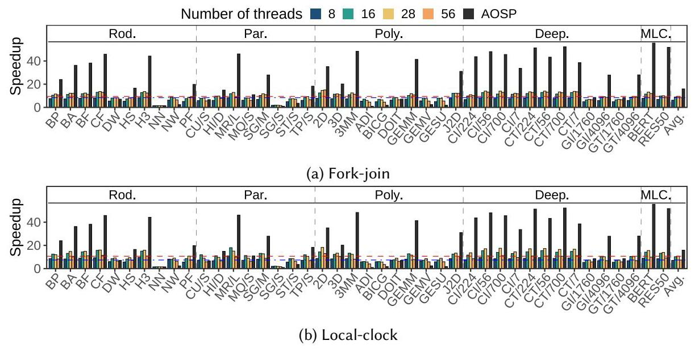
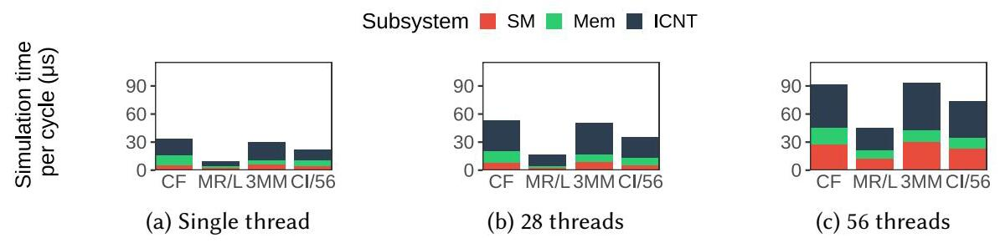
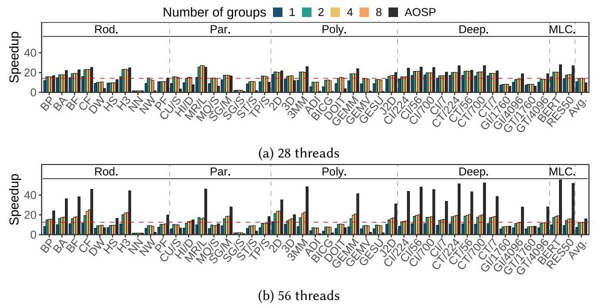
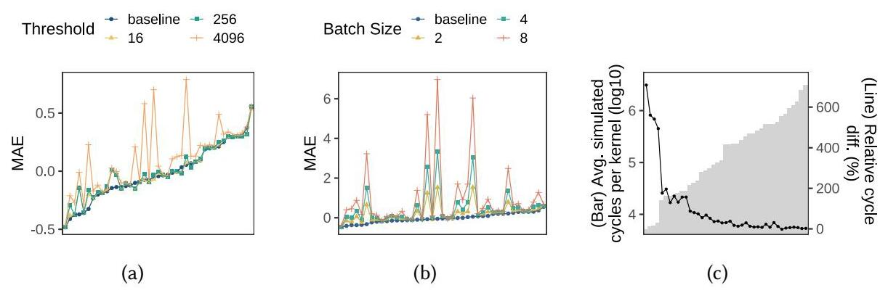

# LPGSim: A Lightweight Parallel GPU Simulator Maximizing Speed with Trustworthy Simulation 深度解读

> **作者**：Hyunwoo Nam、Jay Hwan Lee、Yeonsoo Kim、Mengzhao Zhang、Jeonggeun Kim、Bernd Burgstaller。  
> **期刊**：Proceedings of the ACM on Measurement and Analysis of Computing Systems（POMACS），2026，10(2)，Article 44，27 页。  
> **DOI**：10.1145/3805642。  
> **一句话总结**：LPGSim 用“保留访存时序与依赖、压缩计算细节”的混合精度模型降低单线程成本，再通过局部时钟、NUMA 分组及有代价的同步放宽加速并行仿真，把研究重点从逐部件复刻转向可承受时间内的 GPU 性能趋势分析。

## 一、问题定义（Problem）

### 背景：模拟 GPU 为什么比运行 GPU 慢这么多

GPU 以 warp 为调度单位，在大量 streaming multiprocessor（SM）上并发执行线程块。计算指令访问寄存器和执行单元，访存指令经过 L1、互连、L2 和 DRAM；一次 load 是否命中、返回时间及其后续指令的数据依赖，共同决定一个 warp 何时可以继续。Cycle-level simulator 在 CPU 上逐模拟周期维护这些状态，才能回答“修改 cache、内存时序或调度策略后，性能怎样变化”。因此，目标 GPU 的并行性越强，模拟器每周期需要维护的部件越多，模拟时间就越难承受。

本文属于**改进型工作**。已有 Accel-Sim 等模拟器通过详细流水线和存储系统获得较高准确性，但大工作负载的模拟很慢；已有加速方向包括简化模型、并行化 SM 和使用解析模型。问题在于：删错细节会失去性能可信度，只并行 SM 又会被互连串行路径和全局屏障限制。作者在 §2.3 引用既有研究的约五百万倍实机时间差距，以及 16 线程仅 5.8× 的 fork-join 加速，说明需求并非人为制造；这些数字是**引用的背景证据，不是 LPGSim 本文测出的结果**。

本文希望同时回答两个问题：哪些模型细节值得保留，哪些主机同步值得支付？第一层是 GPU 模型的精度预算，第二层是 CPU 并行执行的协调成本。论文追求的“trustworthy”主要体现为周期趋势和内存计数的可用性，并不意味着所有工作负载都具有低误差，更不等于功能正确性验证。

### 动机评估与核心 Insight

**动机总体扎实，但适用假设有边界。** §2.2 综合既有观察指出，SM 占据大部分模拟时间，而 memory system 对现代 HPC/ML 负载的准确性至关重要。因而可以压缩计算模型，同时细致保留访存行为。本文动机章节没有独立的新 profiling 图；后文 Fig.7 才提供 SM 时间占比及加速分解。不能把“大量现代负载受内存约束”推成“所有计算依赖都无关紧要”，特别是长延迟计算、专用单元和计算依赖链可能成为主要瓶颈。

**核心 Insight 是保留因果关系中最值钱的部分。** 在 GPU 模型中，保留由未完成访存引起的等待，统一处理其余计算；在并行模拟中，一个部件只需要等真正向它交付请求的邻居，不必等整个 GPU；在主机 NUMA 层面，少量动态均衡应服从数据局部性。最后，对于足够长的 kernel，可以容忍有限模拟时钟偏差来换取吞吐，但短 kernel 的起止误差会被放大。这些观察串起全文，而不是互不相关的若干优化。

## 二、相关工作（Related Work）

论文在 §2 和 §8 按**建模方法与加速路径**展开相关工作，可归纳成四条脉络。

| 路线 | 核心方法及代表 | 留给 LPGSim 的空间 |
|---|---|---|
| 详细周期级模拟 | GPGPU-Sim 采用 PTX execution-driven 模式；Accel-Sim 引入 NVBit 采集的 SASS trace；其他工作扩展架构、异构系统或多 GPU 支持 | 能研究微架构，但逐指令、多执行单元及完整依赖维护很贵 |
| 降低模型复杂度 | Jain 等强调存储系统准确性；NVArchSim/Need for Speed 比较不跟踪依赖、单 outstanding load、完整依赖及互连精度 | LPGSim 进一步选择“只跟踪访存指令相关依赖”，并把 trace 改造成 COMPUTE/DEP 表示 |
| 并行周期级模拟 | 以 SM/计算单元为并行任务，常用 fork-join；另有只模拟功能的并行模拟器 | L2/DRAM/互连串行部分与全局同步限制扩展；功能模拟加速不能直接代替时序模拟 |
| 解析、采样与学习模型 | interval 模型估计停顿，reuse-distance 模型预测 cache，principal kernel analysis 选代表 kernel，ML 模型预测性能 | 估计速度快，但细粒度新微架构仍需要可修改的周期级模型；论文认为两者可组合 |

创新并不在于首次提出“简化”或“并行”，而在于为二者选定共同的系统边界：保留详细存储系统，把 SM、memory 和 interconnect 都变成可并行对象。需要保留一个细节：本文实验中的 fork-join 基线已额外并行 memory 子系统，因此与它比较时，主要剩余串行对象是互连，不能把该基线描述成只并行 SM 的原始实现。

## 三、技术挑战（Challenges）

1. **怎样省掉计算模拟，又不让访存消费者提前执行？** 删除所有寄存器依赖会放过尚未返回的 load；完整 scoreboard 又失去轻量化意义。需要在 trace 和执行模型之间共同定义必要信息。
2. **怎样让互连也并行，同时不制造同周期数据竞争？** SM/L1 和 L2/DRAM 通过共享端口、请求缓冲区与互连交换消息。若读写没有时间边界，结果会依赖主机线程碰巧的执行顺序。
3. **怎样让任务均衡，而不在 NUMA 上反复搬状态？** 每周期动态分配能少等慢任务，却可能让子系统状态在 CPU cache 和插槽之间移动；集中式互连还要读取所有其他线程的请求及局部时钟。
4. **怎样处理周期工作量方差，而不无限放松时序？** cache hit/miss 等不同路径造成模拟周期成本剧烈变化。Table 1 中 CF 的 SM 单周期均值仅 3.37 μs、标准差却为 14.45 μs，3MM 为 3.25/12.50 μs；按平均工作量分配并不能消除逐周期等待。容许时钟偏差能缓解等待，但 kernel 起止阶段会积累误差。

这里始终有两个“时间”：**模拟周期**描述目标 GPU 进度，**主机耗时**描述 CPU 算出这些周期要多久。后文的局部时钟记录前者，优化目标是后者；二者混淆会把加速和预测误差误读成同一个指标。

## 四、解决方案（Solution）

### 整体思路与贯穿示例


Fig.1 的颜色分出混合精度边界：计算核心和互连较简化，L1/L2/DRAM 较详细。NVBit 从真实 CUDA 执行采集 SASS，转换器合并计算指令并保留访存依赖，压缩后的 trace 驱动模拟器。issue 阶段保留 warp scheduler 和轻量 dependency tracker，execute 阶段只有 universal unit 与 load/store（LDST）单元，最后在 writeback 释放访存依赖。寄存器文件和 read operands 阶段被省去。

**贯穿示例（为解释构造，不是论文 benchmark）**：一个处理数组的 kernel 有许多线程块，每个 warp 反复执行“加载 A[i] → 做两条不依赖该 load 的地址/整数计算 → 使用 A[i] 做计算 → 加载另一数据 → 写结果”。线程块分散到很多 SM，访存经过不同 L2/DRAM 分区；在主机上，由多个 CPU 线程共同模拟。我们依次看如何压缩这段程序、保证 load 等待、并行运送请求，再解释长短 kernel 为什么表现不同。

### 1. COMPUTE 与 DEP：压缩描述，不跳过计算指令所占的发射机会

对示例中“load → 两条独立计算 → 消费 load”的局部序列，概念上转换成：

```text
LDG R3, [A+i]     保留访存指令及访存所需信息
COMPUTE 2        合并两条不依赖该未完成load的计算指令
DEP R3           原来消费R3的那条计算指令，仍要等load返回
```


Fig.2(a) 中两条计算之间虽然有寄存器依赖，也会被合并；最后一条 load 对前一条 load 的依赖仍保留。Fig.2(b) 的最后一条计算依赖 R3，因此转换成 DEP R3。这直接回应挑战 1：删除的是详细计算元数据与计算—计算依赖，不是所有依赖。

`COMPUTE 2` **不表示一个周期完成两条计算**。issue 每次减少计数器并向 universal unit 送出一条合成计算指令，计数归零才读取下一条 trace。DEP 同样经通用计算路径，但发射前检查未完成访存的寄存器依赖；依赖未解开就停住该 warp，让 scheduler 选择其他 warp。访存指令走 LDST 路径，完成后在 writeback 清除记录。因此，示例中 A[i] 没回来时，消费者不能因为 trace 被压缩而直接发射。

代价也很明确：实际计算指令的专用执行资源、长延迟计算和计算—计算相关停顿不再被详细表达。本文不是重新计算数据值的功能模拟，访存地址等来自既有 trace，所以该办法也不能证明新设计下程序的功能正确性。

### 2. 存储系统保持详细：保留示例中真正决定等待的服务路径

L1 支持 banked、sectored cache 和可调整的 shared-memory/data-cache 分配；L2 使用不可约多项式 hash 缓解 partition camping，提供可配置 transaction size，并建模 A100 的 L2 分区；DRAM 保留时序及结构配置，可描述 GDDR/HBM。因而示例中两个 load 是否争同一 bank、是否落在不同 L2 分区、何时从 DRAM 返回，仍能影响模拟时序。

这种选择回应挑战 1 的另一半：只保留依赖还不够，依赖什么时候解除也必须足够可信。互连则主要捕捉带宽和延迟效应，并不进行完整包级网络仿真，因此对精细路由、仲裁和拥塞机制的研究能力仍有限。

trace 先做地址 base/stride 压缩，再用 Zstandard 压缩。这里应区分三件事：计算合并降低表示复杂度，地址及通用压缩降低容量，流水线简化降低模拟工作量；文件更小不等于已经证明采集/转换的端到端时间更短。

### 3. 子系统、双缓冲和局部时钟：只等待请求来源

LPGSim 划分三类任务：SM 与其私有 L1 构成 SM 子系统，某 memory subpartition 内的 L2 与 DRAM 构成 memory 子系统，二者之间另有 interconnect 子系统。示例中每个 SM 可独立更新内部流水线，不同存储分区也可独立服务请求；通信是必须协调的边界。


Fig.3(a) 显示请求跨子系统时采用双缓冲：本周期写入新请求，读取上一周期留下的请求，下一周期交换缓冲角色。这让同周期的内部模拟无需同时读写同一请求缓冲，回应挑战 2。**当前导出的本地图仅含 Fig.3(a)**；原文 Fig.3(b) 的时间线在 Markdown 中被拆为文本，它比较 fork-join 与 local-clock 两个周期的调度，含义如下。

在严格模式下，模拟第 N 个周期前，只要相关互连已经完成第 N−1 周期，SM 就能看见该看的请求；它无需等无直接通信关系的另一个 SM 完成全局屏障。每个子系统维护 local clock，线程检查依赖子系统的进度，满足条件后模拟并更新本地进度。这样既把互连从串行阶段移到并行任务中，又去掉与无关任务共同等待的屏障。这里取消的是**全局同步**，局部因果依赖检查仍然存在。

Algorithm 1 还允许静态和动态任务并存：线程先处理绑定的子系统，再获取所属线程组中的动态任务。实现采用尽量均匀静态绑定、余数作为动态任务的策略，使负载均衡不必以每个周期搬迁所有状态为代价。

### 4. NUMA 分组与互连并行：把协调热点拆开

把示例扩展到两个 CPU 插槽后，一个互连线程要访问全部 SM/L2 请求队列和 local clock，cache coherence 与远程访问会把它变成热点。若所有子系统都能在任意线程之间迁移，先前的动态均衡收益也可能被数据移动抵消。

LPGSim 把线程和动态任务划入多个组，每组线程位于同一 socket；动态子系统只在所属组内调度。互连也拆为每组的 sub-interconnect，分别处理本组来源请求并仲裁。多个 sub-interconnect 可能同时发往同一目标，故通信缓冲改为使用 CAS 的 concurrent queue，以保证并发访问安全。

这回应挑战 3，但应区分**无数据竞争**和**完全复现串行仲裁顺序**：CAS 队列解决前者，不保证后者。作者承认独立仲裁的顺序变化会带来小幅准确性损失。因此，不能把“所有并行化都不改变模型结果”作为本文结论。

### 5. 放宽时钟差与批量周期：明确用精度换等待时间

前述机制仍会等到依赖子系统足够接近。针对挑战 4，作者添加两个旋钮：允许局部时钟与依赖方相差一定 threshold；以及每次调用连续模拟 bsize 个周期再更新进度，减少逐周期检查、任务切换和方差影响。Algorithm 1 伪代码默认 threshold=0、bsize=1；实验图把 threshold=1 作为对应既有配置的起点，两处计数口径不宜强行等同。

回到数组示例：若 kernel 有大量线程块、运行很久，起步和收尾错开少量周期，相对总周期可能很小；若 kernel 只有很少工作，起止阶段就可能占很大比例。尤其某线程上的 SM 已结束、但 memory 仍服务其他线程请求时，该线程每周期工作骤减，局部时钟可能快速超前，产生额外尾部周期。因而“让线程快跑”并非总能缩短整体模拟，阈值和 batch 都需要控制。

### 与既有方案的关系

LPGSim 的优点是模型表示、任务边界和主机局部性协同设计。相比只优化某个 C++ 热点，它减少需要模拟的工作；相比仅并行 SM，它覆盖 memory 和互连；相比全局任意任务迁移，它尊重 NUMA 局部性。局限则来自同一组选择：无法研究已删去的执行单元细节，且较激进并行配置的误差必须按 workload 重新检查。

## 五、实验评估（Experiments）

### 实验设定与结果口径

| 维度 | 论文设置及阅读注意 |
|---|---|
| 工作负载 | Rodinia、Parboil、PolyBench、DeepBench、MLPerf Inference 4.1；MLPerf 含 BERT、ResNet50 |
| 实验子集 | Table 2 分 Acc.、Comp.、Par.；不是所有 benchmark 参加每项实验，MLPerf 参加准确性/并行实验，但未参加 Accel-Sim 速度比较 |
| 真实 GPU | V100：80 SM、6 MB L2、HBM2；A100：108 SM、40 MB L2、HBM2e；RTX 3090：82 SM、6 MB L2、GDDR6X |
| 软件 | NVCC 12.4、cuDNN 9.1.0、NVBit 1.7.2、GCC 12.4.0、Nsight Compute 2024.1.1.0 |
| 性能目标配置 | 以 RTX 3090 配置比较模拟器主机运行时间 |
| CPU 平台 | 文中报告双路 Xeon E5-2697 v3、总内存 512 GiB，并使用 28/56 线程配置；原文同时写每插槽 28 physical cores，未进一步澄清核心/线程口径，本文不据此推断物理核效率 |
| 准确性指标 | cycles 用文中定义的百分比 MAE；load/store、cache/DRAM 计数用 NRMSE，另报标准差和 Pearson correlation |
| 性能基线 | 单线程 LPGSim 对 Accel-Sim；并行 LPGSim 对其自身单线程；fork-join 是作者实现且已并行 memory 的对照 |

§6.1 的准确性测试**关闭 §4.3 的同步放宽**，不能直接贴到最高加速配置。§6.2 则另外考察放宽同步后的误差。本文把前者称为基础准确性，把后者称为并行配置的附加误差，避免混用。

论文用 AOSP（approximated occupancy-based speedup）解释工作负载的并行潜力：在 Amdahl 思路中，以 `线程数 × occupancy` 近似有效并行度，occupancy 是真实硬件上按执行周期加权的活跃 warp 比例。作者明确说它是启发式指标，**不是可实现加速的理论上界**；公式中的时间项需作归一化比例理解，不能将任意秒数直接代入称作无量纲 speedup。

### 1. 基础准确性：周期约 22% 误差，内存计数更准确

| GPU | 周期 MAE | 周期标准差 | 周期 Pearson r | L1 read miss NRMSE | L2 read miss NRMSE | DRAM read NRMSE |
|---|---:|---:|---:|---:|---:|---:|
| V100 | 21.4% | 18.0% | 0.98 | 5.22% | 5.40% | 1.14% |
| A100 | 23.3% | 20.2% | 0.97 | 6.19% | 4.15% | 0.35% |
| RTX 3090 | 22.7% | 21.6% | 0.98 | 6.89% | 4.90% | 5.47% |

Table 5 还显示 load 指令计数 NRMSE 均为 0.01%，store 为 0.04%–0.05%，L1 write 为 0.02%。这些数字支持访存事件及存储行为建模的可信度，但周期标准差说明单个 workload 偏差可能显著，不能将平均值当作逐 workload 保证。


Fig.4 在对数坐标上比较硬件与模拟值。较高相关性表明跨工作负载量级趋势吻合；它不自动证明两个接近候选设计的优劣排序都可靠，也不能抵消约 22% 的周期平均误差。


Fig.5 按 roofline 划分 49 个 compute-bound、158 个 memory-bound 样本，合计跨三种架构的分类结果，不能当作 207 个不同应用。作者观察到计算受限组也没有显著恶化，解释为这些测试中的长延迟/计算相关停顿并不突出。这支持“这批负载可简化”，尚不足以覆盖任意强计算依赖程序。

Table 6 的同实现消融更有说服力：不跟踪任何寄存器依赖时，LPGSim 平均周期误差约 28%；保留访存依赖后约 22%，改善 **6 个百分点**。No-track 的三架构相关性为 0.96/0.93/0.90，也低于默认的 0.98/0.97/0.98。这直接验证示例中 DEP 不能一并删除。

同表引用 Accel-Sim 24%、NVArchSim 17% 的既有误差，但 workload 和架构不同。LPGSim 没有自身的详细核心版本作为同配置对照，故这些数只能给背景尺度，**不能证明简化核心仅增加了多少误差，也不能据此宣布比 Accel-Sim 更准确**。

### 2. 单线程速度：9.97× 的来源不只是代码重写


Fig.6 在参加 Comp. 的 RTX 3090 配置工作负载上给出平均 **9.97×**。这是模拟器运行速度，不是 GPU 应用加速，也不是包含 trace 生成的端到端加速。


对 CF、MR/L、3MM、CI/56 四个 workload，SM、互连、memory 子系统分别平均快 **13.8×、20.8×、1.60×**。memory 没做同类模型简化，作者把它的改善归于独立代码实现；SM/互连则同时受模型简化与实现差异影响。虽然互连相对加速更高，SM 原始时间占比更大，因此核心简化才是整体收益的主要来源。该 profiling 支持归因方向，但不是把每个因素独立开关后的严格消融。

### 3. 并行扩展：每消除一个瓶颈，另一个瓶颈浮现

以下 speedup 的分母**全部是单线程 LPGSim**，不能直接和 9.97× 混为一列。

| 并行方案 | 28 线程 | 56 线程 | 关键含义 |
|---|---:|---:|---|
| fork-join | 9.44× | 8.37× | 加线程后串行互连和屏障限制更明显 |
| 基础 local-clock | 10.6× | 7.41× | 单插槽改善，但双插槽协调代价反而更大 |
| 分组与互连并行，各自最佳组数 | 14.25×（4 组） | 12.56×（8 组） | 降低热点和迁移，双插槽仍未超过单插槽 |
| 时钟差 threshold=256 | 15.88× | 16.96× | 该实验使用 8 组；容许有限偏差后双插槽开始获益 |
| 再批量模拟周期 | 28 线程反而退化 | 19.8×（batch=4） | batch 收益依赖主机配置，不能默认越大越好 |





Fig.8 中 56 线程不及 28 线程，是论文重要的反直觉证据；Fig.9 解释为什么“已经全部并行”仍然慢：SM 总时间大，但每个 SM 小，分摊后一个集中式互连的协调成本反而主导。到了双插槽，local-clock 读取与请求交换的跨线程/跨 socket 通信把互连成本进一步抬高。



Fig.10 的 1 组配置等同未并行互连的 local-clock。组数增加能减轻集中通信，56 线程相对收益尤其明显，但结果仍不意味着分组越多越好；负载均衡、每组任务数和通信成本共同决定最佳点。


Fig.11 的阈值扫描为 1、16、256、4096，最佳平均速度在 256；56 线程下 DeepBench 和 MLPerf 分别达到 20.1×、25.6×。Fig.12 从 threshold=256 继续改变 batch=1/2/4/8；单插槽批量化变慢，双插槽在 batch=4 达到 19.8×。对于 MLPerf，作者报告未放宽同步时 15.45×、应用两种放宽后 32.99×，这一子集结果不能代替总体平均值。

### 4. 精度代价：长 kernel 的结论不能平移给短 kernel



按 §6.2 的文字结论，阈值放宽到 256 时误差变化很小，4096 时部分 workload 恶化；增大 batch 对 NN、NW、3D、J2D 等短 kernel 的影响显著。Fig.13(c) 用 **threshold=256、batch=8、56 线程**与单线程比较，发现平均 kernel 周期越短，相对周期差越大。注意它并非最高总体速度所在的 batch=4 配置，且该“相对单线程周期差”不同于“相对真实硬件误差”。

这里有两处原图表达不一致，值得保留而非替作者修正：Fig.13(a)(b) 纵轴标为 MAE 却出现负数，严格意义上的绝对误差不可能为负；Fig.13(c) 图注称周期为折线、差异为柱形，图内轴标却标注周期为柱形、差异为折线。因此本报告只使用可与正文互证的趋势，不从这张图硬读精确 MAE，也不把图中极值当作一个已明确定义的误差统计量。

### 5. 端到端开销与证据边界

Table 3 显示 trace 容量确实可观：MLPerf 原始 trace 平均 **2186.86 GB**、最大 **3911.58 GB**，只做地址压缩后平均 **713.20 GB**，再加 Zstandard 后平均 **12.36 GB**、最大 **19.35 GB**；DeepBench 平均从 **18.16 GB** 降到 **0.06 GB**。这些是存储容量，不是 trace 采集、COMPUTE/DEP 转换、压缩和解压的时间测量。论文没有给出这些阶段的完整耗时分解，因此无法从 9.97× 或 19.8× 推出一次性运行完整工具链的端到端加速；多次复用 trace 做配置探索时，预处理成本才可能被摊薄，这是使用情境推论。

作者给出总加速 **197.4×**，数值上是约 `9.97 × 19.8`。但 Comp. 和 Par. 子集并不完全相同，且最高并行速度伴随附加误差；应把它理解为论文按两层平均收益组合出的总量级，不能当作所有 workload 都直接测得的统一端到端加速。

**结论支撑性评价**：多架构、五套 benchmark、存储事件计数和逐层并行实验共同支持“以有界用途换高吞吐”的主张。薄弱处在于：没有同实现完整核心与轻量核心的配对消融；没有展示系统的候选架构排序验证；最高速度配置缺少与基础准确性表同等完整的统计；部分性能实验受时间限制筛选，完整模型仅用 BERT/ResNet50；线程/物理核及 Fig.13 口径需谨慎。以此做存储系统或大 kernel 的早期探索较有根据，用它判断细粒度计算单元改动则超出主要证据范围。

## 六、附加洞察（Side Findings）

**结论 1：在已测试的 A100 tensor-core 工作负载中，统一计算单元仍能得到较小周期误差。**  
**出处**：§6.1 “Impact of the specialized hardware units”。  
**推理链条**：作者识别出实际用了 tensor core 的五个 benchmark → 它们的 tensor 指令在 LPGSim 中仍全部转换为普通 COMPUTE → CT/341、CT/56、CT/7、BERT、ResNet50 的周期误差分别为 2%、9%、2%、11%、2% → 作者据此判断这组测试里 tensor 指令简化带来的准确性问题有限。薄弱点是没有相同工作负载的详细 tensor pipeline 对照，因此这些是总误差观测，不能严格分离 tensor 简化的独立误差，也不覆盖所有 tensor-heavy kernel。

**结论 2：本实现中 trace 读取不是值得优先并行化的热点。**  
**出处**：§4.4 “Implementation Details”。  
**推理链条**：每个 kernel 的一个 trace 文件包含全部线程块 → 多线程读取需要同步避免竞争 → 虽然可以设计并行读取，作者观察到该阶段耗时可忽略 → 因此保留串行/同步读取，把工程精力投入模拟本身。论文未给该阶段量化比例，故这个判断只应限定在其压缩格式、平台和工作负载下，不能推出任何 trace-driven 模拟器的 I/O 都不重要。

**结论 3：轻量核心已丢失核心功耗建模需要的信息，而存储功耗扩展仍有数据基础。**  
**出处**：§7 “Power model”。  
**推理链条**：不同计算指令被折叠为统一类型 → 无法恢复每条指令使用的确切执行单元 → 不能统计核心各单元的准确活动及能耗；相反，详细存储系统保留 L1/L2/DRAM 的访问计数和时间 → 可获得访问率，为带估计参数的存储功耗模型提供输入。前半是当前能力边界，后半只是作者论证的可扩展性，本文没有实现或验证完整功耗模型。

## 七、总结与个人评价（Wrap-up）

LPGSim 的贡献是把“保留哪些因果细节”落实到 trace 格式、核心流水线及并行任务边界：基础周期误差约 21%–23%、相关性约 0.97–0.98，换来相对 Accel-Sim 的 9.97× 单线程加速；再通过分组和同步放宽把并行加速推到相对自身单线程的 19.8×，但需额外承担精度代价。

最大的亮点是认真展示优化失败的中间状态：local-clock 在双插槽反而更慢，分组还不够，batch 在单插槽也可能退化。最大的不足是“可信”主要依赖跨 benchmark 相关性和若干误差统计，尚未完整证明微架构设计排序的可靠性，轻量核心的精度损失也缺乏同实现配对对照。**个人判断**：下一步最有价值的是建立依赖强度、kernel 长度与同步参数之间的自适应准则，并用相同设计点、相同工作负载和端到端成本做配对验证；这属于报告建议，不是论文已经实现的功能。

## 八、章节脉络与段落速览（Structure Map）

以下按正文自然段编号，编号在每个章节或子小节内重置；公式、算法、表格、图注及贡献列表归入相应段落，不把分页拆出的文字视作新段；图表因版面浮动提前出现时按逻辑所属章节导航。

- **Abstract**：概括混合精度与并行化两层加速。
  - ¶1 说明大规模 workload 需要既可信又足够快的 GPU 模拟器。
  - ¶2 概述计算元数据压缩、局部时钟并行及精度—速度结果。
- **1 Introduction**：提出快而可信的模拟需求并陈述贡献。
  - ¶1 说明 HPC/ML 增长要求可用于架构探索的工具。
  - ¶2 对比模型简化和并行化两条加速路线的精度与扩展代价。
  - ¶3 概述 LPGSim 的轻量核心、详细存储及分层并行方案。
  - ¶4 汇总实验结果，并以三项贡献列明模型、并行方法与评估覆盖。
- **2 Background and Motivation**：建立 GPU 建模方法及性能瓶颈背景。
  - **2.1 GPU Architecture Simulation**：比较解析建模与周期级模拟。
    - ¶1 从 GPU 的普及引出架构建模工具需求。
    - ¶2 说明解析模型更快、周期级模型更适合评估微架构变化。
  - **2.2 Trade-off between Accuracy and Simulation Speed**：论证保留详细存储而简化核心的动机。
    - ¶1 结合 SM 时间占比和内存准确性研究提出混合精度取舍。
  - **2.3 GPU Simulation Parallelization**：解释已有 SM 并行为什么扩展有限。
    - ¶1 用既有仿真慢速与 fork-join 加速数据说明并行需求。
    - ¶2 分析串行 memory/interconnect 与全局同步，并提出按通信依赖解耦的机会。
- **3 LPGSim Toolchain**：介绍 trace 到混合精度模拟器的端到端构成。
  - ¶1 用 Fig.1 说明 trace 转换压缩、不同部件精度及实现来源。
  - **3.1 Core Pipeline Simplification**：解释计算指令合并和访存依赖保留。
    - ¶1 定义简化流水线中保留与删除的组件。
    - ¶2 说明只维护访存相关寄存器依赖的 tracker。
    - ¶3 定义转换后的 COMPUTE 与 DEP 指令。
    - ¶4 通过 Fig.2(a) 解释访存—访存依赖和计算合并。
    - ¶5 通过 Fig.2(b) 解释访存—计算依赖的 DEP 表示。
    - ¶6 逐类说明 COMPUTE、memory、DEP 的发射执行与写回路径。
  - **3.2 Detailed and Flexible Memory System Model**：列出可配置的详细存储模型。
    - ¶1 说明 L1 分 bank/sector、L2 hash/分区及 DRAM 时序配置。
  - **3.3 Tracer**：说明 NVBit 采集及两级压缩。
    - ¶1 将 SASS 插桩、trace 转换和地址/Zstandard 压缩串起。
- **4 Simulator Parallelization**：用 Algorithm 1 概览三个并行优化层次。
  - ¶1 提出局部时钟、NUMA 分组及同步放宽三种策略。
  - **4.1 Local-Clock-Based Parallelization**：用子系统与双缓冲消除串行路径和全局屏障。
    - ¶1 定义三类子系统，并用 Fig.3(a) 的双缓冲隔离同周期通信。
    - ¶2 说明只检查依赖方 local clock，以及静态/动态任务的执行流程。
    - ¶3 用 Fig.3(b) 时间线解释全局屏障等待和串行互连等待的减少。
  - **4.2 Thread and Subsystem Grouping and Interconnect Parallelization**：解决跨核和跨插槽通信热点。
    - ¶1 分析集中互连通信和动态迁移带来的 coherence/NUMA 开销。
    - ¶2 说明同插槽分组、子互连与 CAS 队列，以及仲裁次序变化的精度代价。
  - **4.3 Synchronization Relaxation for Performance Improvement as a Trade-off of Accuracy**：以可控同步偏差缓解周期成本方差。
    - ¶1 用 Table 1 的周期方差引出 threshold 与 batch 两种优化。
  - **4.4 Implementation Details**：交代任务绑定和 trace 读取选择。
    - ¶1 说明优先静态分配、余数动态分配，以及不并行 trace 读取的理由。
- **5 Experiment Setup**：定义 workload、硬件、指标和各项基线。
  - ¶1 用 Table 2 区分五套 benchmark 的实验子集，并以 Table 3 展示压缩容量。
  - ¶2 列出软件版本、真实 GPU、Nsight 与双插槽主机设置。
  - ¶3 定义周期/存储指标、roofline 分类及准确性实验关闭同步放宽的条件。
  - ¶4 说明完整核心对照不可用，因此采用既有误差作参考并添加 No-track 消融。
  - ¶5 定义性能基线、加强后的 fork-join 和考虑 occupancy 的 AOSP 公式。
  - ¶6 解释 AOSP 的时间项并强调它仅是并行潜力启发式。
- **6 Evaluation**：分别评估准确性和各级模拟速度。
  - **6.1 Accuracy Validation**：验证三架构误差并讨论简化核心的适用性。
    - ¶1 用 Table 5 与 Fig.4 报告周期及存储指标误差、标准差和相关性。
    - ¶2 用 Fig.5 比较计算/存储受限组，并解释计算简化何时仍足够准确。
    - ¶3 检查五个 A100 tensor-core benchmark 的周期误差。
    - ¶4 用 Table 6 和 No-track 相关性验证访存依赖保留的作用。
  - **6.2 Performance Comparison against State-of-the-Art GPU Simulators**：逐层揭示速度收益、扩展瓶颈和误差代价。
    - ¶1 用 Fig.6–7 报告单线程 speedup，并区分模型简化与代码实现差异。
    - ¶2 用 Fig.8–9 说明 fork-join 的互连串行瓶颈。
    - ¶3 解释基础 local-clock 在双插槽上受跨线程通信影响而退化。
    - ¶4 用 Fig.10 验证分组及互连并行的收益与剩余限制。
    - ¶5 用 Fig.11 说明 threshold=256 的速度优势和大型套件收益。
    - ¶6 用 Fig.12 比较批量周期在单插槽与双插槽的相反效果。
    - ¶7 用 Fig.13(a) 分析大 threshold 下 kernel 起止错位和冗余尾部周期。
    - ¶8 用 Fig.13(b)(c) 解释 batch 对短 kernel 的误差放大及长 kernel 的适用性。
- **7 Discussion**：交代特殊指令、功耗及架构覆盖边界。
  - ¶1 说明 tensor core 统一处理、测试未出现 texture 指令及当前不支持 texture pipeline。
  - ¶2 说明核心功耗信息缺失，而详细存储计数可作为存储功耗扩展基础。
  - ¶3 说明仅支持 NVIDIA/SASS、不能保证所有 benchmark 高精度及 trace-driven 功能验证局限。
- **8 Related Work**：把 LPGSim 放入模拟精度、并行化和解析建模三条脉络。
  - ¶1 回顾 GPU 模拟器演进、依赖精度取舍及各类架构扩展。
  - ¶2 指出现有 GPU 并行方法主要关注 SM，突出全组件并行的区别。
  - ¶3 介绍 interval、reuse-distance、kernel sampling 与 ML 模型，并说明其与周期级模拟的互补性。
- **9 Conclusion**：回收两层贡献、精度速度结果与代码发布信息。
  - ¶1 汇总轻量核心和分层并行的取舍，并指向工具链公开 artifact。
- **Acknowledgments**：披露资助、审稿帮助和生成式 AI 的语言润色用途。
  - ¶1 感谢相关贡献者并说明资助及语言编辑声明。
- **References**：列出 [1]–[81] 的背景、方法、工具与架构资料。
  - 条目导航：模拟器/并行化重点见 [6][28][35][38][43][70]，trace 工具见 [71]，LPGSim artifact 见 [49]；参考文献条目不是论证自然段，不逐条复述。

本文无独立附录；文首版权、作者联系方式、ACM 引用格式和文末收修录用日期属于出版元数据，未计入正文自然段。
