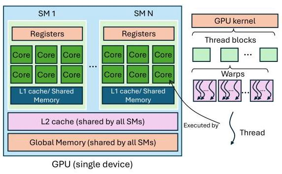
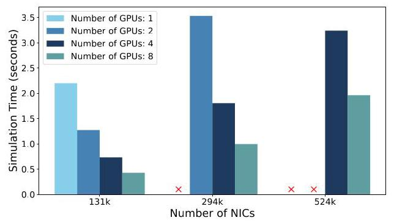
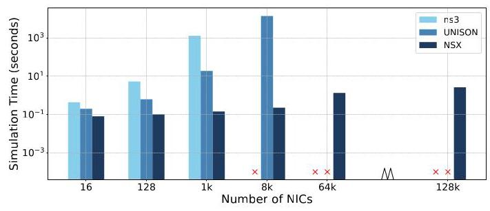

# NSX: Large-Scale Network Simulation on an AI Server

Sajy Khashab ${}^{ \dagger  }$ , Hariharan Sezhiyan ${}^{ \dagger  }$ , Rani Abboud ${}^{ \dagger  }$ , Alex Normatov ${}^{ \dagger  }$ , Stefan Kaestle ${}^{ \dagger  }$ Eliav Bar-Ilan ${}^{ \dagger  }$ , Mohammad Nassar ${}^{ \dagger  }$ , Omer Shabtai ${}^{ \dagger  }$ , Wei Bai ${}^{ \dagger  }$ , Matty Kadosh ${}^{ \dagger  }$ Jiarong Xing ${}^{ \ddagger  }$ , Mark Silberstein ${}^{\dagger  * }$ , T.S. Eugene Ng‡, Ang Chen ${}^{\dagger  * }$

†NVIDIA *Rice University *Technion §University of Michigan

## Abstract

Network innovation is key to supporting AI workloads. Packet-level simulation is indispensable for testing new network features as it enables high-fidelity experimentation. However, today's simulators struggle to scale to large topologies that are typical to AI clusters. To scale the simulation, we have built NSX which is a new simulator that takes advantage of AI servers themselves (e.g., NVIDIA's DGX) to experiment with AI networks. Network simulation has unique workload characteristics that make AI servers an ideal fit: relatively simple, parallelizable compute, with high memory bandwidth pressure. Yet, in order to fully leverage this platform, we need new techniques to rearchitect network simulators for GPU execution. We describe the design decisions that have gone into NSX, and report evaluation results from our current prototype: NSX can scale simulation to networks of ${524}\mathrm{k}$ nodes, and it finishes ${0.1}\mathrm{\;{ms}}$ simulation in less than 2 seconds on a DGX-H100 box. NSX is being used by NVIDIA's networking team on a daily basis for AI cluster design, and new features are added to it on a regular basis.

## ACM Reference Format:

Sajy Khashab ${}^{ \dagger  }$ , Hariharan Sezhiyan ${}^{ \dagger  }$ , Rani Abboud ${}^{ \dagger  }$ , Alex Normatov ${}^{ \dagger  }$ , Stefan Kaestle ${}^{ \dagger  }$ , Eliav Bar-Ilan ${}^{ \dagger  }$ , Mohammad Nassar ${}^{ \dagger  }$ , Omer Shabtai ${}^{ \dagger  }$ , Wei ${\text{ Bai }}^{ \dagger  }$ , Matty Kadosh ${}^{ \dagger  }$ , Jiarong Xing ${}^{ \ddagger  }$ , Mark Silberstein ${}^{\dagger  * }$ , T.S. Eugene Ng $\ddagger$ , Ang Chen ${}^{\dagger \text{ § }}$ . 2025. NSX: Large-Scale Network Simulation on an AI Server.

In 2nd Workshop on Networks for AI Computing (SIGCOMM '25), September 8-11, 2025, Coimbra, Portugal. ACM, New York, NY, USA, 7 pages. https://doi.org/10.1145/3748273.3749199

## 1 Introduction

AI clusters are creating new demands on the network, and packet-level simulation is indispensable for network analysis. New features (e.g., topology designs, congestion control, routing algorithms) need to be studied in simulated environments before production, but existing simulators are slow $\left\lbrack  {{19},{25},{29} - {31}}\right\rbrack$ and struggle to scale to large AI networks. With the modern AI cluster soon approaching million GPUs [28] and with growing link speeds that will exceed Terabit/s, simulator scalability bottlenecks will further worsen. Left unaddressed, this will hinder the speed of innovation.

AI has been driving much of this cluster growth, and AI servers like NVIDIA's DGX have become the main building block; however, the vast majority of today's packet-level simulators are designed for traditional CPU architectures [19, 25, 29, 34]. These simulators cannot effectively scale to AI-scale clusters. Recent work has only used GPUs in limited ways, such as building ML-based predictive simulation [30, 31], or concurrently executing many embarrassingly-parallel "parameter sweep" simulations [14]. However, the more fundamental problem-accelerating a single simulation of large-scale networks at the size of AI clusters-remains difficult because it requires tackling the scalability bottlenecks at the root. This in turn requires rethinking network simulator design.

We observe that network simulation workloads have distinct properties: relatively simple, parallelizable compute, with high memory bandwidth pressure. Packet-level simulation passes times-tamped events (e.g., packet arrival/departure) through a topology of network elements, with event handlers triggered at each processing step. In terms of compute, event handlers (e.g., packet header operations such as decrementing TTLs) do not require complex logic, but they need to process a large number of discrete events concurrently. GPU compute uses vectorized processing (in SIMT, or single instruction multiple threads [33, 38]), which executes the same logic on many parallel ALUs; this stands in stark contrast to CPUs with a much smaller number of high-performance threads. Moreover, network simulation is memory-intensive [20], not only because a large amount of packets need to be sent/received at each hop, but also because larger topologies inherently contain more network state (e.g., to encode all switches and NICs including their buffers). On CPU platforms, the working set will easily exceed the faster cache and become bottlenecked at the slower DRAM; in contrast, GPU platforms provide abundant high-bandwidth memory (HBM) with a unified address space, which have the potential to scale the simulation much further.

Hence, the premise of NSX is that modern AI servers are themselves an ideal fit for network simulation workloads. For example, NVIDIA's DGX hosts eight GPUs, each with 80 GBs of HBM accessible at TB/s bandwidth from hundreds of thousands of threads; a low-latency high-throughput NVLINK interconnect between GPUs further enables efficient scaling across multiple GPUs. The GPU programming software ecosystem is also quickly maturing. The CUDA framework now supports general program execution with familiar interfaces (e.g., in C/C++/Python), with increasingly abundant developer expertise, enabling non-ML workloads to benefit from GPU computation. Combined, these hardware and software trends motivate us to leverage AI servers. NSX is a new network simulator rearchitected for scalable execution on an AI server, and its design challenges lie in fully extracting the performance of such servers for simulation workloads, using several techniques.

---

* Khashab, Sezhiyan, and Abboud have contributed equally to NSX.

Permission to make digital or hard copies of all or part of this work for personal or classroom use is granted without fee provided that copies are not made or distributed for profit or commercial advantage and that copies bear this notice and the full citation on the first page. Copyrights for third-party components of this work must be honored. For all other uses, contact the owner/author(s).

SIGCOMM '25, Coimbra, Portugal

© 2025 Copyright held by the owner/author(s).

ACM ISBN 979-8-4007-2082-6/25/09

https://doi.org/10.1145/3748273.3749199

---

Execution model. To unleash GPU parallelism, NSX adopts a granular execution model customized for SIMT threads, by breaking down a device into very small modules. For instance, even a single ingress/egress queue of a switch is designed as a module, and this is more granular than existing network simulators. This design enables each module to be executed on a SIMT thread, maximizing the performance of vectorized GPU compute. However, a potential downside for granular execution is that it may introduce control flow overheads involving the CPUs. To address this, NSX uses a systolic kernel launch order that leverage the network hierarchy in AI clusters, and further uses recent GPU features (i.e., CUDA graphs) to minimize CPU overheads.

Event queues. Another challenge is that granular modules will increase the amount of inter-module communication [9], because packets need to be passed through many modules for end-to-end simulation. We design NSX's event queues to provide a producer-consumer abstraction; the underlying implementation backs this abstraction using a combination of first-in-first-out (FIFO) and priority queues, and this choice is made depending on the inter-module connectivity pattern. As the rationale, FIFO queues are linear data structures and easier to maintain. However, priority queues are better suited for high fan-in scenarios where, otherwise, dequeueing from many FIFOs will result in irregular memory access.

Event causality. In a simulation, modules concurrently dequeue events from their inbound queues, and enqueue new events into outbound queues. For correctness, simulation needs to process events in timestamped order to preserve event causality. While causality is a global property, a naïve design with topology-wide coordination would cause high overheads. Instead, we adapt a decentralized algorithm to avoid topology-wide synchronization. Specifically, each module relies on its adjacent queue state to safely process as many events as possible, but only uses local synchronization methods; this avoids causing high contention across the GPU substrate.

Transparent scaling. Scaling to multiple GPUs is essential to simulate large-scale topologies, which otherwise exceed the memory capacity of any single GPU. This requires transferring events across GPU boundaries, but a naïve design needs to marshal and demarshal packets across GPUs via collectives such as NCCL. This not only involves CPUs, but also results in poor performance since NCCL is optimized for bulk transfers whereas simulation passes smaller data batches in discontiguous memory. We observe that the NVLINK fabric offers new opportunities to instead leverage load/store-based shared memory abstraction for transparent scaling across GPUs, obviating NCCL overheads.

This paper describes the current snapshot of NSX, since new features are added on a regular basis. NVIDIA engineers have been heavily relying NSX to experiment with AI networking features, such as adaptive routing, congestion control, and topology design. NSX can scale network simulation to ${524}\mathrm{k}$ nodes, and finish a ${0.1}\mathrm{\;{ms}}$ simulation under 2 seconds on an DGX-H100 box. This provides orders-of-magnitude higher speedups than CPU-based simulation, and allows network engineers to derive insights rapidly. We conclude with extensions and emerging use cases of NSX.

## 2 Motivation and Background

Packet-level simulators model a network experiment as a series of discrete events (e.g., packets, timers) that change the state of the network components (e.g., switches, NICs). This high-fidelity analysis is not available in other paradigms like coarser-grained flow simulation or ML-based predictive simulation [3, 30, 31]. Therefore, packet-level simulation has gained wide popularity for studying new network features. Furthermore, other simulation paradigms (e.g., ML-based prediction) often rely on packet-level simulation data as a starting point to train their models.

However, packet-level simulators are notoriously slow and they struggle to scale to large topologies that interconnect servers that support a single distributed application, such as today's AI workloads. Modern networks produce a large number of events, as link speeds soon reach Tbps and cluster sizes exceed ${100}\mathrm{k}$ GPUs and will reach 1 million [5, 28]. This is fueled by the insatiable need of AI training workloads, which require tight coupling of computing resources at such unprecedented scales. Hence, datacenter providers are constructing ever larger clusters and introducing new networking technologies (e.g., topologies, congestion control, in-network aggregation, load-aware routing). To experiment with new features, however, simulation will increasingly become a bottleneck-especially because simulation is most needed to study how a feature would perform at future-generation cluster scales, which could be one order of magnitude larger than the existing cluster.

### 2.1 Recent Work and Limitations

Therefore, improving the performance of packet-level simulators [25, 29] has gained extensive attention [14, 19, 30, 31, 34]. Among existing work, most simulators use CPU platforms and specialize their techniques to suit modern CPU features [1, 12, 15, 16, 18]-e.g., load-adaptive scheduling to optimize for CPU synchronization [34], or data layout schemes that enable better CPU caching [19]. While each of these solutions has improved simulation scale, CPU platforms fundamentally have limited thread parallelism (i.e., a small number of performance-optimized threads) and limited amount of fast memory (i.e., the SRAM cache)-which we observe run counter to the key needs of network simulation.

A recent work, Multiverse [14], has looked to GPU platforms for further improvement. Its key idea is to instantiate an ensemble of almost-identical simulations on a given topology, for parameter sweeping experiments. For instance, a range of congestion control parameters can be tried out in parallel GPU-based simulations, independently. However, this work optimizes for parameter-sweep experiments on a fixed network topology, without directly confronting the simulation scaling bottleneck as topologies become larger. In a simulation of a single large network, different network elements are tightly coupled-it is not an "embarrassingly parallel" workload; but this is exactly the scenario we need to simulate in order to study workloads at scale (e.g., AI training).

### 2.2 NSX: Scaling Simulation on AI Servers

Modern AI servers are custom-designed for training workloads, each enclosing multiple GPUs over a fast NVLink interconnect. For instance, NVIDIA's DGX servers host eight GPUs (e.g., A100/H100), with the H100 model featuring 114 streaming multiprocessors (SMs) and each SM containing 64 warps, which equates to 2048 threads [26, 27]. SMs are the workhorse of the GPU and contain computation cores, register files, and thread schedulers. For network simulation, they provide massive parallelism not found in CPU platforms. Warps are the basic units of execution on the GPU, and each warp consists of 32 threads. The threads in a warp follow a vectored, single instruction multiple threads (SIMT) model. A subset of threads in the same warp execute the same instruction, potentially applying it to different data. Figure 1 illustrates NVIDIA's GPU architecture and its execution model, for which NSX is designed.

Figure 1: NVIDIA's GPU architecture and execution model.

Although AI servers are primarily designed for neural network execution, the CUDA programming model is increasingly general. Functions are organized in the form of kernels, which are the unit of execution; the computing substrate is arranged in a grid of "thread blocks" that contain threads to run computation. In theory, any workloads that can be structured to leverage this hardware could potentially gain speedups. Hence, given that AI servers are becoming commonplace in modern clusters, and that AI workloads do not always saturate the entire cluster at all times, we could co-opt one or more such servers to carry out simulation tasks when they are free. As we will show later, even one such server can scale network simulation to an unprecedented size.

However, leveraging this substrate effectively requires rearchi-tecting network simulators and addressing new considerations not found in CPU platforms. Consider some examples. The GPU instruction fetch unit supplies the same instruction to multiple threads. If these threads encounter different control flows (i.e., diverging at if/else branches in the same kernel), this will cause threads to duplicate each other's execution leading to resource waste. For memory-intensive workloads, divergence also leads to poor bandwidth utilization. GPU kernels are also typically launched from the host CPU, and the launch crosses PCIe and involves the GPU driver, slowing down GPU execution. Finally, GPUs have more complex memory hierarchies and demand higher developer expertise to optimize memory movement. Hence, we have designed the NSX architecture to exploit these properties.

## 3 NSX Design

NSX is built using four techniques for a) structuring the simulated modules, b) passing events across modules, c) synchronizing the modules to preserve global causality, and d) scaling the architecture to multiple GPUs. We wrote it in ${13}\mathrm{k}$ lines of code.

### 3.1 Execution Model

GPUs schedule work in the granularity of CUDA kernels. While larger kernels supply more work to the GPU threads, more granular designs enables higher parallelism needed to scale to large topologies. Our execution model uses a granular division of network devices into 'modules'-akin to the Click [21] modular router where small components can be assembled together to build diverse network functions. This modularity reduces GPU thread divergence by ensuring threads within a warp execute the same homogeneous logic for their assigned modules (e.g., ingress queues), with each module being mapped to a single SIMT thread to exploit parallelism $\left\lbrack  {8,{23}}\right\rbrack$ .

Kernel launch order. The NSX executor launches the kernels based on the observation that datacenter network topologies are hierarchical. In the absence of misconfigurations, a packet's trajectory through the network is linear and follows a highly regular lifecycle-i.e., being generated by some NIC, transmitted upward, and then finally downward to its destination; switches do not produce packets on their own. This enables a systolic execution workflow, where NSX launches NICs, links, and switches based on their topological locations sequentially for each round. Since a kernel needs to fetch its device state (e.g., queue/NIC state) for execution, we further optimize this data access: GPUs issue hardware transactions that fetch larger memory segments than a single read; therefore, threads within a warp should ideally access contiguous memory locations, so that accesses can be coalesced for higher throughput [24]. NSX partitions network state based upon module assignment, ensuring that device states are colocated with their SIMT threads.

Control flow offloading. This launch order further enables us to minimize control flow overheads by eliminating CPU involvement in the common case. Naïvely, the CPU intervenes after each kernel completes, and explicitly dictates which kernel(s) to launch next-e.g., by inserting synchronization barriers (e.g., cudaStreamSynchronize()) that transfer control to the CPU. However, each barrier involves a CUDA driver call and traverses PCIe, incurring high overheads. NSX offloads the control flow supervision using an advanced feature called "CUDA graphs" [7, 10]. With this technique, only the first iteration of kernel launches is from the CPU; from that point on, the GPUs memorize the launch order and repeat the same control flow until termination. At the end of every iteration, we insert a dedicated kernel (i.e., a condition node [10]) that checks for completion criteria-e.g., the simulation timestamp reaching a predefined limit-and then transfer the control flow back to the CPU when all simulation steps are complete.

### 3.2 Event Queues

Modules need to communicate, e.g., passing packets through the topology for end-to-end simulation. Conventional simulators use a global queue to store all events sorted by timestamps. On GPU platforms, however, many threads will concurrently access this queue, which would lead to high contention. NSX instead designs 'module-local' event queues, where each simulated module has its own incoming/outgoing event queues. By creating these event queues local to each module, a much smaller number of threads contend on this shared data structure. Moreover, since NSX assigns simulation modules based on the thread and memory hierarchy, module-local event queues add another benefit: threads typically only move events to other threads that are close together.

We also give special attention to the data structure design in NSX. Event queues implement producer/consumer behavior; in each iteration, a module fetches events from all of its incoming queues, processes the earliest events, and enqueues the results to outgoing queues. The need to identify the earliest inbound events induces a natural definition of "event priority" by timestamps. Indeed, priority queues are the de-facto choice in CPU-based simulators, because they enable fast retrieval of the earliest events in a global queue. However, priority queues require pointer-based operations for maintenance, which is particularly heavyweight for GPUs because the irregular access patterns cause memory stalls and require threads to wait for each other.

Flex queues. Since NSX obviates a global queue, each module-local queue is already much smaller. Hence, FIFO (first-in-first-out) queues provide sufficient performance in many cases; in addition, FIFO queues being linear data structures are also easier to maintain on GPUs. However, in high fan-in scenarios, a module needs to fetch from many incoming FIFO queues to determine the earliest event. For instance, modules that comprise a network switch are interconnected at higher fan-in degrees-e.g., the forwarding module scans all ingresses buffers, processes the earliest event, and forwards it to the egresses. It needs to examine many FIFO queue heads (i.e., the ingresses) which scale poorly as the switch radix increases. This leads to irregular memory accesses across disparate locations and performance degradation.

NSX strategically inserts priority queues where needed, depending on the module fan-in. This in turn depends on the underlying network topology and device complexity; we call this design pattern "flex queues." For high fan-in scenarios, NSX uses FIFO queues for each ingress module as the main backing store, but inserts another priority queue that connects all FIFO queues as an intermediate data structure. In the beginning of each iteration, NSX scans all the FIFO queues and places all events into the priority queue. The scan operation incurs a one-time overhead as it needs to touch disparate memory locations in the FIFO queues. However, from this point on until the current iteration completes, the next module reads from the priority queue without additionally requiring memory accesses to disparate FIFO queues.

### 3.3 Event Causality

Having decentralized event queues, however, requires synchronization across modules so that globally, events are not processed out of order. In discrete simulation literature, this relies on a "lookahead" mechanism [32], where an event is considered safe to process if it is guaranteed no other events with a lower timestamp will appear at that specific component. The conventional solution is to use a centralized scheduler that determines the largest safe lookahead time for all modules. For instance, if the current simulation time is $t$ and the fastest link in the network has a propagate delay of $d$ , then the scheduler will instruct all simulated modules to process all events up to $t + d$ in parallel, without breaking causality.

Decentralized causality synchronization. However, on GPU platforms, this leads to two inefficiencies. First, we observe that again, global coordination is needed, leading to contention. Moreover, NSX's granular modules lead to another challenge, because some inter-module latencies are orders of magnitude larger than others-for instance, inside a switch, the propagation latency is on the order of nanoseconds, whereas across switches the latency increases to microseconds or more. A central synchronization algorithm will force all modules to use the most conservative lookahead value, which severely restricts parallelism.

---

function ProcessEvents(Module m)

	met $\leftarrow$ GETMET(InQs); $\; \vartriangleright$ Minimum enqueue time (met)

	ev $\leftarrow$ GETNxtEvt(InQs);

	while ev exists and ev.time $\leq$ met do

		m.cur_time $\leftarrow$ ev.time;

		EVTHANDLER(ev);

		ev $\leftarrow$ GETNXTEVT(InQs);

	m.cur_time $\leftarrow$ met;

	promise $\leftarrow$ m.cur_time + LookAheadVal;

	SETMET(OutQs, promise); $\; \vartriangleright$ Promises to outgoing queues.

---

Figure 2: Event processing loop with decentralized "minimum enqueue time" propagation.

We develop a decentralized synchronization algorithm, where each module updates its lookahead values for itself and its adjacent event queues locally, and then propagates such updates across the system. This can be viewed as a variant of the "null message" [32] algorithm but it avoids sending any timestamp messages by assigning a "minimum enqueue time" accessible to all modules in shared memory [37]. Consider a module $m$ and its outgoing queue $q$ : NSX allows $m$ to promise $q$ a "minimum enqueue time" based on the module’s local timestamp and the propagation delay between $m$ and $q$ -this will be the earliest timestamp at which a future event may appear in this queue. Each queue $q$ then promises its downstream module ${m}^{\prime }$ on its current minimum enqueue time; and ${m}^{\prime }$ will likewise compare across all incoming queues and compute the cross-queue miminum. This algorithm only requires local coordination, which occurs in faster GPU memory and minimizes contention; and it allows for each module to maximize the number of events to process safely.

Figure 2 outlines the algorithm. ProcessEvents is called for every module. First, a module computes the minimal MinEnqueueTime for every input event queue. It obtains the head of each input queue, which corresponds to the event with the earliest timestamp. If this timestamp is less than or equal to the minimal MinEnqueueTime, the event is processed. This is repeated until all eligible events for this object are processed. Lastly, the MinEnqueueTime of any output event queues are updated with the lookahead value.

### 3.4 Transparent Scaling

NSX is capable of leveraging all GPUs on an AI server to scale the simulated network size. By default, it partitions the nodes and links of a large network evenly across GPUs, and marks cross-GPU event queues where inter-module events will traverse the GPU boundary. Although GPUs typically benefit from well-optimized collective communication primitives (e.g., NCCL), we observe that network simulation presents unique challenges that make NCCL inefficient. Specifically, event queues are colocated with their kernels to maximize simulation efficiency, so cross-GPU communication is between many event queues at disparate memory locations, rather than a typical NCCL transfer that optimizes for bulk data movement. Moreover, the amount of event transfer depends on the per-module simulation progress, whereas collective primitives typically perform better if the transfer sizes can be calculated in advance. Finally, collective communication calls are launched from host CPUs, incurring extra overheads when simulation events pass the GPU boundary $\left\lbrack  {{11},{17},{35}}\right\rbrack$ .

Figure 3: Scalability on a DGX-H100 server with 1, 2, 4, 8 GPUs used, reaching 524k nodes in the largest setting. X's indicate out of memory errors due to the large network size.

Cross-GPU event queues / Xqueues. To overcome these limitations, we observe that the NVLink substrate on AI servers enables NSX to transparently scale the simulation using a shared memory abstraction. NSX gives Xqueues special treatment by allocating the backing memory using nvshmem [6], an allocator that exploits the global memory space across GPUs as enabled by NVLink. Xqueues no longer follow an event-based design with enqueue/dequeue operations; rather, access to Xqueues trigger get and put operations which are, thanks to nvshmem, one-sided operations that are initiated and completed from the GPU side. Since gets and puts are load/store memory operations, they do not pay the overhead of setting up NCCL contexts or marshalling/demarshalling data into messages. Many such small data transfers can occur efficiently over NVLink despite the fact that the underlying data exists in non-contiguous, small chunks.

## 4 Evaluation

We report benchmark results obtained from a single GPU (A100) and a single DGX server (eight H100 GPUs). Unless noted otherwise, all links are 100 Gbps. We define the cluster size using the number of NICs, because AI clusters equip each GPU with its own NIC. We use a ${0.1}\mathrm{\;{ms}}$ trace for simulation, which is a bisection traffic pattern where each NIC is sending at full line rate to another NIC crossing the entire network hierarchy. We tested three-level Fat-tree and two-level leaf/spine topologies and report the results by the number of NICs each experiment contains.

### 4.1 Scalability

Our primary goal is to scale simulation to large clusters. Hence, we start by testing NSX on a DGX-H100 server, scaling the simulation from one to two, four, and eight GPUs. As Figure 3 shows, doubling the number of GPUs yields a performance improvement between 65% and 95%. Across all runs, we find that Xqueue operations account for 10%-25% of total execution time when scaling beyond one GPU. Our baseline used NCCL for the communication (not shown), but we found that the NCCL setup costs dominate the execution time, to the extent that the performance would degrade with multiple GPUs. With our techniques, NSX can scale to networks with 524k NICs on a single DGX box.

Figure 4: NSX outperforms ns3 and Unison. We use Fat-tree topologies, and increase the number of NICs by eight times in each step, except for the last data point which shows the largest scale NSX can support.

### 4.2 Comparison against CPU simulation

Next, we compared NSX against ns3 [25], a popular CPU-based simulator, and Unison [34], the most recent CPU simulator that extends ns3 for optimized multicore execution. We used the same traffic generator to ensure that the number of flows and the packet sizes are the same across all simulators. We aligned device-level logic across all simulators to only implement basic forwarding behavior: e.g., for NSX we have disabled several features, such as adaptive routing, weighted ECMP, for a fair comparison.

The CPU simulators run on an AMD EPYC 32-core machine [2] equipped with ${250}\mathrm{\;{GB}}$ of DRAM capacity; and we restricted NSX to run in a single A100 GPU. We use a Fat-tree topology and scale the cluster size by 8 times for each step, and Figure 4 shows the results. ns3 and Unison timed out (threshold: ${10}^{4}$ seconds) beyond 1024 and 8192 NICs, respectively, whereas NSX scales to 128k NICs. At 1024 NICs, NSX is 130x faster than Unison and 9,000x faster than ns3, and at 8192 NICs, NSX is 60,000x faster than Unison.

### 4.3 GPU-centric optimizations

Next, we evaluate the effectiveness of two GPU-centric optimizations on a single A100 GPU: a) CUDA graphs for control flow offloading, and b) flex queues for high fan-in networks. Our baseline is a version of NSX with these optimizations disabled thus representing a naïve use of GPUs for network simulation. This baseline is similar to Multiverse [14], a recent work that performs simulation within the bounds of a single GPU. We use leaf/spine topologies and increase the cluster size by four times per step-except for the last data point where instead we test the largest topology NSX can support. Figure 5(a) shows that CUDA graphs provide strong speedups at smaller scales-this is because kernel execution times are smaller, accentuating overheads due to kernel launches; for larger networks, simulation time dominates the runtime. Figure 5(b) shows that the benefits of flex queues have the opposite trend because larger topologies have required higher-radix switches that in turn benefit from flex queues. Figure 5(c) shows the overall results-NSX supports ${204}\mathrm{k}$ NICs and completes within 16 seconds.

Figure 5: (a) Control flow offloading with CUDA graphs; (b) Flex queues for high fan-in; (c) End-to-end simulation times in NSX. We use leaf/spine topologies and increase the cluster size by four times for each step, except for the final data point where we measure the largest network size that NSX can support (i.e., 204k NICs).

### 4.4 Cluster validation

We then simulate the topology of our cluster with 576 NICs (i.e., 72 AI servers, each with 8 GPUs) interconnected in a three-level topology at a line rate of ${400}\mathrm{{Gbps}}$ . We sampled the queue occupancy at different levels of the network hierarchy at a frequency of every ${200\mu }\mathrm{s}$ , and compare the P99 and median values in NSX and the real cluster in Table 1. At all levels of the hierarchy, the simulation results closely follow the actual occupancy in the real cluster.

## 5 Related Work

CPU-centric network simulation. Recent network simulators on CPUs has focused on improving performance with techniques to leverage the parallelism provided by modern CPUs [1, 12, 15, 16, 18]. Unison [34] proposes an optimized version of parallel DES (PDES) that leverages a fine-grained and load-adaptive scheduling algorithm to improve the efficiency of synchronization across CPU cores. DONS [19] proposes load-aware partitioning scheme to place work on different cores. It also proposes a novel data layout scheme to enable better caching behavior on the CPU. Unlike these works, our work specifically targets GPU platforms.

ML-based simulation. ML techniques for network simulation have been widely explored $\left\lbrack  {4,{22},{36},{40}}\right\rbrack$ . They approximate certain aspects of the simulation using deep neural networks, scaling up the performance but sacrificing packet-level fidelity. While this is a useful technique, training these neural network models requires packet-level simulation data to begin with. Hence, packet-level network simulation remains indispensable for ML-based acceleration. Furthermore, we are in an era where new networks are being designed on a regular basis; for these novel designs, network engineers need to experiment with new network designs (instead of existing designs), and we do not have data readily available for model training. Our work, therefore, focuses on next-generation network simulation on GPU platforms for packet-level accuracy.

GPU-centric simulation. GPU-based discrete event simulation [13, 39] have been studied on earlier generation GPUs (early 2010s), and for generic simulation goals. NSX focuses on network simulation and leverages recent AI servers with new features, such as CUDA graphs and shared memory. Existing work [39] also uses a global synchronization algorithm, whereas NSX develops a decentralized algorithm for GPU platforms. Another work [13] divides simulation across CPUs and GPUs, whereas NSX places the entire simulation on GPUs and eliminates CPU involvement except for the first launch. Multiverse [14] concurrently simulates many "parameter sweep" experiments on GPU/CPU systems, but each such experiment is still limited in size (54k GPUs/NICs); in contrast, NSX proposes four novel scaling techniques, which push the limit of the simulated network size by another order of magnitude (524k).

<table><tr><td>Queue Type</td><td>Real/NSX (P99)</td><td>Real/NSX (Med.)</td></tr><tr><td>Leaf (Down)</td><td>33/40</td><td>8/15</td></tr><tr><td>Leaf (Up)</td><td>92/85</td><td>26/30</td></tr><tr><td>Spine (Down)</td><td>88/84</td><td>25/29</td></tr><tr><td>Spine (Up)</td><td>88/84</td><td>26/29</td></tr><tr><td>Core (All)</td><td>83/83</td><td>25/29</td></tr></table>

Table 1: Queue occupancy [KB] comparison between a real cluster and its simulation with NSX.

## 6 Future Work

NVIDIA's end-to-end networking team has been using NSX as the main simulation tool for several months, to study and design new AI networking features (e.g., adaptive routing, packet spraying, various congestion control algorithms) and understand their behaviors at scale. We have also identified several emerging directions for NSX.

(1) Cross-DC training: NSX currently supports 524k devices, but AI clusters are continuing to grow. Cross-datacenter training workloads will involve even more devices, and million-scale clusters are being constructed. To evaluate network designs for cross-DC training, a potential direction is to extend NSX to multiple AI servers (e.g., multiple DGX) or a single GB300 system with 72 NVLink-connected GPUs, to further amplify the simulation scale.

(2) Simulation cost: Spending compute cycles in network simulation potentially takes away from the amount of computing power for AI workloads. However, AI workloads rarely saturate all servers at all times. Hence, for clusters that are already equipped with AI servers, we believe that the primary cost will come from energy consumption of network simulation. Another interesting avenue of future work is to investigate the cost/efficiency tradeoff of running simulation on rented AI servers in the cloud, which are more costly than CPU-based platforms but can finish the simulation much faster.

(3) Simulation programming. Conventional simulators like ns3 export a well-defined interface for developers to write simulation scripts; we plan to investigate a similar programming interface that allows developers to compose CUDA-based modules together, yet without requiring deep CUDA programming expertise.

## References

[1] Alfred Park, Richard M Fujimoto, and Kalyan S Perumalla. 2004. Conservative synchronization of large-scale network simulations. Proceedings of the eighteenth workshop on Parallel and distributed simulation. 153-161. (2004).

[2] AMD. 2019. AMD EPYC 7002 Series Processors. https://www.amd.com/en/ products/processors/server/epyc/7002-series.html.

[3] Carson J. S. Nelson B. L. Nicol D. M. Banks, J. 2010. Discrete-Event System Simulation. Prentice Hall.

[4] Charles W. Kazer, Jo ao Sedoc, Kelvin K.W. Ng, Vincent Liu, and Lyle H. Ungar. 2018. Fast Network Simulation Through Approximation or: How Blind Men Can Describe Elephants. Proceedings of the 17th ACM Workshop on Hot Topics in Networks (HotNets '18) (2018).

[5] XAI cluster. 2024. https://www.capacitymedia.com/article/ 2e4448ylfh4c7zxhcavwg/news/article-musks-xais-colossus-cluster-set-for-one-million-gpu-supercomputer-expansion.

[6] Nvidia Corporation. 2021. NVSHMEM. https://developer.nvidia.com/nvshmem.

[7] CUDA Graph. Nvidia Corporation. https://developer.nvidia.com/blog/cuda-graphs.2019.

[8] Divergence, scheduling and floating point. https://cseweb.ucsd.edu//classes/fa12/cse260-b/Lectures/Lec09.pdf.2012.

[9] Donghua Xu and M. Ammar. 2004. BencHMAP: benchmark-based, hardware and model-aware partitioning for parallel and distributed network simulation. The IEEE Computer Society's 12th Annual International Symposium on Modeling, Analysis, and Simulation of Computer and Telecommunications Systems, 2004. (MASCOTS 2004). Proceedings., Volendam, Netherlands, 2004, pp. 455-463. (2004). https://doi.org/10.1109/MASCOT.2004.1348301

[10] Dynamic Control Flow in CUDA Graphs with Conditional Nodes. https://developer.nvidia.com/blog/dynamic-control-flow-in-cuda-graphs-with-conditional-nodes/ 2024.

[11] Bengisu Elis, Olga Pearce, David Boehme, Jason Burmark, and Martin Schulz. 2024. Non-Blocking GPU-CPU Notifications to Enable More GPU-CPU Parallelism. International Conference on High Performance Computing in Asia-Pacific Region (HPCAsia 2024), January 25-27, 2024, Nagoya, Japan. ACM, New York, NY, USA 11 Pages. https://doi.org/10.1145/3635035.3635036

[12] Georg Kunz. 2010. Parallel discrete event simulation. Modeling and Tools for Network Simulation. Springer, 121-131. (2010).

[13] Georg Kunz, Daniel Schemmel, James Gross, Klaus Wehrle. 2012. Multi-level Parallelism for Time- and Cost-efficient Parallel Discrete Event Simulation on GPUs. ACM/IEEE/SCS 26th Workshop on Principles of Advanced and Distributed Simulation. (2012). https://doi.org/10.1177/0037549713508839

[14] Fei Gui, Kaihui Gao, Li Chen, Dan Li, Vincent Liu, Ran Zhang, Hongbing Yang, and Dian Xiong. 2026. Accelerating Design Space Exploration for LLM Training Systems with Multi-experiment Parallel Simulation. In 23th USENIX Symposium on Networked Systems Design and Implementation (NSDI 26).

[15] Guillaume Seguin. 2009. Multi-core parallelism for ns-3 simulator. INRIA Sophia-Antipolis, Tech. Rep 106 (2009), 110. (2009).

[16] Hao Wu, Richard M Fujimoto, and George Riley. 2001. Experiences parallelizing a commercial network simulator. Proceeding of the 2001 Winter Simulation Conference (Cat. No. 01CH37304), Vol. 2. IEEE, 1353-1360. (2001).

[17] Changho Hwang, KyoungSoo Park, Ran Shu, Xinyuan Qu, Peng Cheng, and Yongqiang Xiong. 2023. ARK: GPU-driven Code Execution for Distributed Deep Learning. In 20th USENIX Symposium on Networked Systems Design and Implementation (NSDI 23). USENIX Association, Boston, MA, 87-101. https: //www.usenix.org/conference/nsdi23/presentation/hwang

[18] K. Mani Chandy and Jayadev Misra. 1979. Distributed simulation: A case study in design and verification of distributed programs. IEEE Transactions on software engineering (1979).

[19] Kaihui Gao, Li Chen, Dan Li, Vincent Liu, Xizheng Wang, Ran Zhang, and Lu Lu. 2023. DONS: Fast and Affordable Discrete Event Network Simulation with Automatic Parallelization. Proceedings of the ACM SIGCOMM 2023 Conference. (2023), 167-181. https://doi.org/10.1145/3603269.3604844

[20] Kalyan S. Perumalla. [n. d.]. Discrete-event Execution Alternatives on General Purpose Graphical Processing Units (GPGPUs). Oak Ridge National Laboratory. ([n. d.]).

[21] Eddie Kohler, Robert Morris, Benjie Chen, John Jannotti, and M. Frans Kaashoek. 2000. The click modular router. ACM Trans. Comput. Syst. 18, 3 (2000), 263-297. https://doi.org/10.1145/354871.354874

[22] Krzysztof Rusek, José Suárez-Varela, Paul Almasan, Pere Barlet-Ros, and Albert Cabellos-Aparicio. [n.d.]. RouteNet: Leveraging graph neural networks for network modeling and optimization in SDN. IEEE Journal on Selected Areas in Communications 38, 10 (2020), 2260-2270 ([n. d.]).

[23] Lecture 3: control flow and synchronisation. https://people.maths.ox.ac.uk/gilesm/cuda/lecs/lec3-2x2.pdf [n. d.].

[24] Memory Transactions. Nvidia Corporations. https://docs.nvidia.com/gameworks/content/ de-velopertools/desktop/analysis/report/ cudaexperi-ments/sourcelevel/memorytransactions.htm. 2015.

[25] nsnam. ns3. https://www.nsnam.org.2017.

[26] NVIDIA A100 TENSOR CORE GPU. Nvidia Corporation. https://www.nvidia.com/content/dam/en-zz/Solutions/Data-Center/a100/pdf/nvidia-a100-datasheet-us-nvidia-1758950-r4-web.pdf 2021.

[27] NVIDIA H100 Tensor Core GPU. Nvidia Corporation. https://resources.nvidia.com/en-us-tensor-core/nvidia-tensor-core-gpu-datasheet?ncid=no-ncid 2024.

[28] OpenAI Stargate. https://www.nextplatform.com/2025/01/22/openai-declares-its-hardware-independence-sort-of-with-stargate-project/ 2025.

[29] OpenSim Ltd. OMNeT++. https://omnetpp.org.2018.

[30] Qingqing Yang, Xi Peng, Li Chen, Libin Liu, Jingze Zhang, Hong Xu, Baochun Li, Gong Zhang. 2022. DeepQueueNet: towards scalable and generalized network performance estimation with packet-level visibility. Proceedings of the ACM SIGCOMM 2022 Conference. (2022). https://doi.org/10.1177/0037549713508839

[31] Qizhen Zhang, Kelvin K.W. Ng, Charles Kazer, Shan Yan, Joao Sedoc, Vincent Liu. 2021. MimicNet: fast performance estimates for data center networks with machine learning. Proceedings of the 2021 ACM SIGCOMM 2021 Conference (2021). https://doi.org/10.1145/3452296.3472926

[32] Richard Fujimoto. 2015. Parallel and Distributed Simulation. Proceedings of the 2015 Winter Simulation Conference (2015).

[33] SIMT and Warps. Cornell University. https://cvw.cac.cornell.edu/gpu-architecture/gpu-characteristics/simt_warp.2024.

[34] Songyuan Bai, Hao Zheng, Chen Tian, Xiaoliang Wang, Chang Liu, Xin Jin, Fu Xiao, Qiao Xiang, Wanchun Dou, Guihai Chen. 2024. Unison: A Parallel-Efficient and User-Transparent Network Simulation Kernel. Proceedings of the Nineteenth European Conference on Computer Systems. (2024), 115-131. https: //doi.org/10.1145/3627703.3629574

[35] Understanding the Visualization of Overhead and Latency in NVIDIA Nsight Systems. Nvidia Corporation. https://developer.nvidia.com/blog/understanding-the-visualization-of-overhead-and-latency-in-nsight-systems/.2020.

[36] US Department of Commerce. National Institute of Standards and Technology. 2021. Machine Learning in Network Modeling and Simulation. https://www.nist.gov/programs-projects/machine-learning-network-modeling-and-simulation.(2021).

[37] Using Shared Memory in CUDA C/C++. NVidia Corporation. https://developer.nvidia.com/blog/using-shared-memory-cuda-cc/.2013.

[38] Vasily Volkov. 2016.. Understanding Latency Hiding on GPUs. Technical Report No. UCB/EECS-2016-143 (2016.).

[39] Wenjie Tang, Yiping Yao. 2013. A GPU-based discrete event simulation kernel. Simulation: Transactions of the Society for Modeling and Simulation International. (2013), 1-20. https://doi.org/10.1177/0037549713508839

[40] Wesley Garey, Richard A. Rouil, Evan Black, Tanguy Ropitault, Weichao Gao. 2023. O-RAN with Machine Learning in ns-3. WNS3 '23: Proceedings of the 2023 Workshop on ns-3. (2023). https://doi.org/10.1145/3592149.3592157