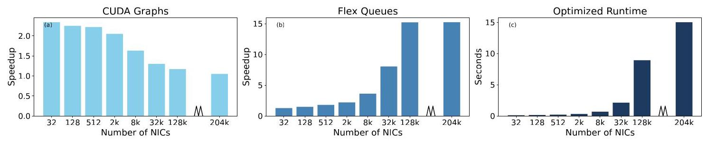

# NSX: Large-Scale Network Simulation on an AI Server 深度解读

> **作者**：Sajy Khashab、Hariharan Sezhiyan、Rani Abboud、Alex Normatov、Stefan Kaestle、Eliav Bar-Ilan、Mohammad Nassar、Omer Shabtai、Wei Bai、Matty Kadosh、Jiarong Xing、Mark Silberstein、T. S. Eugene Ng、Ang Chen。
> **发表信息**：2nd Workshop on Networks for AI Computing（SIGCOMM ’25 期间的研讨会），2025，7 页；不是 SIGCOMM 主会论文。DOI：10.1145/3748273.3749199。
> **一句话总结**：NSX 将一次大规模分组级网络仿真重构为 GPU 上的细粒度模块、局部事件队列和分散式因果推进，并通过 NVLink 扩展到单台 DGX 的多张 GPU，在报告的短时流量实验中模拟最高约 52.4 万个 NIC。

本文依据完整论文的 doc2x 文本与原图解读；下文“原文 §”指论文节号，图表沿用论文编号，读图估计及本报告计算均明确标识。论文没有单独的 Conclusion 或附录。

## 一、问题定义（Problem）

### 背景、假设与问题来源

分组级网络仿真把网络运行表示成一系列带时间戳的离散事件：一个包到达交换机入口，触发排队与转发，再经过链路到达下一设备；定时器也可以成为事件。仿真器保存 NIC、交换机和缓冲区的状态，按因果关系推进这些事件。因此，**模拟网络经过 0.1 ms，与计算机花多少秒完成仿真是两个不同的时间概念**。本文目标是缩短后一种墙钟时间，并扩大一次仿真容纳的网络规模。

AI 集群的网络设计需要研究拥塞控制、路由与拓扑，分组级模型能够保留流级近似或学习型预测不一定能保留的细节。本文用 NIC 数衡量被模拟集群规模，理由是其目标 AI 集群中每个 GPU 配有一个 NIC；因此“524k”是仿真对象中的 NIC 数，不是运行 NSX 所需的 GPU 数，也不等于包括所有交换机在内的设备总数。

这属于**在已有离散事件仿真体系上的改进性工作**。传统方法已通过 CPU 多核并行、调度优化和缓存友好的布局加速仿真，但大拓扑带来大量设备状态与分组事件，受限于线程并行度及内存访问。已有 GPU 参数扫描研究又主要把多次相近、彼此独立的实验并行运行；一次超大网络内部的节点互相依赖，无法直接套用这种独立任务并行。

NSX 的关键场景假设是数据中心拓扑具有层次性，正常情况下分组由 NIC 产生，先向上穿越网络层级，再向下到达目的端。该规律用于安排 kernel 执行顺序；论文没有证明任意含环拓扑和任意网络功能也具有相同效率。其扩展平台是具有高速 NVLink 的 AI 服务器，不能把结果直接推广到仅以普通服务器网络相连的 GPU。

### 动机是否扎实

原文 Introduction 与 Motivation 没有专门的瓶颈实测图，主要依据 AI 集群规模增长、事件处理逻辑较简单而内存压力大，以及 GPU 的 SIMT 并行与 HBM 带宽来建立动机。后文实验提供更直接的佐证：在同样基本转发功能下，CPU 基线随规模增长迅速变慢；多 GPU 的容量扩展也确实决定大拓扑能否运行。但论文没有给出 CPU 缓存失效率、GPU 带宽利用率或事件吞吐 profiling，因而“内存带宽是关键”的解释更多是架构分析，未被独立量化。


Figure 1 是背景架构图而非性能证据：左侧展示 SM、寄存器、L1/shared memory、L2 与设备全局内存，右侧展示 kernel、thread block、warp 和 thread 的层次。它说明为什么仅把 CPU 程序搬到 GPU 不够——同一 warp 内线程若执行不同逻辑，分支会降低效率；线程若访问分散状态，也难以利用合并访存。这里的 SM 片上 shared memory、设备全局内存，以及后文跨 GPU 的共享地址空间抽象是不同层面的概念。

**核心 Insight**：分组仿真虽然在全局上具有紧密因果依赖，但单个事件处理通常简单，且同类设备子模块之间有大量可并行工作；只要把计算、队列和安全时间推进都拆到适合 GPU 的局部单元，就能在保持分组级事件模型的同时利用 AI 服务器的并行度与内存系统。这一洞察把“单次仿真无法整体视为独立任务”转化为“同一阶段的同类模块可以并行，依赖通过局部状态处理”。

## 二、相关工作（Related Work）

原文 §2.1 先对比 CPU 仿真和 GPU 参数扫描，§5 再按 **CPU-centric、ML-based、GPU-centric** 三类组织研究脉络。

**CPU 仿真沿着调度与内存局部性改进。** ns3、OMNeT++ 是经典分组级工具；Unison [34] 通过细粒度、负载自适应调度改善多核同步，DONS [19] 通过负载感知分区和数据布局改善核间分配及缓存行为。它们解决了 CPU 平台上的重要问题，但不能直接提供 GPU 的大量并行线程与 HBM 访问能力。NSX 没有在实验中对比 DONS，因此不能把对 ns3、Unison 的具体倍数扩展成对所有 CPU 仿真器的结论。

**学习型方法改变了模拟方式。** MimicNet [31]、DeepQueueNet [30] 以及 §5 引用的 RouteNet 等工作使用神经网络近似网络行为，以预测换取效率。作者认为分组级细节和新设计的训练数据可得性构成边界；NSX 则继续显式处理事件。两类方法可能互补，本文没有通过预测误差实验对学习型方法作定量比较。

**GPU 研究既有通用离散事件内核，也有多实验并行。** 早期 GPU DES [13, 39] 涉及全局同步或 CPU/GPU 分工，NSX 针对网络场景，把常见执行路径放在 GPU，并利用 CUDA graphs 与跨 GPU 共享内存抽象。Multiverse [14] 优化参数扫描中的多次仿真，而 NSX 强调扩大单次仿真的规模；原文声称其规模上限分别为 54k 与 524k NIC，但这不是相同配置下的直接对照实验。§4.3 采用的是“类似 Multiverse 思路”的未优化 NSX，不是运行 Multiverse 本身。参考文献 [14] 在此文版本中标为 NSDI 2026，本文保留这一版本信息，不据此更改 NSX 的 2025 年发表信息。

## 三、技术挑战（Challenges）

1. **并行粒度与执行开销相互制约。** 整台交换机作为一个线程任务，会混入不同功能、限制并行度；拆成入口、出口等小模块后，同类工作更多，却会增加 kernel 调度和模块间通信。GPU 需要同质控制流与连续访存，这比“线程越多越快”严格得多。
2. **局部队列也可能产生昂贵的最小事件查找。** 全局优先队列会让大量线程争用；全部改用局部 FIFO 后，高扇入交换模块又必须反复检查许多输入队列头，访问地址分散，端口越多问题越重。
3. **事件顺序正确性不能由队列非空决定。** 某入口当前没有包，不意味着未来不会收到时间戳更早的包；各模块必须知道安全处理边界。交换机内部纳秒级延迟与设备间微秒级延迟并存，统一采用最小 lookahead 会拖慢整个系统。
4. **容量扩展需要适配通信粒度。** 大网络状态会超过单 GPU 内存，而跨 GPU 的事件传递是小块、分散、大小随局部进度变化的数据访问。面向大块集合通信的路径还会引入 CPU 调用及数据整理成本，可能抵消增加 GPU 的收益。

## 四、解决方案（Solution）

### 整体思路与贯穿示例

NSX 以约 13k 行代码实现四项相互配合的设计：细粒度模块在同类 kernel 中执行，模块通过局部 flex queues 交换事件，通过 minimum enqueue time（MET）传播安全处理承诺，再用 Xqueues 跨越 GPU 边界。前三项把一次仿真组织为 GPU 能高效执行的工作，第四项扩展容量与吞吐。

下面用一个**解释性示例，并非论文实验配置**贯穿设计：NIC A 与 NIC B 的包经过不同入口汇入同一交换机 S，再向上经过核心层，最终到达 NIC C。一个仿真 GPU 放 A、B 和 S，另一个放后续节点；在 S 的输入队列中，已知包时间戳分别为 12 ns、18 ns、25 ns。时间戳及后续 MET 数字仅用于说明算法。

### 1. 把设备拆成同质模块，并让 GPU 自己推进执行轮次

对应挑战 1，NSX 不让一个线程执行完整交换机逻辑，而是把设备拆成入口队列、出口队列等模块，一个模块映射到一个 SIMT 线程，同一 warp 尽量处理相同种类的模块。示例中的 S 入口与其他交换机入口一起执行，S 的转发处理再进入相应阶段；这样大量线程执行相似操作，减少分支分化。

在原文 §3.1 的 **systolic execution** 中，一轮 kernel 按 NIC、链路和交换机在拓扑中的位置依次启动，利用包“产生—向上—向下”的生命周期。模块状态按线程分配组织，尽量让 warp 内线程读取相邻内存地址，提高合并访存机会。这个顺序决定调度节奏，但不能替代下文的因果检查。

若每个小 kernel 完成后都回到 CPU 调用下一次执行，驱动调用、PCIe 往返和同步将很昂贵。NSX 用 CUDA graphs 记录控制流，首次由 CPU 启动，后续轮次在 GPU 继续，轮末通过 condition node 检查模拟时间等终止条件。示例中 A 发包、链路传递、S 处理的重复调度因此不必每一步都由 CPU 指挥。§4.3 的消融表明这在小网络最有价值，因为此时计算短、启动成本占比高。

### 2. 用局部 FIFO 承载事件，在高扇入处加优先队列

对应挑战 2，每个模块有自己的输入、输出队列，避免所有线程争用一个按时间戳排序的全局结构。FIFO 是线性结构，GPU 上维护较简单；但选出所有入口中的最早事件仍需要比较。

在示例的两个入口中，比较队列头即可选择 12 ns 的包；若 S 增长为很多入口，且一轮要处理许多包，每次处理后重新扫描全部 FIFO 会产生大量分散访问。**Flex queues** 根据扇入决定是否加入中间优先队列：高扇入场景仍以各入口 FIFO 为主要存储，但在每轮开始扫描各 FIFO，把事件放入优先队列，随后在这一轮内直接取最早事件。原文描述的是汇集事件，而非只维护各队列头的堆。

巧妙之处在于把多次分散访问转为一次汇集后的连续处理；代价是扫描、构建及维护优先队列。因此它不是在所有位置替换 FIFO，收益依赖端口数与事件量。原文未给出自动选择阈值或完整空间开销分析。

### 3. 用局部“未来最早入队时间”承诺维护因果性

对应挑战 3，局部队列之外还维护 MET：上游保证未来不会向该队列送入早于所承诺时间戳的事件。模块取全部输入的承诺下界，确定自己能安全处理到哪里，再把自己的进度加上传播延迟形成输出承诺。这是 null-message 思路的变体，但通过可共享访问的状态传播，避免发送独立时间戳消息与拓扑级集中协调。

例如，S 的两个输入给出的未来入队下界分别为 20 ns 与 35 ns，则安全边界是 20 ns；已有的 12 ns、18 ns 事件可以处理，25 ns 事件暂缓。如果输出侧 lookahead 为 5 ns，S 推进到 20 ns 后可向下游承诺 25 ns。即使某一输入当前为空，也必须看其承诺，而不能凭“没有包”无限推进。输入队列如何综合未消费事件与未来下界的完整维护细节，原文只作概述。

原文 Figure 2 是算法伪代码，下面按其逻辑转写，变量名略统一：

```text
ProcessEvents(module m):
    met = GetMET(m.input_queues)        // 输入队列的最小安全边界
    ev  = GetNextEvent(m.input_queues) // 当前最早的输入事件
    while ev exists and ev.time <= met:
        m.current_time = ev.time
        EventHandler(ev)
        ev = GetNextEvent(m.input_queues)
    m.current_time = met
    promise = m.current_time + LookAheadValue
    SetMET(m.output_queues, promise)
```

这段代码的关键不是仅比较事件大小，而是循环结束后也把局部时间推进到已知安全边界，再传播承诺。相比整个网络都使用最小链路延迟，各模块可按自己的局部下界前进；但所有必要的同步并未消失，局部状态的可见性和更新顺序仍须正确。论文没有给出完整并发正确性证明、同时间戳事件的 tie-breaking 规则或所有零延迟环的处理细节，不能由简短伪代码推导出这些保证。

### 4. 把跨 GPU 通信变为设备端单边访问

对应挑战 4，NSX 默认把节点与链路均匀分布到各 GPU，并标记跨 GPU 队列。示例中从 S 发往下一张仿真 GPU 的事件不必先回到 CPU 打包，再调用 NCCL 传输；其 Xqueue 通过 NVSHMEM 分配底层存储，利用 NVLink 上的跨 GPU 内存访问抽象执行设备端发起、完成的 get/put。

这让分散的小块事件免去传统消息整理和 NCCL 上下文设置开销。对上层模块而言仍然是在传播事件，但 Xqueue 的底层访问采用单边操作，不能把它理解为普通本地队列“自动零成本远程化”。§4.1 中跨 GPU Xqueue 操作仍占总执行时间的 10%–25%；原文也没有报告跨多台 DGX 的实现与性能。

### 与已有方案的关系及边界

四项设计共同服务于单次大网络仿真，而不是简单增加独立实验数量：同质模块解决 GPU 执行效率，flex queues 解决高扇入访存，MET 解决依赖约束，Xqueues 解决单卡容量。这些方法依赖网络结构、GPU 编程和 NVLink/NVSHMEM 平台；通用脚本接口在 §6 中仍是未来方向，不能把现有成熟仿真工具的可编程性直接归于 NSX。

## 五、实验评估（Experiments）

### 实验设定

| 项目 | 原文设置及阅读边界 |
| --- | --- |
| 执行平台 | 单张 A100；单台配 8 张 H100 的 DGX；CPU 对照为 32 核 AMD EPYC、250 GB DRAM |
| 默认网络 | 100 Gbps 链路；三级 Fat-tree 或两级 leaf/spine |
| 工作负载 | 0.1 ms 的 bisection traffic，每个 NIC 以满线速向穿越整个网络层级的另一 NIC 发送 |
| 规模单位 | 被模拟网络的 NIC 数，不是运行仿真的物理 GPU 数 |
| 基线 | ns3、Unison；禁用相关优化的 NSX；NCCL 通信版本仅作文字说明 |
| 公平性处理 | CPU 比较使用同一流量生成器、相同流数与包大小，统一为基本转发，并关闭 NSX 的 adaptive routing、weighted ECMP 等功能 |
| 主要指标 | 墙钟执行时间、速度提升、可容纳 NIC 数、跨 GPU 操作时间占比、真实集群队列占用的中位数与 P99 |

论文没有交代所有复现所需细节，例如完整软件版本、流量包大小数值、重复运行次数、置信区间以及各实验的全部内存配置。该 workload 是短时合成网络压力流量，不是完整 LLM 训练轨迹或端到端训练任务。

### 1. 多 GPU 同时提高速度和可运行规模


Figure 3 的横轴是 131k、294k、524k NIC，纵轴是秒；不同颜色表示仿真实际使用的 GPU 数。131k 可在单卡运行，294k 的单卡配置内存不足，524k 的单卡和双卡配置内存不足。**524k 在 4 卡已经能运行，8 卡把其时间进一步降到约 1.95 秒**（读图估计）；因此不能将图解读成“只有 8 卡才能装下 524k”。

原文 §4.1 报告每次加倍 GPU 数带来 65%–95% 的性能提升，结合图中时间变化，应理解为速度/吞吐约变为 1.65–1.95 倍，而不是运行时间减少 65%–95%；换算对应时间约下降 39%–49%（本报告计算）。跨 GPU Xqueue 占总时间 10%–25%，说明扩展并非无通信成本。NCCL 版本随多 GPU 扩展反而变慢，但正文没有给出其独立曲线或具体耗时，证据粒度弱于 Figure 3。

摘要与 Introduction 所称“少于 2 秒完成 0.1 ms 仿真”，属于短仿真窗口下的墙钟性能；按 2 秒参考值计算，墙钟与模拟时间比约为 20,000:1，并非实时模拟。

### 2. 对 CPU 基线的数量级加速有明确测试范围


Figure 4 的纵轴为对数刻度，不能按柱高线性理解倍数。CPU 两基线随拓扑增长陡增，单张 A100 上的 NSX 保持较短时间，并在该 Fat-tree 实验达到 128k NIC；图中红叉在这里表示超时，而非 Figure 3 中的显存不足。

| 被模拟规模 | 原文报告的性能关系 |
| --- | --- |
| 1,024 NIC | NSX 比 Unison 快 130×，比 ns3 快 9,000× |
| 8,192 NIC | NSX 比 Unison 快 60,000× |
| 超时边界 | 超过 1,024 NIC 的 ns3、超过 8,192 NIC 的 Unison 超过 10⁴ 秒阈值 |
| NSX 最大点 | 单 A100 的本组 Fat-tree 实验达到 128k NIC |

这些结果强力支持“所测基本转发场景中，重新设计的 GPU 仿真可以大幅快于这两个 CPU 基线”。但 CPU 与 GPU 硬件不同，结果综合了算法、实现和平台因素；没有等价格、等功耗或同样硬件预算的对照，不能把倍数解释为纯软件优化收益或经济性收益。

### 3. 两种 GPU 优化在不同规模发挥作用



Figure 5 在单张 A100 上测两级 leaf/spine，规模通常每次增至 4 倍，最后单独测最大点 204k NIC。图 (a) 中 CUDA graphs 在小规模约有 2.2×–2.3× 收益，到 204k 仅约 1.05×；图 (b) 中 flex queues 从小规模约 1.2× 增至 128k、204k 时约 15×。这些数值是读图估计，不是正文精确报数。

两种趋势对应不同瓶颈：小规模 kernel 短，控制流启动占比高；较大拓扑需要更高端口数交换机，高扇入事件查找开销更突出。图 (c) 最终 204k NIC 约需 15 秒，正文表述为 **16 秒以内**。这不与前一组单卡 128k 的上限矛盾，因为两组使用不同拓扑。图 (a)(b) 的具体基线组合描述较简略，不应把两个峰值直接相乘作为论文实测总加速比。

### 4. 真实集群验证：绝对差较小，不代表所有相对误差都小

原文 §4.4 模拟 576 NIC 的实际集群，即 72 台服务器、每台 8 GPU，三级网络、400 Gbps 链路；每 200 μs 采样一次队列占用。下面完整转写 Table 1，单位均为 KB：

| 队列 | P99：真实 / NSX | 中位数：真实 / NSX |
| --- | ---: | ---: |
| Leaf (Down) | 33 / 40 | 8 / 15 |
| Leaf (Up) | 92 / 85 | 26 / 30 |
| Spine (Down) | 88 / 84 | 25 / 29 |
| Spine (Up) | 88 / 84 | 26 / 29 |
| Core (All) | 83 / 83 | 25 / 29 |

作者据此判断不同网络层级的模拟占用紧随真实情况。表内 P99 和中位数的绝对差都不超过 7 KB；但 Leaf Down 中位数从 8 KB 到 15 KB，按真实值作分母相对误差为 **87.5%**，该行 P99 的相对误差约 **21.2%**（均为本报告计算）。所以更准确的结论是“这些队列统计量在绝对量上接近”，而非所有队列都有很低相对误差。

### 结论支撑性与缺口

本文较有力地验证了容量扩展、基本转发性能，以及两项 GPU 优化的作用；真实集群结果也提供一定保真度证据。但验证只有一个 576 NIC 集群和少量占用统计量，未覆盖流完成时间、丢包、完整队列分布、不同拥塞控制与路由策略的误差。仿真规模达 524k 也不等于已在同规模真实系统验证准确性。

此外，性能实验的 0.1 ms 窗口短于真实集群验证的 200 μs 采样间隔；两者显然不能未经说明视为同一条实验轨迹。论文没有明确给出验证实验的持续时间、样本数或完整流量参数。MET 同步与模块粒度也没有独立消融，因此四项设计的每一项都必要、各自贡献多大，仍未被完整实验拆分。

## 六、附加洞察（Side Findings）

以下只保留未被前文技术与实验主线展开的两项次要判断；本文较短，不为满足数量而将性能结果或未来计划重复归入本节。

**结论 1：学习型模拟的发展并没有消除对分组级模拟数据的依赖。** 出处：原文 §2 第 1 自然段、§5 “ML-based simulation” 自然段。作者的推理是：神经网络预测依赖训练样本，而部分样本来自分组级模拟；新网络设计又缺少现成训练数据，所以至少在建立模型与研究新设计时，精确模拟仍是基础工具。这说明 GPU 仿真器还可能作为预测方法的数据生产端，而不只是与其竞争。论证是方法依赖关系分析，没有对所有学习型模拟器的数据来源作系统统计，不能扩大成“所有模型都必须由 NSX 训练”。

**结论 2：在已经部署 AI 服务器且存在空闲时段的集群中，作者判断仿真的主要新增成本可能是能耗。** 出处：原文 §6 条目 (2) “Simulation cost”。推理链条是：仿真占用算力会挤占训练资源，但作者认为 AI 工作负载不会一直占满所有服务器；若利用已有设备空闲时间，额外购置硬件不再是主要成本，于是其成本判断转向能耗。这里是原文明确给出的、有条件的经济性判断，不是已通过实验验证的结论；论文没有提供利用率曲线、电表数据或排队机会成本测量。紧接着提出的云租赁性价比研究属于 future work，不能当作此结论的支持证据。

## 七、总结与个人评价（Wrap-up）

NSX 的贡献在于把单次分组级仿真的计算粒度、事件数据结构、因果同步与多 GPU 通信一起改造成适合 AI 服务器的执行方式。其最大亮点是系统设计能同时解释小规模启动成本、高扇入访存成本和大规模容量限制，而实验显示这一组合可以达到数十万 NIC 的规模。

最大的不足是性能结果集中于短时合成流量和基本转发，准确性验证的规模与指标较窄，尚不足以证明复杂 AI 训练网络的广泛保真度。后续最值得补充的是长时间、真实通信轨迹下的误差与吞吐评测，以及同步机制的独立消融；跨多台服务器和面向非 CUDA 专家的编程接口则是作者明确提出、尚未在本文完成的方向。

## 八、章节脉络与段落速览（Structure Map）

以下按原文章节与自然段组织，段号在各节或小节内重新计数；跨栏分页造成的断裂合为同一自然段，Figure 2 代码并入其解释段，图注、版权信息和参考条目不当作正文自然段。

- **Abstract**：概括 AI 服务器上的分组级仿真动机、设计与当前规模。
  - ¶1 说明 GPU 工作负载契合性、524k 节点的原型能力及 NVIDIA 内部应用。
- **ACM Reference Format**：提供作者、题名、2025 年研讨会、页数与 DOI 的正式引用信息。
  - ¶1–2 列出论文署名及研讨会出版信息。
- **1 Introduction**：从 AI 网络扩张引出单次仿真扩展问题，并预告四项设计。
  - ¶1 指出 AI 网络创新依赖分组级仿真而现有仿真器速度与规模不足。
  - ¶2 区分传统 CPU 仿真、学习型预测和参数扫描与单次大网络仿真的问题。
  - ¶3 从事件处理复杂度、并行性和状态内存压力解释 GPU 的潜在契合性。
  - ¶4 结合 DGX 硬件与 CUDA 生态提出利用 AI 服务器重构仿真的方向。
  - ¶5（Execution model）介绍细粒度模块、拓扑顺序执行与控制流卸载。
  - ¶6（Event queues）说明以 FIFO 与优先队列组合处理模块通信。
  - ¶7（Event causality）说明因果顺序通过局部协调维护。
  - ¶8（Transparent scaling）说明跨 GPU 小块事件传输为何改用共享内存抽象。
  - ¶9 报告原型规模、速度及 NVIDIA 工程使用情况。
- **2 Motivation and Background**：解释分组级模拟的价值及 AI 网络对模拟规模的需求。
  - ¶1 区分离散分组事件与粗粒度或学习型模拟，并说明其数据基础作用。
  - ¶2 说明链路提速、集群增长与未来网络设计共同加重仿真瓶颈。
  - **2.1 Recent Work and Limitations**：界定 CPU 优化与 GPU 参数扫描留下的缺口。
    - ¶1 概括 CPU 并行调度和缓存优化及其平台限制。
    - ¶2 解释 Multiverse 的独立参数实验与单一紧耦合网络的差别。
  - **2.2 NSX: Scaling Simulation on AI Servers**：介绍 GPU 执行基础及重构仿真的必要性。
    - ¶1 介绍 AI 服务器、SM、warp 与 SIMT，并由 Figure 1 展示架构。
    - ¶2 说明通用 CUDA kernel 与利用空闲 AI 服务器运行模拟的可行性。
    - ¶3 归纳线程分化、CPU kernel 启动和复杂内存层次带来的设计约束。
- **3 NSX Design**：以四个部分描述约 13k 行代码的系统架构。
  - ¶1 列出模块组织、事件传递、因果同步与多 GPU 扩展四项技术。
  - **3.1 Execution Model**：让模块划分、执行顺序与控制流适配 GPU。
    - ¶1 说明细粒度模块到 SIMT 线程的映射如何减少分支分化。
    - ¶2（Kernel launch order）利用网络层次安排执行顺序并组织合并访存。
    - ¶3（Control flow offloading）利用 CUDA graphs 和条件节点减少 CPU 干预。
  - **3.2 Event Queues**：用局部队列与按扇入选择的数据结构降低事件处理成本。
    - ¶1 说明模块局部队列如何缓解全局队列争用并改善通信局部性。
    - ¶2 分析按时间戳选取事件的需求及 GPU 上优先队列维护成本。
    - ¶3（Flex queues）指出 FIFO 在高扇入交换模块中反复查找最早事件的代价。
    - ¶4 说明按轮次将 FIFO 事件汇入中间优先队列的 flex queues 设计。
  - **3.3 Event Causality**：以局部安全时间承诺替代集中式保守同步。
    - ¶1 解释 lookahead 与传统统一安全时间窗口。
    - ¶2（Decentralized causality synchronization）指出全局协调争用和不同模块时延差异的限制。
    - ¶3 说明 MET 承诺在模块和相邻队列之间传播的分散算法。
    - ¶4 结合 Figure 2 说明安全事件处理循环与输出承诺更新。
  - **3.4 Transparent Scaling**：让跨 GPU 的事件队列适配分散小块通信。
    - ¶1 说明均匀分区及 NCCL 在动态、离散事件传输中的不匹配。
    - ¶2（Cross-GPU event queues / Xqueues）解释 NVSHMEM 与 NVLink 上设备端单边访问的机制。
- **4 Evaluation**：从扩展性、CPU 对比、GPU 优化和真实集群四方面评估。
  - ¶1 定义平台、链路速率、NIC 规模单位、流量窗口与拓扑。
  - **4.1 Scalability**：评估多 GPU 的速度与容量扩展。
    - ¶1 结合 Figure 3 报告扩展收益、Xqueue 占比、NCCL 局限和最大规模。
  - **4.2 Comparison against CPU simulation**：对齐基本功能后比较 CPU 与 GPU 实现。
    - ¶1 说明 ns3、Unison 基线以及流量和设备逻辑的对齐方式。
    - ¶2 结合 Figure 4 报告硬件、超时边界、可运行规模与加速倍数。
  - **4.3 GPU-centric optimizations**：通过 Figure 5 分析两项 GPU 优化。
    - ¶1 说明消融设置、两种优化随规模相反的收益趋势及最大拓扑耗时。
  - **4.4 Cluster validation**：将模拟队列统计与真实网络测量比较。
    - ¶1 说明 576 NIC 集群、采样方式及 Table 1 的占用对照结论。
- **5 Related Work**：按 CPU、机器学习和 GPU 三类定位 NSX。
  - ¶1（CPU-centric network simulation）对照 Unison、DONS 等 CPU 调度和布局方法。
  - ¶2（ML-based simulation）分析学习型近似的保真度与训练数据依赖。
  - ¶3（GPU-centric simulation）对照早期 GPU DES 和 Multiverse 的设计目标与规模。
- **6 Future Work**：从实际使用出发提出扩展、成本与编程接口方向。
  - ¶1 说明 NVIDIA 网络团队已将 NSX 用于多种 AI 网络功能研究。
  - ¶2（1. Cross-DC training）提出跨服务器或更大 NVLink 系统的扩展方向。
  - ¶3（2. Simulation cost）讨论利用空闲算力的成本判断及云租赁性价比研究。
  - ¶4（3. Simulation programming）提出面向开发者的模块组合接口。
- **References**：共 40 条参考条目，覆盖离散事件同步、CPU/GPU 仿真、学习型网络建模与 GPU 平台资料。
  - [1]–[40] 已完整阅读，用于核对方法归属与引文版本，不逐条重复书目信息。
