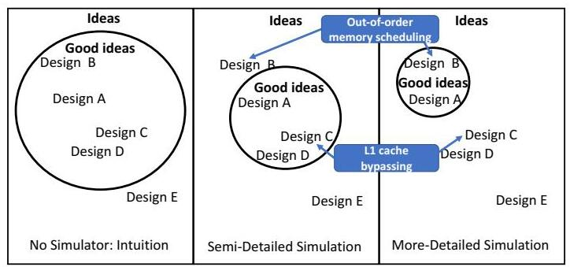
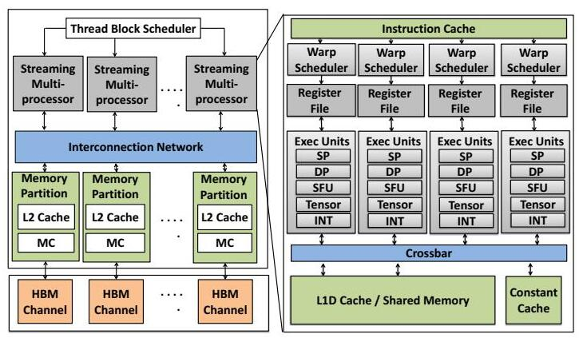
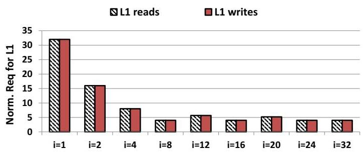
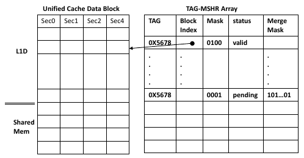
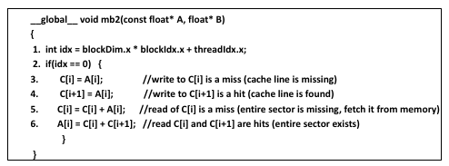
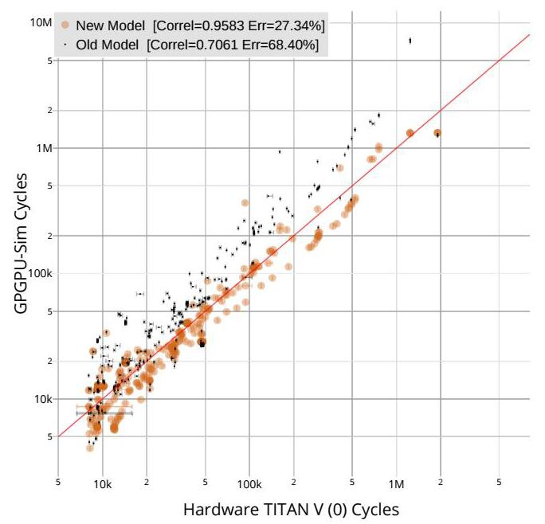
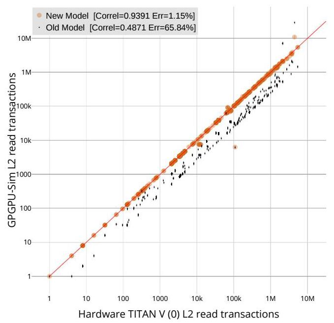
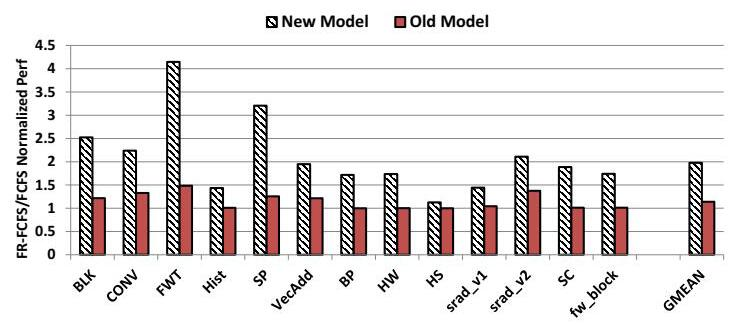
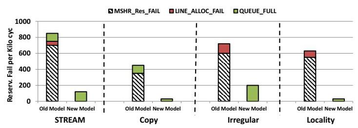
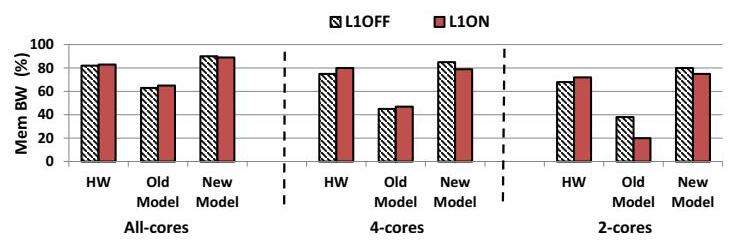

# Exploring Modern GPU Memory System Design Challenges through Accurate Modeling 深度解读

> **作者**　Mahmoud Khairy、Jain Akshay、Tor Aamodt、Timothy G. Rogers（依 PDF 首页署名顺序）  
> **版本**　arXiv:1810.07269v1，2018 年 10 月 16 日，cs.AR。[论文原文](https://arxiv.org/abs/1810.07269v1)  
> **一句话总结**　作者逐层重建 GPGPU-Sim 的 Volta 存储系统，使 TITAN V 执行周期的平均绝对百分比误差由 68.40% 降至 27.34%，同时发现旧模型高估了绕过 L1 的收益，也低估了 DRAM 调度的价值。

## 一、问题定义

架构师常用模拟器筛选尚未造出的硬件设计。一个 GPU 的流式多处理器（SM）同时运行许多以 32 个线程为一组的 warp。访问显存时，硬件先将线程的地址合并成事务，再经 SM 的 L1、各存储分区的 L2 到达 DRAM。大量 warp 可以交错等待，因此缓存的重要作用之一是过滤下层流量。即使模拟器填入正确的核心数和峰值带宽，一条指令生成多少事务、事务何时分配缓存位置、写入会不会引发额外读取，仍会决定瓶颈落在哪一层。

这是对既有模拟方法的改进。公开的 GPGPU-Sim 3.x 原本面向 Fermi，常见做法是扩大资源配置来模拟更新的 GPU。作者统计，此前四年顶级体系结构会议平均每年约 20 篇 GPU 设计论文，其中约 80% 使用 GPGPU-Sim。这说明基线影响范围大。更直接的动机来自表 I，同一张 TITAN V 上旧模型的 L2 读请求误差为 66%，DRAM 读请求误差为 89%。原图 1 示意这种误差的研究代价，同一个设计可能被提前放弃，也可能因虚高的收益占用后续验证时间。图中的集合是概念示意，两个具体案例的证据在第 V 节。

**核心洞察**　在存储层次中，上一层产生的事务流就是下一层调度器看到的工作负载。如果请求大小和写缺失行为有误，改进某个模块的收益也会跟着变。把每层的事务、命中和最终周期逐项对照真机，可以追踪这种偏差的来源，而单个运行时间可能掩盖相互抵消的误差。

## 二、相关工作

- **整机模拟与程序观测。** Multi2Sim 的 Kepler 模型、ATTILA、MacSim、gem5-gpu、gem5 的 AMD GCN 模型以及 MIAOW 分别覆盖不同代际、ISA 或实现层次。SASSI 能插桩观察机器指令。它们提供了实现或测量手段，本文要解决的是另一个具体缺口，即以足够多的真实内核验证 Volta 各级存储行为。
- **微基准逆向。** 从 Tesla GT200、Fermi、Maxwell 到 Volta，前人已测得容量、组相联度、替换和索引等属性。作者直接采用已有 Volta L1 时延、索引、组数和行大小测量，再追问运行时策略，例如不完整扇区的后续读取是否需要访问显存，以及共享内存容量变化后能保留多少未完成请求。
- **模拟器误差诊断。** 既有研究指出 GPGPU-Sim 的核内时延、L1 吞吐和 MSHR 数量有偏差，Pascal 对照实验又将多数误差指向存储系统。本文继而修改模拟器代码，检验修复能否同时改善多层计数，并对照改动前后同一架构优化的收益。文中也提到基于内部 Pascal 模拟器的研究，其模型难以供外部逐项复核。

## 三、技术挑战

1. **从外部计数识别内部粒度。** 连续的线程访问产生四个请求，既可能对应四条小缓存行，也可能对应大行内的四个扇区；两种组织对替换和未来命中的预测不同。还需单独测量逐出粒度。
2. **区分数据容量、并发缺失与带宽。** 统一 SRAM 同时服务 L1 和程序显式分配的 shared memory。若假设每个尚未返回的缺失都占一个数据槽，缩小 L1 就会人为限制在途请求，模拟器可能把 DRAM 无法吃满归咎于 L1。
3. **还原写入的下游代价。** 线程可以只写一个字节，L2 收到的读请求却以 32 B 扇区为单位。要判断哪些旧字节必须取回，还需考虑读和写的顺序、首个内核之前的主机拷贝，以及存储分区收到请求的先后。
4. **建立可比的观测口径。** 硬件运行机器码 SASS，本文模拟器执行 PTX。短内核周期波动、分析器对“命中”的定义和小样本百分比误差都会影响比较；硬件内部控制逻辑也不能从单一计数器唯一反推。

## 四、解决方案

**整体思路。** 作者保留与目标 GPU 对齐的资源规模，结合公开文档、专利、已有测量和新微基准逐层修改请求处理规则，最后用真实程序校验。原图 2 展示了请求经过的硬件边界。一个 SM 有四个带独立寄存器文件和执行单元的子核，共享合并器和 L1/shared memory。多个 SM 通过互连访问分布在存储侧的 L2 与 HBM 通道。这样一来，某个 warp 的几个地址如何分组，会影响共享 L1 的压力，也会改变内存控制器能重新排序的请求集合。

**贯穿示例。** 设一个 warp 从对齐的连续数组读取 32 个相邻的 float，随后只有一个线程更新另一个冷扇区中的一个 float，稍后另一个 warp 再读该位置。以下例子把原图 3–6 测得的机制串起来，各阶段的访问条件是为说明机制而设。

1. **合并和扇区。** 前 32 个 float 共 128 B。模型按每 8 个线程分别合并，在连续对齐条件下产生四个 32 B 扇区请求。原图 4 将每组连续地址的线程数从 1 调到 32，访问离散时每 warp 有 32 次请求，连续时仍有 4 次。另一项填满缓存、逐出一项再访问的实验测出逐出粒度为 128 B。两者合起来支持“128 B 行中有四个 32 B 扇区”。绕过 L1 重测，L2 也表现出类似粒度。

2. **允许在途缺失等待填充。** 若例中多个 warp 紧接着读同一个尚未返回的扇区，模型为未完成事务保存状态并合并等待者，数据返回时才分配数据位置（allocate-on-fill）。作者假设 tag 和 MSHR（记录未完成缺失的结构）的合并功能位于独立表中。有效项提供数据块索引，等待项用位图标出等待的 warp。驱动按内核显式共享内存需求，在 128 KB 统一存储中选择 0、8、16、32、64 或 96 KB 给共享内存，余量作 L1；模型可以在减少数据槽位时保留跟踪未完成访问的能力。独立表的具体布局是作者提出的行为实现，微基准直接支持的是并发能力对所分配 L1 容量不敏感。
   

3. **把读旧值推迟到确实需要时。** 单线程向冷扇区写一个 float 后，L2 可为四个字节设置写掩码，无须立刻读回整行。若稍后 warp 读这个地址，合并器向 L2 请求整个 32 B；掩码未满，此时模型才从下层取回缺失字节并合并。再读同扇区的相邻 float 就能命中。若此前的写已覆盖全部字节，读可以直接满足。这就是作者命名的 *lazy fetch-on-read*。原图 5 的单线程实验用写后第一次读缺失、再次读命中区分了“每次写缺失立即取回”和“已写的个别字节足以应答读”两种预测。
   

4. **让控制器看到较接近真机的流量。** 主机向设备拷贝会经过 L2，模型因此允许内核启动前已有缓存数据；地址映射用异或分散对存储分区的集中访问。继续向下，模型加入 HBM 的双总线、按 bank 刷新、bank 索引和独立读写缓冲。例中冷扇区只在需要时引发读取，控制器实际可调度的读写序列随之改变。相较于仅扩大 Fermi 配置，这些改动能够同时改变请求**数量、粒度和到达顺序**。各项改动共同生效，完整实验未逐一分离每项贡献。

## 五、实验评估

**设定。** 真机为 80 SM 的 NVIDIA TITAN V，分析器为 nvprof 10.0。旧基线采用只扩展配置参数的 GPGPU-Sim 3.x，新模型修改代码并使用 Volta 子核和存储模型。表 II 中两者均以 4.5 MB L2 和 652 GB/s 目标显存带宽建模。两者均运行 CUDA 10、面向 sm_70 的 PTX。作者纳入能在模拟器中运行的八组负载，涵盖原 GPGPU-Sim 应用、Rodinia 3.1、CUDA SDK、Parboil、Pannotia、Lonestar、SHOC 和 DOE proxy apps，共超过 1,400 个不同的内核启动。单项散点图至多约 1,200 个内核，每个内核各有两个模型的数据点。Correlator 另提供适合模拟的输入、CUDA 4.2–10.0 的构建工作流和五代 NVIDIA GPU 的硬件数据；本文的逐项验证对象是 TITAN V。

**逐层对照。** 下表保留表 I 的整数或一位小数口径。误差衡量数值偏离，相关性衡量跨内核的共同变化。旧模型的 L2 写次数与硬件的相关性已达 99%，平均误差仍有 56%，说明只看趋势会漏掉系统偏差。

| 指标 | 旧模型平均绝对误差 | 新模型平均绝对误差 | 旧 → 新相关性 |
| --- | ---: | ---: | ---: |
| L1 请求 | 48% | 0.5% | 92% → 100% |
| L1 命中率 | 41% | 18% | 89% → 93% |
| L2 读事务 | 66% | 1% | 49% → 94% |
| L2 写事务 | 56% | 1% | 99% → 100% |
| L2 读命中次数 | 80% | 15% | 68% → 81% |
| DRAM 读事务 | 89% | 11% | 60% → 95% |
| 执行周期 | 68% | 27% | 71% → 96% |

原图 7 横轴是真机周期，纵轴是模拟周期，横向误差条表示连续 10 次真机运行的范围。为降低短内核噪声，只统计真机至少运行 8,000 周期的内核。橙点更接近对角线，平均绝对误差从 68.40% 降至 27.34%，约缩小 2.5 倍。仍有明显偏离的内核。摘要的“最高 66 倍”是作者对部分计数器的概括；表 I 的 L2 读由 66% 降至 1%，原图 10 图例给出的更细数值为 65.84% 和 1.15%，四舍五入影响倍率，不宜把 66 倍套用到全部指标。

原图 10 的旧模型点形成一条偏离对角线的斜带，新模型点明显收拢，符合事务粒度修正后的预测。原图 11 的 L2 读命中误差仍为 15.45%，说明总次数吻合以后，访问顺序与冷热状态仍重要。DRAM 对照只保留至少 1,000 次 DRAM 访问的内核；原图 12 的图例给出 89.19% → 11.02%，表 I 也写 11%，但 IV-D 正文另写 15%，本文按图例与表 I 报告并保留这一差异。

**案例一，DRAM 调度。** FCFS 按请求到达顺序服务，FR-FCFS 优先服务可利用已打开行的请求，并考虑先后顺序。原图 13 的每组柱都以所在模型自身的 FCFS 为基准。旧模型平均约快 20%，新模型平均约为基线的 2 倍。作者将差异归因于合并、扇区访问和写分配共同改变了控制器输入。不同工作负载的收益差异很大，这组实验直接说明**模型选择改变模拟所得收益**；它没有在 TITAN V 上实测可替换的两套调度器。

**案例二，L1 吞吐。** 原图 14 将失败拆成 MSHR 预留、数据行分配和队列已满三类。在新模型的示例负载上，前两项不再主导，仍可看到队列已满造成的失败。原图 15 保持显存带宽配置不变，减少活跃 SM，真机在全核、4 核和 2 核时分别达到理论带宽的约 82%、75%、68%。旧模型在 2 核下打开 L1 明显降低吞吐，真机和新模型中开关 L1 的差异都小得多。这直接检验了 STREAM 的瓶颈归属。它支持重新评估依赖旧 L1 争用的优化，对其他访问模式和其他芯片仍需分别检验。

**证据边界。** 八组负载和分层计数比只对齐平均周期更有辨识力，但样本受可模拟性筛选，计时与 DRAM 统计又各有门槛。多项硬件机制一起更新且包含执行单元调整，整体周期改善不能精确分摊给某一项。27% 的周期误差也意味着，若新想法只带来少量收益，仍须检验目标内核与相关计数的吻合程度。

## 六、附加洞察

**分析器记录一次 L1 命中，指令仍可能等待 L2。** 在 III-A、IV-B 与 IV-C 的微基准和对照中，若 128 B 行的 tag 已在 L1，所需扇区未驻留，分析器仍可能记作命中，但相应扇区会继续向 L2 发请求。L1 命中率误差仍近两成，L2 读事务误差却只有 1.15%，与“部分偏差来自记账口径”的解释相符。它没有量化所有残差中这一原因的占比。

**主机拷贝会改变短小数据集的初始命中行为。** IV-C、原图 11 指出，旧模型里有一批内核的 L2 读命中显著低于实测。它们包括数据集小、启动前已由 CPU 拷入数据的内核。把拷贝引擎经过 L2 的填充纳入模型，就避免了把本可命中的访问当作冷缺失，解释了许多偏低的点。

**硬件给出的比值也需要检查分子、分母是否可用。** IV-C 中分析器报告的部分 L2 读命中率超过 100%，作者因此改用读命中次数来与模型比较。这个观察决定了表 I 的 L2 Read Hits 应读作次数，不能拿来与 L1 Hit Ratio 直接比较。

## 七、总结与评价

这篇论文最有说服力的是两组方向相反的案例。同样是提高模型细节，内存调度显得更值得研究，绕过 L1 却少了原先看似可观的收益；STREAM 的真机开关对照尤其能区分这两种 L1 行为。最大的局限是从端到端吻合到内部机制仍有距离。推定的 TAG–MSHR 组织、成组加入的多项优化和 PTX/SASS 差异都留下了可替代解释。若要沿用本文结论研究另一代 GPU，最有价值的复核是先测它的请求粒度、写后读和缓存开启／绕过曲线，再判断哪些基线假设可以移植。

## 八、章节脉络与段落速览

段号按各节或小节内的自然段重新计数，跨栏续段合并，图表、脚注和贡献列表归入对应段落。

- **Abstract**　摘要从总体精度转向设计判断与工具产出。
  - ¶1 作者以 TITAN V 的分层计数和周期衡量增强模型的精度。
  - ¶2 两组设计案例引出提高模拟细节的必要性和 Correlator 的用途。
- **I. INTRODUCTION**　从模拟筛选设计的风险引出存储建模任务。
  - ¶1 模拟误差可能让架构师过早放弃好设计或保留弱设计。
  - ¶2 GPGPU-Sim 在 GPU 研究中的普及使基线误差具有广泛影响。
  - ¶3 前人定位的存储偏差推动逐模块重建，表 I 概括结果。
  - ¶4 公开资料和逐项验证共同揭示多项未明确记载的缓存行为。
  - ¶5 两项设计案例说明模型变化怎样改变优化判断。
  - ¶6 贡献列表归纳模型、设计案例、逆向观察和验证工具。
- **II. EXPERIMENTAL SETUP**　交代 Volta、模拟实现及负载来源。
  - ¶1 说明四个子核如何经共享访存单元发出请求。
  - ¶2 描述统一缓存的自适应容量分配及 SM 到 HBM 的连接。
  - ¶3 对照仅缩放 Fermi 参数的旧配置与依赖代码变更的新模型。
  - ¶4 概述缓存、拷贝引擎、分区寻址和显存控制器的修改。
  - ¶5 列出八组工作负载、编译目标和内核覆盖范围。
- **III. EXPLORING THE VOLTA MEMORY SYSTEM**　用小程序分离几个容易混淆的存储机制。
  - ¶1 将 GPU 缓存定位为带宽过滤器，并指出既有逆向结果留下的空白。
  - **A. Volta Memory Coalescer**　用地址排布和逐出实验区分合并与替换粒度。
    - ¶1 原图 3 的参数控制一个 warp 会访问多少条不同缓存行。
    - ¶2 计数、逐出和绕过 L1 三项测量共同刻画分组和扇区行为。
  - **B. L2 cache**　用部分写后的读序列识别 L2 写分配策略。
    - ¶1 原图 5 的命中和缺失顺序支持延迟到读时补全扇区。
  - **C. Streaming Throughput-oriented L1 cache**　把流式缺失处理归纳成可模拟的内部组织。
    - ¶1 并发缺失的容量特征启发了填充时分配和独立 TAG–MSHR 表的假设。
- **IV. HARDWARE CORRELATION**　逐项对照模拟器与 TITAN V 的计时和计数。
  - ¶1 说明散点、两套模型、PTX 执行方式和选择 PTX 的理由。
  - ¶2 给出先看总周期、再看各层计数的分析顺序。
  - **A. Overall Cycle Correlation**　检验整机时序是否随模型一起改善。
    - ¶1 原图 7 给出重复测量区间、内核门槛和执行周期误差。
  - **B. Correlating the L1**　分别检验 L1 收到的请求及计为命中的比例。
    - ¶1 交代默认开启 L1、自适应容量及固定标签资源等设定。
    - ¶2 原图 8 将请求数的偏差与合并和扇区粒度相联系。
    - ¶3 原图 9 讨论分析器命中口径及替换、调度带来的残差。
  - **C. Correlating the L2**　区分事务总量和命中次数的误差来源。
    - ¶1 原图 10 的高吻合度表明部分 L1 命中偏差没有传导到 L2 读流量。
    - ¶2 旧模型的系统性偏差与传输粒度有关，写事务也呈类似趋势。
    - ¶3 原图 11 以命中次数规避异常比值，并讨论调度与拷贝预热的影响。
  - **D. Correlating DRAM**　追踪旧模型为何从 DRAM 读入过多数据。
    - ¶1 原图 12 将偏高的读流量追溯到写缺失取整行，并交代小计数过滤条件。
- **V. DESIGN DECISION CASE STUDY**　用两类优化检验模型选择是否会改变设计取舍。
  - ¶1 并列提出需要重新检验的 L1 吞吐和显存调度问题。
  - ¶2 原图 13 对比两种模型中乱序调度相对先来先服务的收益。
  - ¶3 原图 14–15 用预留失败和 STREAM 带宽对照定位 L1 争用。
- **VI. RELATED WORK**　从工具谱系与误差诊断定位本文贡献。
  - ¶1 回顾不同 GPU 代际的模拟器、插桩工具和微基准。
  - ¶2 概述 GPGPU-Sim 已知缺陷，以及单纯缩放配置缺乏验证的问题。
  - ¶3 作者将逐层验证的 Volta 开源模型与已有内部模型区分开来。
- **VII. CONCLUSION**　总结精度、架构决策和验证基础设施三项结果。
  - ¶1 更细致的存储行为模型缩小了执行时间误差。
  - ¶2 两项案例显示旧模型分别低估调度收益、高估 L1 争用。
  - ¶3 Correlator 为后续硬件与模型的重复验证提供基础设施。
- **REFERENCES**　文献 [1]–[55] 涵盖模拟方法、GPU 逆向、硬件资料、基准套件、缓存及 DRAM 调度。
