# Exploring Modern GPU Memory System Design Challenges through Accurate Modeling

Mahmoud Khairy*, Jain Akshay*, Tor Aamodt ${}^ \dagger$ , Timothy G. Rogers *

> 
Mahmoud Khairy*、Jain Akshay*、Tor Aamodt ${}^ \dagger$、Timothy G. Rogers *


*Electrical and Computer Engineering, Purdue University

> 
*普渡大学电气与计算机工程系 (Electrical and Computer Engineering)*


\{abdallm, akshayj, timrogers\}@purdue.edu

> 
\{abdallm, akshayj, timrogers\}@purdue.edu


${}^ \dagger$ Electrical and Computer Engineering, University of British Columbia

> 
${}^ \dagger$ 不列颠哥伦比亚大学电气与计算机工程系


aamodt@ece.ubc.ca

> 
aamodt@ece.ubc.ca


Abstract-This paper explores the impact of simulator accuracy on architecture design decisions in the general-purpose graphics processing unit (GPGPU) space. We perform a detailed, quantitative analysis of the most popular publicly available GPU simulator, GPGPU-Sim, against our enhanced version of the simulator, updated to model the memory system of modern GPUs in more detail. Our enhanced GPU model is able to describe the NVIDIA Volta architecture in sufficient detail to reduce error in memory system even counters by as much as $66 \times$ . The reduced error in the memory system further reduces execution time error versus real hardware by $2.5 \times$ . To demonstrate the accuracy of our enhanced model against a real machine, we perform a counter-by-counter validation against an NVIDIA TITAN V Volta GPU, demonstrating the relative accuracy of the new simulator versus the publicly available model.

> 
摘要——本文探讨了模拟器精度（simulator accuracy）对通用图形处理器（GPGPU）领域体系结构设计决策的影响。我们将最流行的公开可用 GPU 模拟器 GPGPU-Sim 与我们增强版的模拟器进行对比，开展了详细、定量的分析；该增强版模拟器经过更新，能够更细致地建模现代 GPU 的存储系统（memory system）。我们的增强 GPU 模型能够以足够的细节描述 NVIDIA Volta 架构，从而将存储系统事件计数器（event counters）的误差最多降低 $66 \times$。存储系统中误差的降低进一步使相对于真实硬件的执行时间（execution time）误差降低 $2.5 \times$。为了证明增强模型相对于真实机器的准确性，我们与 NVIDIA TITAN V Volta GPU 进行了逐计数器验证（counter-by-counter validation），展示了新模拟器相对于公开可用模型的相对准确性。


We go on to demonstrate that the simpler model discounts the importance of advanced memory system designs such as out-of-order memory access scheduling, while overstating the impact of more heavily researched areas like L1 cache bypassing. Our results demonstrate that it is important for the academic community to enhance the level of detail in architecture simulators as system complexity continues to grow. As part of this detailed correlation and modeling effort, we developed a new Correlator toolset that includes a consolidation of applications from a variety of popular GPGPU benchmark suites, designed to run in reasonable simulation times. The Correlator also includes a database of hardware profiling results for all these applications on NVIDIA cards ranging from Fermi to Volta and a toolchain that enables users to gather correlation statistics and create detailed counter-by-counter hardware correlation plots with minimal effort.

> 
我们进一步证明，较简单的模型会低估乱序内存访问调度 (out-of-order memory access scheduling) 等先进内存系统设计的重要性，同时高估 L1 缓存绕过 (L1 cache bypassing) 等已有较多研究的领域的影响。我们的结果表明，随着系统复杂性持续增长，学术界提高架构模拟器 (architecture simulators) 的细节程度十分重要。作为这项细致的相关性与建模工作的一部分，我们开发了一个新的 Correlator 工具集 (Correlator toolset)，其中包含对来自多种流行 GPGPU 基准测试套件 (GPGPU benchmark suites) 的应用进行整合后的集合，其设计可在合理的仿真时间内运行。Correlator 还包含一个数据库，涵盖所有这些应用在从 Fermi 到 Volta 的 NVIDIA 显卡上的硬件性能剖析结果 (hardware profiling results)，以及一个工具链，使用户能够以最小的工作量收集相关性统计数据并创建详细的逐计数器硬件相关性图 (counter-by-counter hardware correlation plots)。


## I. INTRODUCTION

In contemporary computer architecture research, simulation is commonly used to estimate the effectiveness of a new architectural design idea. High-level simulators enable architects to rapidly evaluate ideas at the expense of less accurate simulation results. Ideas that do not show promise in simulation are discarded while those that do show promise are refined in an iterative process [1]. As Figure 1 illustrates, simulation inaccuracy can lead to the retention of design proposals with overestimated benefits, or the rejection of design proposals with underestimated benefits. In one scenario promising ideas are throw out prematurely leading to less optimal solutions. In the other scenario, ineffective ideas are retained longer than necessary, leading to wasted time and effort during the architecture design process.

> 
在当代计算机体系结构研究中，模拟 (simulation) 常被用于评估新的体系结构设计思想的有效性。高层次模拟器 (high-level simulators) 使架构师 (architects) 能够快速评估各种想法，但代价是模拟结果的准确性较低。在模拟中未显示出前景的想法会被舍弃，而那些确实显示出前景的想法则在迭代过程 (iterative process) 中被不断完善 [1]。如图1所示，模拟不准确性 (simulation inaccuracy) 可能导致保留收益被高估的设计方案 (design proposals)，或拒绝收益被低估的设计方案。在一种情形下，有前景的想法被过早抛弃，从而导致次优解决方案。在另一种情形下，无效的想法被保留的时间超过必要，从而在体系结构设计过程 (architecture design process) 中浪费时间和精力。


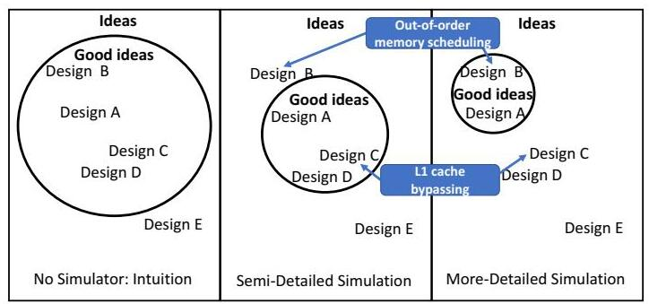

Fig. 1: The architecture design and simulation process represented as a collection of good and ineffective ideas. As the level of simulation detail increases, the space of effective ideas shrinks and potentially moves.

> 
图 1：将体系结构设计 (architecture design) 和模拟过程 (simulation process) 表示为良好想法与无效想法的集合。随着模拟细节 (simulation detail) 层次的提高，有效想法 (effective ideas) 的空间会缩小，并可能发生迁移。


Our paper focuses on the simulation of massively parallel architectures, in particular GPUs. GPUs have witnessed rapid change and a widespread increase in their adoption with the rise of GPGPU computing and machine learning. In academia, the design of programmable accelerators is mostly carried out through modeling new techniques in high level GPU simulators. Over the past four years, there have been approximately 20 papers per year focusing on GPU-design at the top architecture conferences. 80% of those papers have used today's most popular open-source GPU simulator, GPGPU-Sim [2]. The relative popularity of GPGPU-Sim can be attributed to several factors, but it's most appealing aspect is perhaps the accuracy with which it models modern GPUs (relative to other open-source solutions). Such accuracy should provide a solid basleine for studying important architectural ideas that are relevant to future machines.

> 
我们的论文关注大规模并行架构 (massively parallel architectures) 的模拟，尤其是图形处理器 (GPU)。随着 GPGPU 计算 (GPGPU computing) 和机器学习 (machine learning) 的兴起，GPU 经历了快速变化，其采用率也大幅提高。在学术界，可编程加速器 (programmable accelerators) 的设计主要通过在高层次 GPU 模拟器 (high-level GPU simulators) 中对新技术进行建模来完成。过去四年中，顶级体系结构会议 (top architecture conferences) 上每年约有 20 篇聚焦 GPU 设计的论文。这些论文中有 80% 使用了当今最流行的开源 GPU 模拟器 (open-source GPU simulator) GPGPU-Sim [2]。GPGPU-Sim 的相对流行可归因于多个因素，但其最吸引人的方面也许在于它对现代 GPU 建模的准确性（相对于其他开源解决方案）。这种准确性应为研究对未来机器具有重要意义的重要体系结构思想提供坚实的基线 (baseline)。


Recent work on validating GPGPU-Sim [3] has demonstrated that there are several areas where a lack of detail in the performance model creates a a major source of error. However, the bulk of the error comes from the modeling of the memory system. Building on that observation, we perform a module-by-module redesign of the GPU's memory system, demonstrating its improved correlation with real hardware. Our improved performance model decreases memory system error on several key metrics over a diverse set of benchmarks by as much as $66 \times$ , resulting in a $2.5 \times$ reduction in execution cycle error when modeling and NVIDIA TITAN V GPU. Table 1 presents the average absolute error rates of the publicly available GPGPU-Sim 3.x versus our new model 4 The GPGPU-Sim 3.x model, or old model is a faithful representation of how papers currently scale GPGPU-Sim to update their baseline GPU, without modifying the code. The new model represents all the changes implemented in this paper.

> 
近期关于验证 GPGPU-Sim [3] 的工作已经表明，在若干领域中，性能模型 (performance model) 缺乏细节会成为主要的误差来源。然而，大部分误差来自存储系统 (memory system) 的建模。基于这一观察，我们对 GPU 的存储系统进行了逐模块 (module-by-module) 重新设计，并证明其与真实硬件的相关性 (correlation) 有所提高。我们改进后的性能模型在多种基准测试 (benchmarks) 上，将若干关键指标上的存储系统误差最多降低了 $66 \times$，从而在对 NVIDIA TITAN V GPU 建模时将执行周期 (execution cycle) 误差降低了 $2.5 \times$。表 1 给出了公开可用的 GPGPU-Sim 3.x 与我们的新模型 4 的平均绝对误差率 (average absolute error rate)。GPGPU-Sim 3.x 模型（即旧模型）忠实反映了当前论文在不修改代码的情况下如何扩展 GPGPU-Sim 以更新其基准 GPU (baseline GPU) 的做法。新模型体现了本文中实现的所有更改。


TABLE I: Average absolute error and correlation rates of the publicly available GPGPU-Sim model versus our enhanced memory system model when modeling an NVIDIA Volta TITAN V.

> 
表 I：公开可用的 GPGPU-Sim 模型与我们的增强内存系统模型 (enhanced memory system model) 在对 NVIDIA Volta TITAN V 建模时的平均绝对误差与相关性比率。


<table><tr><td rowspan="2">Statistic</td><td colspan="2">Mean Abs Error</td><td colspan="2">Correlation</td></tr><tr><td>Old Model</td><td>New Model</td><td>Old Model</td><td>New Model</td></tr><tr><td>L1 Reqs</td><td>48%</td><td>0.5%</td><td>92%</td><td>100%</td></tr><tr><td>L1 Hit Ratio</td><td>41%</td><td>18%</td><td>89%</td><td>93%</td></tr><tr><td>L2 Reads</td><td>66%</td><td>1%</td><td>49%</td><td>94%</td></tr><tr><td>L2 Writes</td><td>56%</td><td>1%</td><td>99%</td><td>100%</td></tr><tr><td>L2 Read Hits</td><td>80%</td><td>15%</td><td>68%</td><td>81%</td></tr><tr><td>DRAM Reads</td><td>89%</td><td>11%</td><td>60%</td><td>95%</td></tr><tr><td>Execution Cycles</td><td>68%</td><td>27%</td><td>71%</td><td>96%</td></tr></table>

To demonstrate that our new model more closely matches the hardware, we perform a counter-by-counter validation of the improved memory system versus the current 3.x memory system. During the course of this analysis we uncover a number of interesting insights into how contemporary hardware works. We utilized every publicly available resource to construct the new memory system model, capturing the details of what others has either disclosed or discovered [4]-[7]. However, in the process of correlating the memory system we also discovered several new, previously undocumented features. For example, we uncovered more detailed elements of the Volta streaming L1 cache behaviour, implemented Volta's adaptive L1 cache configuration policy, discovered that both the L1 and L2 caches are sectored, explored the fine details of the Volta memory coalescer and finally discovered and implemented the L2 writepolicy for GPU caches which attempt to conserve memory bandwidth in the presence of sub-sector reads.

> 
为了证明我们的新模型与硬件更为接近，我们对改进后的存储系统 (memory system) 与当前 3.x 存储系统进行了逐计数器验证 (counter-by-counter validation)。在此分析过程中，我们获得了若干关于当代硬件工作方式的有趣洞见。我们利用所有公开可获得的资源构建了新的存储系统模型，涵盖了他人已披露或已发现的细节 [4]-[7]。然而，在关联存储系统的过程中，我们还发现了若干此前未被记录的新特性。例如，我们揭示了 Volta 流式 L1 缓存 (streaming L1 cache) 行为的更详细要素，实现了 Volta 的自适应 L1 缓存配置策略 (adaptive L1 cache configuration policy)，发现 L1 和 L2 缓存均采用分扇区 (sectored) 设计，探究了 Volta 访存合并器 (memory coalescer) 的精细细节，最后发现并实现了 GPU 缓存 (GPU caches) 的 L2 写策略 (L2 write policy)，该策略试图在存在子扇区读取 (sub-sector reads) 时节省内存带宽 (memory bandwidth)。


Using this more detailed model, we perform a case-study on the effects error in the memory system can have on architectural design decisions. As expected, we demonstrating that some ideas are rendered both more and less effective using a more detailed model. In particular, we demonstrate that out-of-order memory access scheduling, which appears relatively ineffective under the old model, yields a significant performance improvement when the level of detail in the memory system is increased to more closely match hardware. We then go on to demonstrate that the L1 cache throughput bottleneck present in the current version of the simulator no longer exists in contemporary hardware. The introduction of streaming, banked, sectored L1s with an allocate-on-fill policy removes a key source of contention in GPGPU-Sim's L1 cache. Consequentially, any design aimed at mitigating this L1 throughput bottleneck will is less effective on a contemporary GPU, which is reflected in our enhanced simulator.

> 
使用这一更详细的模型，我们开展了一项案例研究，考察内存系统中的误差可能对架构设计决策产生的影响。正如预期，我们展示出：使用更详细的模型后，一些设计思路会变得更有效，而另一些则变得更无效。特别地，我们证明：乱序内存访问调度 (out-of-order memory access scheduling) 在旧模型下看起来相对无效，但当内存系统的细节程度提高到更接近硬件时，它会带来显著的性能提升。随后我们进一步证明，当前版本模拟器中存在的 L1 缓存吞吐量瓶颈 (L1 cache throughput bottleneck) 在当代硬件中已不复存在。引入带有填充时分配 (allocate-on-fill) 策略的流式 (streaming)、多体 (banked)、分扇区 (sectored) L1 缓存，消除了 GPGPU-Sim 的 L1 缓存中的一个关键争用来源。因此，任何旨在缓解这一 L1 吞吐量瓶颈的设计在当代 GPU 上都会效果较差，这一点在我们的增强模拟器中得到了反映。


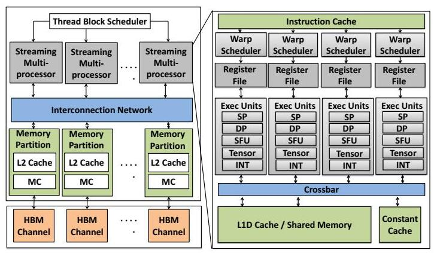

Fig. 2: Volta Architecture

> 
图 2：Volta 架构


This paper makes the following contributions:

> 
本文的贡献如下：


- It presents the most accurate open-source GPU performance model to date, reducing the error in Volta execution time by a factor of $2.5 \times$ , by reducing error between silicon performance counters and GPGPU-Sim by $66 \times$ .

> 
它提出了迄今最准确的开源 GPU 性能模型 (performance model)：通过将硅性能计数器 (silicon performance counters) 与 GPGPU-Sim 之间的误差降低 $66 \times$，使 Volta 执行时间 (execution time) 的误差降低 $2.5 \times$。


- It demonstrates the effect of modeling error on architectural design decisions made using the simulator. We concretely demonstrate that some problems observed using the less detailed memory model are no longer an issue in state-of-the-art machines, which have designed around issues like the L1 cache bottleneck but are more sensitive to issues like memory access scheduling.

> 
- 它展示了建模误差 (modeling error) 对使用该模拟器 (simulator) 做出的体系结构设计决策 (architectural design decisions) 的影响。我们具体证明，使用细节较少的内存模型 (memory model) 所观察到的一些问题，在最先进机器 (state-of-the-art machines) 中已不再是问题；这些机器已针对 L1 缓存瓶颈 (L1 cache bottleneck) 等问题进行了设计规避，但对访存调度 (memory access scheduling) 等问题更为敏感。


- It identifies and confirms a number of architectural design decisions that have be made in contemporary accelerators. We discuss the potential reasons why these decisions were made and suggest opportunities to exploit those decisions in future research.

> 
- 它识别并确认了当代加速器 (accelerator) 中已做出的一系列架构设计决策 (architectural design decision)。我们讨论了做出这些决策的潜在原因，并提出了在未来研究中利用这些决策的机会。


- It introduces a new open-source correlator toolset that includes a simple workflow for compiling over the GPU applications from 8 popular GPGPU benchmark suites for CUDA versions 4.2 through 10.0, with inputs curbed for simulation. The toolset also includes a database of real hardware timing and performance counters for these workloads for five different GPU product generations and a correlation tool that allows users of GPGPU-Sim to easily generate counter-by-counter correlation plots for their simulator changes or their new workloads .

> 
- 它引入了一个新的开源关联器工具集 (correlator toolset)，其中包含一个简单的工作流，用于编译来自 8 个流行 GPGPU 基准测试套件 (benchmark suite) 的 GPU 应用程序，覆盖 CUDA 4.2 至 10.0 版本，并针对仿真对输入进行了裁剪。该工具集还包含一个数据库，记录这些工作负载在五代不同 GPU 产品上的真实硬件时序和性能计数器 (performance counter)，以及一个关联工具 (correlation tool)，使 GPGPU-Sim 用户能够轻松地为其模拟器改动或新工作负载生成逐计数器关联图 (counter-by-counter correlation plot)。


## II. EXPERIMENTAL SETUP

We modified the GPGPU-Sim 3.x [8] extensively to model the new Volta architecture [9], [10]. Figure 2 depicts the Volta V100 architecture. The new streaming multiprocessor (SM) is composed of four warp schedulers, compared to two warp schedulers in Fermi architecture. Each warp scheduler has a dedicated register file (RF) and its own execution unit (EU), including: single-precision floating point unit (SP), doubleprecision unit (D), special-function unit (SFU), integer unit (INT), and tensor core unit (TENSOR) to accelerate 4x4 matrix multiplication [9]. A warp scheduler with its dedicated RF and EUs is named sub-core [10]. All the four warp schedulers share the memory unit that contains a memory coalescer unit and a unified cache. The coalescer unit coalesces warp requests at the granularity of eight threads whether the request is cached or non-cached. The schedulers and memory units are connected via a fair round-robin crossbar.

> 
我们大幅修改了 GPGPU-Sim 3.x [8]，以对新的 Volta 架构 [9], [10] 进行建模。图 2 展示了 Volta V100 架构。新的流式多处理器 (streaming multiprocessor, SM) 由四个线程束调度器 (warp scheduler) 组成，而 Fermi 架构中为两个线程束调度器。每个线程束调度器都有一个专用寄存器文件 (register file, RF) 和自己的执行单元 (execution unit, EU)，包括：单精度浮点单元 (single-precision floating point unit, SP)、双精度单元 (double-precision unit, D)、特殊功能单元 (special-function unit, SFU)、整数单元 (integer unit, INT) 以及用于加速 4x4 矩阵乘法 [9] 的张量核心单元 (tensor core unit, TENSOR)。一个线程束调度器及其专用 RF 和 EU 称为子核 (sub-core) [10]。四个线程束调度器均共享存储单元 (memory unit)，该单元包含内存合并器单元 (memory coalescer unit) 和一个统一缓存 (unified cache)。合并器单元 (coalescer unit) 以八个线程为粒度合并线程束请求 (warp request)，无论该请求是否被缓存。调度器和存储单元通过公平轮询交叉开关 (fair round-robin crossbar) 连接。


---

${}^1$ Simulator changes described in this paper will be released publicly

> 
${}^1$ 本文所述的模拟器 (simulator) 更改将公开发布。


---

In Volta, the L1 cache and shared memory are combined together in a 128KB unified cache. The shared memory capacity can be set to0,8,16,32,64or $96\mathrm{KB}$ and the remaining cache serves as L1 data cache (minimum L1 cache capacity $= 32\mathrm{\;KB}$ ). Unlike previous generations, the driver adaptively configures the shared memory capacity for each kernel [11] such that it avoids shared memory occupancy bottlenecks. On the other hand, if a kernel does not utilize shared memory, the whole unified cache (128KB) will be assigned to L1 cache. The Volta V100 comes with High Bandwidth Memory (HBM) modules [12], [13]. Each HBM memory module contains eight channels. Memory channels, including the memory-side L2 cache, are connected with SMs throughout an on-chip crossbar.

> 
在 Volta 中，L1 缓存 (L1 cache) 与共享内存 (shared memory) 被合并到一个 128KB 的统一缓存 (unified cache) 中。共享内存容量 (shared memory capacity) 可设置为 0、8、16、32、64 或 $96\mathrm{KB}$，剩余缓存用作 L1 数据缓存 (L1 data cache)（最小 L1 缓存容量 (L1 cache capacity) $= 32\mathrm{\;KB}$）。与前几代不同，驱动程序 (driver) 会为每个内核 (kernel) 自适应配置共享内存容量 [11]，从而避免共享内存占用瓶颈 (shared memory occupancy bottlenecks)。另一方面，如果某个内核不使用共享内存，则整个统一缓存 (128KB) 将被分配给 L1 缓存。Volta V100 配备高带宽内存 (High Bandwidth Memory, HBM) 模块 [12], [13]。每个 HBM 内存模块包含八个通道 (channel)。包括内存侧 L2 缓存 (memory-side L2 cache) 在内的内存通道通过片上交叉开关 (on-chip crossbar) 与流式多处理器 (SM) 相连。


The public version of GPGPU-sim models the now 9 year old Fermi architecture [14]. The standard practice in GPGPU-Sim to model modern GPUs, such as Volta, is to scale the configuration of the Fermi model by increasing parameters like the number of cores, memory channels, clocks, number of warp schedulers etc. without performing a rigorous validation of such a configuration against modern hardware. In this work, we made material changes to the GPGPU-sim simulator code in order to accurately model the Volta architecture. Table III details the high-level architecture of the Volta V100 TITANV [15] architecture we model and validate against. The left column of the table contains the configuration of the GPGPU-sim 3.X old model obtained by scaling the Fermi resources similar to standard practice. The right column lists the new changes, shown in bold, made to model Volta architecture accurately. Note that, these new changes cannot be configured in the old model, instead it requires significant code changes. All the data shown in the table are adopted from either publicly available documents and patents from Nvidia [9], [10], or via running extensive in-house micro-benchmarks. Section III discusses in more detail th micro-benchmarks and the details they uncover. The L1 cache's latency, indexing, number of sets and line size is adopted from [7].

> 
GPGPU-sim 的公开版本对如今已有 9 年历史的 Fermi 架构 (Fermi architecture) [14] 进行建模。在 GPGPU-Sim 中，对 Volta 等现代 GPU (modern GPU) 进行建模的标准做法是：通过增加核心 (core) 数量、内存通道 (memory channel) 数量、时钟 (clock)、warp 调度器 (warp scheduler) 数量等参数来扩展 Fermi 模型的配置 (configuration)，而未针对此类配置在现代硬件 (modern hardware) 上进行严格验证 (validation)。在本工作中，我们对 GPGPU-sim 模拟器 (simulator) 代码进行了实质性修改，以便准确地对 Volta 架构 (Volta architecture) 进行建模。表 III 详细列出了我们建模并据以验证的 Volta V100 TITANV [15] 架构的高层架构 (high-level architecture)。该表的左列包含通过类似于标准做法的方式扩展 Fermi 资源 (resource) 所得到的 GPGPU-sim 3.X 旧模型 (old model) 的配置。右列列出了为准确建模 Volta 架构而做出的新更改（以粗体显示）。注意，这些新更改无法在旧模型中进行配置，而是需要大量代码更改。表中所示的所有数据均取自 Nvidia 的公开文档和专利 [9], [10]，或通过运行大量内部微基准测试 (micro-benchmark) 获得。第 III 节更详细地讨论了这些微基准测试及其揭示的细节。L1 缓存 (L1 cache) 的延迟 (latency)、索引 (indexing)、组数 (number of sets) 和行大小 (line size) 采用自 [7]。


We implement a throughput-oriented, banked, streaming, sectored L1 cache, a sectored L2 cache with a lazy-fetch-on-read policy that is highly correlated with the real hardware. Further, we model CPU-GPU memory copy engine which we found is an important factor on L2 accesses and hit rate, since all DRAM accesses go through the L2, including CPU-GPU memory copies [16]. In order to reduce uneven accesses across memory partitions [17], we add an advanced partition indexing that xors the L2 channel bits with randomly selected bits from the higher row and lower bank bits [18]. In the memory system, we accurately model HBM. This includes the dual-bus interface and the new per-bank refresh command [12], [13].

> 
我们实现了一个面向吞吐量的、分体式 (banked)、流式 (streaming)、分扇区 (sectored) 的 L1 缓存 (L1 cache)，以及一个采用读时惰性取回 (lazy-fetch-on-read) 策略并与真实硬件高度相关的分扇区 L2 缓存 (sectored L2 cache)。此外，我们对 CPU-GPU 内存复制引擎 (CPU-GPU memory copy engine) 进行了建模，我们发现它是影响 L2 访问和命中率 (hit rate) 的重要因素，因为所有 DRAM 访问都经过 L2，包括 CPU-GPU 内存复制 [16]。为了减少跨内存分区 (memory partitions) 的不均衡访问 [17]，我们添加了一种高级分区索引 (partition indexing)，它将 L2 通道位 (L2 channel bits) 与从较高行位 (higher row bits) 和较低存储体位 (lower bank bits) 中随机选择的位进行异或 [18]。在内存系统 (memory system) 中，我们准确建模了 HBM。这包括双总线接口 (dual-bus interface) 以及新的按存储体刷新命令 (per-bank refresh command) [12], [13]。


global_void mb1(const float* A, const float* B, float* C, int stride)

> 
`__global__ void mb1(const float* A, const float* B, float* C, int stride)`


\{

> 
\{


int idx = blockDim.x * blockldx.x + threadldx.x;

> 
```c
int idx = blockDim.x * blockldx.x + threadldx.x;
```


C[((idx /stride)*32)+(idx %stride)] = A[((idx /stride)*32)+(idx %stride)];

> 
`C[((idx /stride)*32)+(idx %stride)] = A[((idx /stride)*32)+(idx %stride)];`


\}

> 
The message you provided does not contain any Markdown paragraph to translate—it appears to consist only of a stray `}` character. Please send the paragraph you would like translated into Simplified Chinese, and I will return only the final translation.


Fig. 3: Volta coalescer micro-benchmark . Further, we implement the well-known memory optimization techniques, bank indexing and separate read/write buffers, to reduce bank conflicts and read-write inference [19], [19]-[21].

> 
图 3：Volta 合并器 (coalescer) 微基准测试 (micro-benchmark)。此外，我们实现了众所周知的内存优化技术——bank 索引 (bank indexing) 和独立的读/写缓冲区 (separate read/write buffers)，以减少 bank 冲突 (bank conflicts) 和读写干扰 (read-write interference) [19], [19]-[21]。


For Validation, we use a wide range of applications to ensure our new model generalizes to a variety of workloads. We indiscriminately include all the workloads we could get to run in simulation from the original GPGPU-Sim paper [8], Rodinia 3.1 [22], the CUDA SDK [23], Parboil [24], Pannotia [25], Lonestar [26], SHOC [27], and a collection of DOE proxy apps [28]. The sum total of which is over 1400 unique kernel launches. All the workloads are compiled with CUDA 10 and the compute capability of Volta architecture (=sm_70). We updated the simulator to execute applications compiled with sm_70 PTX.

> 
在验证 (Validation) 中，我们使用广泛的应用程序，以确保我们的新模型能够泛化到各种工作负载 (workload)。我们不加区分地纳入所有我们能够在模拟 (simulation) 中运行的、来自原始 GPGPU-Sim 论文 [8]、Rodinia 3.1 [22]、CUDA SDK [23]、Parboil [24]、Pannotia [25]、Lonestar [26]、SHOC [27] 以及一组 DOE 代理应用 (proxy apps) [28] 的工作负载。其总计超过 1400 次不同的内核启动 (kernel launch)。所有工作负载均使用 CUDA 10 编译，目标为 Volta 架构的计算能力 (compute capability)（=sm_70）。我们更新了模拟器 (simulator)，使其能够执行使用 sm_70 PTX 编译的应用程序。


## III. EXPLORING THE VOLTA MEMORY SYSTEM

The memory system in modern GPUs has changed significantly since the last detailed modeling effort in GPGPU-Sim, which took place for the Fermi architecture. Unlike in CPUs, the caches in GPUs are not primarily used to reduce single-thread memory latency, but rather are designed as a bandwidth filter, reducing accesses to lower levels of memory. Workloads with a higher hit rate in the L2 cache service more requests at the faster throughput of the L2 cache, which is typically $2\mathrm{X}$ the DRAM throughput. There have been numerous works tried to demystify GPU architecture and memory system details through micro-benchmarks for Tesla GT200 [4], Fermi [5], Maxwell [6], and recently Volta [7]. They demystified the L1/L2 cache's associativity, replacement policy, indexing and capacity. However, none of these works dissect the details of Volta L1 streaming cache behaviour, adaptive cache configuration, sectoring L1/L2 caches, Volta coalescer and L2 write policy, taking into account that these details have a substantial impact on the GPU Modeling. In the following subsections, we explore the design of the Volta L1/L2 cache policy in order to accurately model the Volta memory system.

> 
自 GPGPU-Sim 中上一次针对 Fermi 架构进行详细建模以来，现代 GPU 中的内存系统 (memory system) 已发生显著变化。与 CPU 不同，GPU 中的缓存 (cache) 主要并非用于降低单线程内存延迟 (single-thread memory latency)，而是被设计为带宽过滤器 (bandwidth filter)，以减少对更低层级内存的访问。在 L2 缓存 (L2 cache) 中具有更高命中率 (hit rate) 的工作负载 (workloads) 会以 L2 缓存的更快吞吐量 (throughput) 服务更多请求，而该吞吐量通常为 DRAM 吞吐量 (DRAM throughput) 的 $2\mathrm{X}$。已有大量工作试图通过针对 Tesla GT200 [4]、Fermi [5]、Maxwell [6] 以及最近的 Volta [7] 的微基准测试 (micro-benchmarks) 来揭示 GPU 架构和内存系统细节。它们揭示了 L1/L2 缓存的相联度 (associativity)、替换策略 (replacement policy)、索引 (indexing) 和容量 (capacity)。然而，考虑到这些细节会对 GPU 建模 (GPU modeling) 产生重大影响，这些工作都没有剖析 Volta L1 流式缓存 (streaming cache) 行为、自适应缓存配置 (adaptive cache configuration)、L1/L2 缓存的分扇区 (sectoring)、Volta 合并器 (coalescer) 和 L2 写策略 (write policy) 的细节。在以下小节中，我们探讨 Volta L1/L2 缓存策略的设计，以便准确地对 Volta 内存系统 (memory system) 建模。


## A. Volta Memory Coalescer

To understand the behaviour of the Volta global access coalescer, we create the micro-benchmark shown in Figure 3. We run our micro-benchmark on the NVIDIA TITANV [15] and collect the results via nvprof 10.0 [29]. In the micro-benchmark, we adjust the number of cache lines accessed by a warp based on variable stride. When stride=1, each thread will access a different cache line, when stride=8, each consecutive group of eight threads will access the same cache line, and so on.

> 
为了理解 Volta 全局访问合并器 (global access coalescer) 的行为，我们创建了图 3 所示的微基准测试 (micro-benchmark)。我们在 NVIDIA TITANV [15] 上运行该微基准测试，并通过 nvprof 10.0 [29] 收集结果。在该微基准测试中，我们根据可变步长 (stride) 调整一个线程束 (warp) 所访问的缓存行 (cache line) 数量。当 stride=1 时，每个线程将访问不同的缓存行；当 stride=8 时，每连续八个线程组成的组将访问同一缓存行；依此类推。


TABLE II: Volta V100 TITANV Configuration

> 
表 II：Volta V100 TITANV 配置


<table><tr><td></td><td>Old Model</td><td>New Model</td></tr><tr><td>#SMs</td><td>80</td><td>80</td></tr><tr><td>#SM Configuration</td><td>Warps per SM = 64, #Schedulers per SM = 4, #Warps per Sched = 16, RF per SM = 64 KB</td><td>+Volta model (similar to fig2</td></tr><tr><td>#Exec Units</td><td>4 SPs, 4 SFUs</td><td>+ 4 DPs, 4 INTs</td></tr><tr><td>Memory Unit</td><td>Fermi coalescer (32 threads coalescer)</td><td>Volta coalescer (8 threads coalescer) + Fair memory issue</td></tr><tr><td>Shared Memory</td><td>Programmable-specified up to $96\mathrm{\;KB}$</td><td>Adaptive (up to 96 KB)</td></tr><tr><td>L1 cache</td><td>32KB, 128B line, 4 ways, write-evict, turn-on-by-default</td><td>+32B sector, adaptive cache (up to 128 KB), <br> Streaming cache, banked, latency = 28 cycles</td></tr><tr><td>L2 cache</td><td>4.5 MB, 24 banks, 128B line, 32 ways, Write Back, Naive write allocate, LRU, latency=100 cycles</td><td>+32B sector, Lazy_Fetch_on_Read, memory copy engine model,</td></tr><tr><td>Interconnection</td><td>40x24 crossbar, 32B flit</td><td>+advanced memory partition indexing (reduce partition camping)</td></tr><tr><td>Memory Model</td><td>GDDR5 model, BW=652 GB/sec, latency=100ns</td><td>HBM Model, dual-bus interface, Read/Write buffers, advanced bank indexing</td></tr></table>

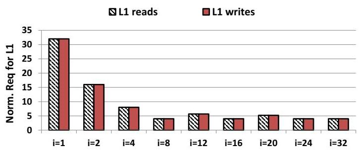

Fig. 4: Volta coalescer micro-benchmark results.

> 
图 4：Volta 合并器 (coalescer) 微基准测试结果。


Figure 4 plots the number of L1 cache reads and writes per warp. In figure 5, when stride=1, each thread reads a different cache line, resulting in 32 accesses for each warp. When the stride=32, the memory access is converged, and all the threads within the same warp will access the same cache line, however we receive four read accesses at L1 cache, as shown in figure. This means that the access granularity of the L1 cache is 32B. To determine if the cache has a true 32B line size or if the line size is still 128B (the cache line size in GPGPU-Sim's modeled Fermi coalescer is 128B), with 32B sectors [30], [31], we created an additional microbenchmark. Our line-size-determining microbenchmark fills the L1 cache, evicts one entry then attempts to re-access the data loaded into cache. We find that the eviction granularity of the cache is $128\mathrm{\;B}$ , indicating that the $\mathrm{L}1$ cache has $128\mathrm{\;B}$ lines with 32B sectors. Furthermore, the coalescer operates across eight threads, i.e. the coalescer tries to coalesce each group of eight threads separately to generate sectored accesses. We ran these same microbenchmarks with L1 bypassing turned on and we observed similar behavior at the L2 for both reads and writes, indicating that the L2 cache has a similar configuration.

> 
图 4 绘制了每个线程束 (warp) 的 L1 缓存 (L1 cache) 读取和写入次数。在图 5 中，当步长 (stride)=1 时，每个线程读取不同的缓存行 (cache line)，导致每个线程束产生 32 次访问。当 stride=32 时，内存访问发生汇聚 (converged)，同一线程束内的所有线程将访问同一缓存行，然而我们在 L1 缓存处收到四次读取访问，如图所示。这意味着 L1 缓存的访问粒度 (access granularity) 为 32B。为了确定该缓存具有真正的 32B 行大小 (line size)，还是其行大小仍为 128B（GPGPU-Sim 建模的 Fermi 合并器 (coalescer) 中的缓存行大小为 128B）并带有 32B 扇区 (sector) [30], [31]，我们创建了一个额外的微基准测试 (microbenchmark)。我们用于确定行大小的微基准测试会填满 L1 缓存，逐出一个条目，然后尝试重新访问已加载到缓存中的数据。我们发现该缓存的逐出粒度 (eviction granularity) 为 $128\mathrm{\;B}$，这表明 $\mathrm{L}1$ 缓存具有 $128\mathrm{\;B}$ 的行，并带有 32B 扇区。此外，合并器跨八个线程进行操作，即合并器尝试分别合并每组八个线程，以生成扇区化访问 (sectored accesses)。我们在开启 L1 绕过 (L1 bypassing) 的情况下运行了这些相同的微基准测试，并在 L2 缓存 (L2 cache) 处观察到读取和写入均具有类似行为，这表明 L2 缓存具有类似配置。


### B.L2 cache

Since high throughput memory systems are especially sensitive to write traffic, the handling of writes at the L2 is very important. The existing GPGPU-Sim memory model fetches 128B cache lines from DRAM on write misses at the L2 and uses an allocate-on-fill writeback policy. To determine what the behaviour of writes at the L2 is in real hardware, we created the small microbenchmark in Figure 5. The mi-crobenchmark confirmed that the L2 is writeback with a write-allocate policy. However, we observed some interesting, previously unmodeled behaviour that occurs on write misses. In literature, there are two different write allocation policies [32], fetch-on-write and write-validate. In fetch-on-write, when we write to a single byte of a sector, the L2 fetches the whole sector then merges the written portion to the sector and sets the sector as modified. In the write-validate policy, no read fetch is required, instead each sector has a bit-wise write-mask. When a write to a single byte is received, it writes the byte to the sector, sets the corresponding write bit and sets the sector as valid and modified. When a modified cache line is evicted, the cache line is written back to the memory along with the write mask. It is important to note that, in a write-validate policy, it assumes the read and write granularity can be in terms of bytes in order to exploit the benefits of the write-mask. In fact, based on our micro-benchmark shown in Figure 5, we have observed that the L2 cache applies something similar to write-validate. However, all the reads received by L2 caches from the coalescer are 32-byte sectored accesses. Thus, the read access granularity (32 bytes) is different from the write access granularity (one byte). To handle this, the L2 cache applies a different write allocation policy, which we named lazy fetch-on-read, that is a compromise between write-validate and fetch-on-write. When a sector read request is received to a modified sector, it first checks if the sector write-mask is complete, i.e. all the bytes have been written to and the line is fully readable. If so, it reads the sector, otherwise, similar to fetch-on-write, it generates a read request for this sector and merges it with the modified bytes. In Figure 5, the kernel runs for a single thread, and we inserted some dummy code (not shown in figure) to prevent compiler from register allocating the accesses. In Figure 5, a four-byte float is written at line 3. When it reads it back at line 5 , it is a miss. This is because the sector is not full yet. Note that, in a write-validate policy, this should be a hit. Later, at line 6, reading the same four bytes and the next four bytes are both hits, because the whole sector is fetched from the read to $\mathrm{C}\lbrack\mathrm{i}\rbrack$ at line 5 .

> 
由于高吞吐量存储系统 (high throughput memory systems) 对写流量 (write traffic) 尤其敏感，因此 L2 对写操作的处理非常重要。现有 GPGPU-Sim 存储模型 (memory model) 在 L2 发生写缺失 (write miss) 时从 DRAM 取回 128B 缓存行 (cache line)，并采用填充时分配 (allocate-on-fill) 的写回策略 (writeback policy)。为了确定真实硬件中 L2 的写行为，我们创建了图 5 中的小型微基准测试 (microbenchmark)。该微基准测试确认，L2 是采用写分配 (write-allocate) 策略的写回式 (writeback) 缓存。然而，我们观察到写缺失 (write miss) 时会出现一些有趣的、此前未被建模的行为。在文献中，存在两种不同的写分配策略 (write allocation policy) [32]：写时取回 (fetch-on-write) 和写验证 (write-validate)。在写时取回 (fetch-on-write) 中，当我们向一个扇区 (sector) 的单个字节写入时，L2 会取回整个扇区，然后将写入的部分合并到该扇区，并将该扇区标记为已修改 (modified)。在写验证 (write-validate) 策略中，不需要进行读取取回 (read fetch)，而是每个扇区 (sector) 都有一个按位写掩码 (bit-wise write-mask)。当收到对单个字节的写操作时，它将该字节写入扇区 (sector)，设置相应的写位 (write bit)，并将该扇区标记为有效 (valid) 且已修改 (modified)。当已修改 (modified) 的缓存行 (cache line) 被逐出 (evicted) 时，该缓存行会连同写掩码 (write-mask) 一起写回存储器。需要注意的是，在写验证 (write-validate) 策略中，它假设读、写粒度 (granularity) 可以按字节计，以便利用写掩码 (write-mask) 的优势。事实上，基于图 5 所示的微基准测试 (micro-benchmark)，我们观察到 L2 缓存 (L2 cache) 采用了类似写验证 (write-validate) 的机制。然而，L2 缓存从合并器 (coalescer) 接收到的所有读操作都是 32 字节的扇区化访问 (sectored access)。因此，读访问粒度 (read access granularity)（32 字节）不同于写访问粒度 (write access granularity)（1 字节）。为解决这一问题，L2 缓存采用了另一种写分配策略 (write allocation policy)，我们将其命名为读时惰性取回 (lazy fetch-on-read)，它是写验证 (write-validate) 与写时取回 (fetch-on-write) 之间的折中。当收到针对已修改 (modified) 扇区 (sector) 的扇区读请求时，它首先检查该扇区的写掩码 (write-mask) 是否完整，即所有字节都已写入且该行完全可读。如果是，则读取该扇区；否则，与写时取回 (fetch-on-write) 类似，它会为该扇区生成读请求，并将其与已修改 (modified) 的字节合并。在图 5 中，内核以单线程运行，并且我们插入了一些哑代码 (dummy code)（图中未显示），以防止编译器对这些访问进行寄存器分配 (register allocating)。在图 5 中，第 3 行写入了一个四字节 float。当在第 5 行将其读回时，这是一次缺失 (miss)。这是因为该扇区 (sector) 尚未填满。请注意，在写验证 (write-validate) 策略中，这应当是一次命中 (hit)。随后，在第 6 行，读取相同的四个字节以及接下来的四个字节都会命中 (hit)，因为在对第 5 行 $\mathrm{C}\lbrack\mathrm{i}\rbrack$ 的读取中已经取回了整个扇区 (sector)。


<table><tr><td>_global_ void mb2(const float* A, float* B)</td></tr><tr><td>\{</td></tr><tr><td>1. int idx = blockDim.x * blockldx.x + threadldx.x;</td></tr><tr><td>2. if(idx == 0) \{</td></tr><tr><td>//write to C[i] is a miss (cache line is missing)</td></tr><tr><td>4. $\mathrm{C}\lbrack\mathrm{i} + 1\rbrack = \mathrm{A}\lbrack\mathrm{i}\rbrack$ ; //write to $\mathrm{C}\lbrack\mathrm{i} + 1\rbrack$ is a hit (cache line is found)</td></tr><tr><td>//read of C[i] is a miss (entire sector is missing, fetch it from memory)</td></tr><tr><td>6. $A\lbrack i\rbrack = C\lbrack i\rbrack + C\lbrack i + 1\rbrack ;\;//$ read $C\lbrack i\rbrack$ and $C\lbrack i + 1\rbrack$ are hits (entire sector exists)</td></tr><tr><td>\}</td></tr><tr><td>\}</td></tr></table>

Fig. 5: Microbenchmark to explore the Volta L2 cache write policy .

> 
图 5：用于探究 Volta L2 缓存 (L2 cache) 写策略 (write policy) 的微基准测试 (microbenchmark)。


<table><tr><td></td><td colspan="4">Unified Cache Data Block</td><td colspan="6">TAG-MSHR Array</td></tr><tr><td></td><td>Sec0</td><td>Sec1</td><td>Sec2</td><td>Sec4</td><td></td><td>TAG</td><td rowspan="2">Block Index</td><td>Mask</td><td rowspan="2">status</td><td rowspan="2">Merge Mask</td></tr><tr><td></td><td></td><td></td><td></td><td></td><td></td><td></td><td></td></tr><tr><td></td><td></td><td></td><td></td><td></td><td></td><td>0X5678</td><td>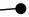</td><td>0100</td><td>valid</td><td></td></tr><tr><td>L1D</td><td></td><td></td><td></td><td></td><td></td><td></td><td></td><td></td><td></td><td></td></tr><tr><td></td><td></td><td></td><td></td><td></td><td></td><td>-</td><td>-</td><td></td><td></td><td>-</td></tr><tr><td></td><td></td><td></td><td></td><td></td><td></td><td>-</td><td>-</td><td></td><td></td><td>-</td></tr><tr><td></td><td></td><td></td><td></td><td></td><td></td><td>-</td><td>-</td><td></td><td></td><td>-</td></tr><tr><td></td><td></td><td></td><td></td><td></td><td></td><td>-</td><td>-</td><td></td><td></td><td>-</td></tr><tr><td></td><td></td><td></td><td></td><td></td><td></td><td>0X5678</td><td></td><td>0001</td><td>pending</td><td>101...01</td></tr><tr><td rowspan="4">Shared Mem</td><td></td><td></td><td></td><td></td><td></td><td></td><td></td><td></td><td></td><td></td></tr><tr><td></td><td></td><td></td><td></td><td></td><td></td><td></td><td></td><td></td><td></td></tr><tr><td></td><td></td><td></td><td></td><td></td><td></td><td></td><td></td><td></td><td></td></tr><tr><td></td><td></td><td></td><td></td><td></td><td></td><td></td><td></td><td></td><td></td></tr></table>

Fig. 6: Our Assumed Organization for Streaming L1 Cache in Volta .

> 
图 6：我们假设的 Volta 中流式 L1 缓存 (streaming L1 cache) 组织结构。


## C. Streaming Throughput-oriented L1 cache

The L1 cache in Volta is what NVIDIA is calling a streaming cache [33]. It is streaming because the documentation states that it allows unlimited cache misses to be in flight regardless the number of cache lines per cache set [10]. In other words, L1 cache throughput is not limited by cache resources (e.g, miss-status holding registers (MSHRs) [34] and cache lines). To achieve this, we change the miss allocation policy in the L1 to be $ON_ - {FILL}$ rather than $ON_ - {MISS}$ to elimante line allocaiton fails. Further, based on our analysis from running some micro-benchmarks, imilar to [5], we find the number of MSHRs in Volta has increased substantially compared to previous generations. We observe that, with just two SMs running a streaming workload, Volta can fully utilize the memory system. Also, we notice that, independent of the number of L1 configured size, the number of MSHRs available are the same, even if more of the on-chip SRAM storage is devoted to shared memory. Based on that, Figure 6 depicts our assumed organization of streaming cache. We believe that unified cache is a plain SRAM where sectored data blocks are shared between the L1D and the CUDA shared memory. It can be configured adaptively by the driver as we discussed earlier. We assume that the L1D's TAG and MSHR merging functionality are combined together in a separate table structure (TAG-MSHR table). Since, the filling policy is now ON_FILL, we can have more TAG entries and outstanding requests than the assigned L1D cache lines. When a new 32B sector request generated from the coalescer is received, it checks the TAG array. If it hits and the status is valid, it uses a block index to access the data array. If it is a hit to a reserved sector (i.e. the status is pending), it sets its corresponding warp bit in the merging mask (64 bits for 64 warps). When the pending request comes back, it allocates a cache line/sector in the data block and sets the allocated block index in the table. Then, the merged warps access the sector, on a cycle-by-cyle basis.

> 
Volta 中的 L1 缓存 (L1 cache) 就是 NVIDIA 所称的流式缓存 (streaming cache) [33]。它之所以是流式的，是因为文档指出，无论每个缓存组 (cache set) 中有多少缓存行 (cache lines)，它都允许无限数量的缓存缺失 (cache misses) 同时处于处理中 (in flight) [10]。换言之，L1 缓存吞吐率 (throughput) 不受缓存资源 (cache resources)（例如缺失状态保持寄存器 (miss-status holding registers, MSHRs) [34] 和缓存行）的限制。为实现这一点，我们将 L1 中的缺失分配策略 (miss allocation policy) 改为 $ON_ - {FILL}$ 而不是 $ON_ - {MISS}$，以消除缓存行分配失败。此外，基于我们运行一些微基准测试 (micro-benchmarks) 的分析，与 [5] 类似，我们发现 Volta 中 MSHR 的数量相比前几代已大幅增加。我们观察到，仅用两个流多处理器 (SM, streaming multiprocessor) 运行流式工作负载 (streaming workload)，Volta 就能充分利用内存系统 (memory system)。我们还注意到，与 L1 配置的大小 (configured size) 无关，可用 MSHR 的数量都相同，即使更多片上 SRAM 存储 (on-chip SRAM storage) 被分配给共享内存 (shared memory)。基于此，图 6 (Figure 6) 展示了我们所假设的流式缓存 (streaming cache) 组织。我们认为统一缓存 (unified cache) 是一块普通 SRAM (plain SRAM)，其中分扇区数据块 (sectored data blocks) 在 L1D 与 CUDA 共享内存 (CUDA shared memory) 之间共享。它可以由驱动程序 (driver) 自适应配置，如前所述。我们假设 L1D 的标签 (TAG) 与 MSHR 合并功能 (MSHR merging functionality) 合并在一个单独的表结构 (table structure) 中（TAG-MSHR 表 (TAG-MSHR table)）。由于填充策略 (filling policy) 现在是 ON_FILL，我们可以拥有比分配的 L1D 缓存行 (assigned L1D cache lines) 更多的 TAG 条目 (TAG entries) 和未完成请求 (outstanding requests)。当接收到由合并器 (coalescer) 产生的新的 32B 扇区请求 (32B sector request) 时，它会检查 TAG 数组 (TAG array)。如果命中且状态有效，它使用块索引 (block index) 访问数据数组 (data array)。如果命中保留扇区 (reserved sector)（即状态为挂起 (pending)），它会在合并掩码 (merging mask) 中设置其对应的线程束位 (warp bit)（64 位对应 64 个线程束 (64 bits for 64 warps)）。当挂起请求 (pending request) 返回时，它在数据块 (data block) 中分配一个缓存行/扇区 (cache line/sector)，并在表中设置已分配块索引 (allocated block index)。然后，合并后的线程束 (merged warps) 逐周期 (cycle-by-cycle basis) 访问该扇区。


## IV. HARDWARE CORRELATION

Throughout this section we will study the correlation of both the older, less detailed GPGPU-Sim model and our enhanced version versus a silicon NVIDIA Volta TITAN V card. The correlation figures presented throughout this section plot the collected hardware number on the x-axis and the GPGPU-Sim number on the y-axis. Depending on the statistic, there are up to 2400 datapoints (1200 kernels with one data point for each of the old and new models) on each graph. The center of the larger orange circle represent the new GPU model and the small black dot is the old model. The New Model represents the results after performing the memory system enhancements detailed in Section II, while the Old Model is our best-effort attempt to model the Volta card using the existing codebase with only configuration file changes to the existing GPGPU-Sim memory model. We note that both configurations make use of the virtual PTX ISA, which is different from the SASS machine code used in the Volta. Using PTX enables us to run many more workloads than with the limited support in GPGPU-Sim for PTXPLUS. Moreover, recent work [3] has demonstrated that while using PTXPLUS can slightly improve the correlation of compute-intensive workloads, but has largely no effect on memory-intensive applications and that error in the memory system is the most pervasive cause of error in the simulator, independent of ISA choice.

> 
在本节中，我们将研究较旧、细节较少的 GPGPU-Sim 模型以及我们的增强版本相对于实际硅芯片 NVIDIA Volta TITAN V 显卡的相关性 (correlation)。本节中给出的相关性图将采集到的硬件数值 (hardware number) 绘制在 x 轴上，将 GPGPU-Sim 数值绘制在 y 轴上。根据统计量 (statistic) 的不同，每张图上最多有 2400 个数据点 (datapoints)（1200 个内核 (kernels)，旧模型和新模型各有一个数据点）。较大的橙色圆点的中心代表新 GPU 模型，小黑点表示旧模型。新模型 (New Model) 表示执行第 II 节详述的内存系统增强 (memory system enhancements) 后的结果，而旧模型 (Old Model) 是我们尽力使用现有代码库、仅通过修改现有 GPGPU-Sim 内存模型的配置文件来对 Volta 显卡建模的尝试。我们注意到，两种配置都使用虚拟 PTX ISA (virtual PTX ISA)，这与 Volta 中使用的 SASS 机器码 (SASS machine code) 不同。使用 PTX 使我们能够运行比 GPGPU-Sim 对 PTXPLUS 的有限支持所允许的更多工作负载 (workloads)。此外，近期工作 [3] 已表明，虽然使用 PTXPLUS 可以略微改善计算密集型工作负载 (compute-intensive workloads) 的相关性，但对内存密集型应用 (memory-intensive applications) 基本没有影响，并且内存系统中的误差 (memory system error) 是模拟器 (simulator) 中最为普遍的误差来源，与 ISA 选择 (ISA choice) 无关。


This section begins by presenting the improvement in overall performance correlation that results from our enhanced memory model. Then we detail how well the performance counters in the memory system correlate to both the new and old models.

> 
本节首先展示由我们增强的内存模型 (enhanced memory model) 带来的整体性能相关性 (overall performance correlation) 提升。然后，我们详细说明内存系统 (memory system) 中的性能计数器 (performance counters) 与新、旧两种模型的相关程度。


## A. Overall Cycle Correlation

Figure 7 plots the resulting error and correlation of cycles in both the old and new models. The error bars on the x-axis represent the range of the silicon GPU execution time for this particular kernel over 10 successive runs of the application. To minimize the effect of noisy, small kernels on the correlation results, only kernels that ran for at least 8000 GPU cycles in hardware are considered for cycles correlation. Both the correlation mean absolute error of cycles are significantly better using the new memory model. In particular, the mean absolute error is reduced by $2.5 \times$ . This result confirms our working assumption that increasing the level of detail in the memory system would decrease the overall error in execution time.

> 
图 7 绘制了旧模型和新模型下所得周期 (cycles) 误差与相关性 (correlation)。x 轴上的误差条 (error bars) 表示该特定内核 (kernel) 在应用程序 10 次连续运行中的硅 GPU (silicon GPU) 执行时间 (execution time) 范围。为尽量减少噪声较大的小内核对相关性结果的影响，只有那些在硬件 (hardware) 上运行至少 8000 个 GPU 周期的内核才纳入周期相关性分析。使用新的内存模型 (memory model) 时，周期的相关性和平均绝对误差 (mean absolute error) 均显著更优。具体而言，平均绝对误差减少了 $2.5 \times$。该结果证实了我们的工作假设 (working assumption)：提高存储系统 (memory system) 的细节程度将降低执行时间 (execution time) 的整体误差。


## B. Correlating the L1

By default the L1 cache is enabled in Volta (unlike in prior generations like Pascal, where the L1 cache was shared with the texture and disabled by default). Therefore; to run all of our test, we assume that the L1 is enabled and our newly implemented adaptive L1/shared memory partitioning algorithm determines it's size. Independent of the number of data lines allocated, we assume the streaming cache is still in use and that the number of tags are available the same, even if more of the on-chip SRAM storage is devoted to shared memory.

> 
默认情况下，Volta 中启用了 L1 缓存 (L1 cache)（不同于 Pascal 等前几代产品，在那些产品中 L1 缓存 (L1 cache) 与纹理 (texture) 共享且默认禁用）。因此；为了运行我们的所有测试，我们假设 L1 缓存 (L1 cache) 已启用，并且我们新实现的自适应 L1/共享内存分区算法 (adaptive L1/shared memory partitioning algorithm) 决定其大小。无论分配了多少数据行 (data lines)，我们都假设流式缓存 (streaming cache) 仍在使用，并且可用的标签 (tags) 数量相同，即使更多片上 SRAM 存储 (on-chip SRAM storage) 被专用于共享内存 (shared memory)。


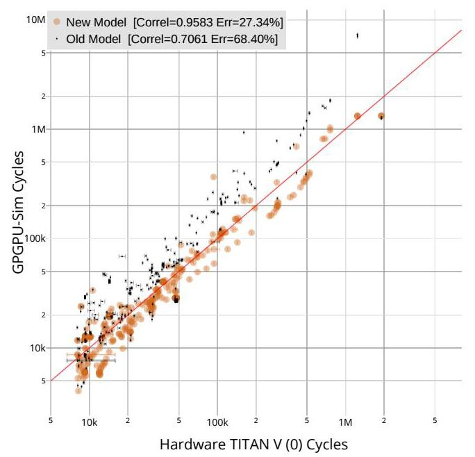

Fig. 7: Execution time correlation for the NVIDIA TITANV.

> 
图 7：NVIDIA TITANV 的执行时间相关性。


Figure 8 plots correlation for the L1 read accesses generated. Note that for all the counter correlation graphs, there are no errors on the hardware measurement, as the hardware nvprof profiler runs the app several times to collect the statistics and we have found these to be much more stable than execution time over successive runs of the apps. Moreover, we plot the results for all the kernels run, regardless of their execution time, as the counters are less noisy and more consistent than execution time. As figure 8 shows, the error in the new model has been reduced to almost zero, where the old model gives almost $50\%$ . This is primarily due to the implementation of Volta coalescer and the fact that the L1 cache is sectored. The consistent band of accesses in the old model at $y = 4x$ are reflective of this. $1128\mathrm{\;B}$ access in the old model will count as 4 sector accesses in the new model. Completely divergent applications show consistent behaviour between both models since 32 unique sectors are generated in the new model and 32 unique cache lines are generated in the old model.

> 
图8绘制了所生成的 L1 读访问 (L1 read accesses) 的相关性 (correlation)。注意，对于所有计数器相关性图 (counter correlation graphs)，硬件测量 (hardware measurement) 没有误差，因为硬件 nvprof 分析器 (nvprof profiler) 会多次运行应用以收集统计数据，并且我们发现这些数据在应用连续多次运行时比执行时间 (execution time) 稳定得多。此外，我们绘制了所有已运行内核 (kernels) 的结果，而不考虑其执行时间，因为计数器 (counters) 比执行时间噪声更小且更一致。如图8所示，新模型中的误差已降至几乎为零，而旧模型给出的误差几乎为 $50\%$。这主要是由于 Volta 合并器 (coalescer) 的实现以及 L1 缓存 (L1 cache) 是分扇区 (sectored) 的这一事实。旧模型中位于 $y = 4x$ 的一致访问带反映了这一点。旧模型中的 $1128\mathrm{\;B}$ 访问在新模型中将计为 4 次扇区访问 (sector accesses)。完全发散的应用 (completely divergent applications) 在两个模型之间表现出一致行为，因为新模型生成 32 个唯一扇区 (unique sectors)，而旧模型生成 32 条唯一缓存行 (unique cache lines)。


Figure 9 plots the corresponding hit rate for the L1 cache. We note that this statistic is particularly hard to correlate, given that the warp scheduling policy, cache replacement policy and hit/miss accounting decisions in the profiler can skew the results. For example, the through rigorous microbenchmarking we determined that the hardware profiler will count a sector miss on a cache line whose tag is already present as a "hit", but will still send the sector access down to the L2. Effectively, the profiler appears to be counting $128\mathrm{\;B}$ line cache tag hits, even if the sector is still fetched and the instruction must wait. Even with these variables, our improved cache model and coalescer achieve only $20\%$ error (a $2 \times$ improvement over the old model) and a correlation of 93%. In the apps where pervasive error still exist, we believe more detailed reverse engineering of the warp scheduling policy and L1 eviction policy would help.

> 
图 9 给出了 L1 缓存 (L1 cache) 相应的命中率 (hit rate)。我们注意到，这一统计量尤其难以进行相关性分析 (correlation analysis)，因为性能分析器 (profiler) 中的 warp 调度策略 (warp scheduling policy)、缓存替换策略 (cache replacement policy) 以及命中/缺失统计决策 (hit/miss accounting decisions) 都可能使结果产生偏差。例如，通过严谨的微基准测试 (microbenchmarking)，我们确定硬件性能分析器 (hardware profiler) 会将标签 (tag) 已存在的缓存行 (cache line) 上的扇区缺失 (sector miss) 计为“命中” (hit)，但仍会将扇区访问发送至 L2 缓存 (L2 cache)。实际上，性能分析器似乎是在统计 $128\mathrm{\;B}$ 行缓存标签命中 (line cache tag hits)，即使该扇区仍会被取回，且指令 (instruction) 必须等待。即使存在这些变量，我们改进的缓存模型 (improved cache model) 和合并器 (coalescer) 也仅达到 20% 的误差（相比旧模型有 2× 改进），相关性 (correlation) 为 93%。在仍然普遍存在误差的应用中，我们认为对 warp 调度策略 (warp scheduling policy) 和 L1 逐出策略 (L1 eviction policy) 进行更详细的逆向工程 (reverse engineering) 会有所帮助。


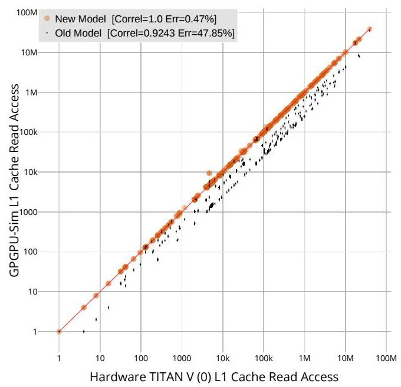

Fig. 8: L1 read accesses correlation for the NVIDIA TITANV.

> 
图 8：NVIDIA TITANV 的 L1 读访问 (L1 read accesses) 相关性 (correlation)。


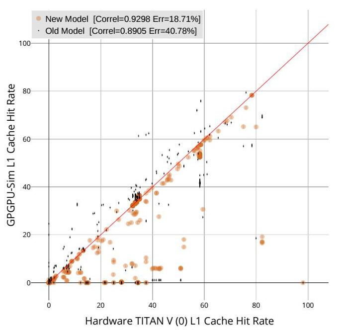

Fig. 9: L1 hit rate correlation for the NVIDIA TITANV.

> 
图 9：NVIDIA TITANV 的 L1 命中率 (hit rate) 相关性。


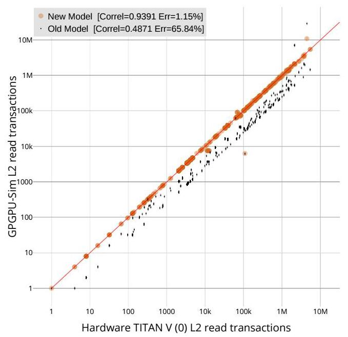

Fig. 10: L2 read transaction correlation with NVIDIA TITAN V.

> 
图 10：L2 读事务与 NVIDIA TITAN V 的相关性。


## C. Correlating the L2

To determine how well the memory system is operating at the memory controller level, we begin by examining the performance of the memory-side L2 data cache. Figure 10 plots the correlation of L2 read accesses versus hardware. Both correlation and error are much improved with the new model, with absolute error reaching only 1.15%. Interestingly, the relatively high error in L1 miss rate does not end up resulting in error at the L2 level. This leaves us to believe that most of the error is a result of accounting peculiarities for L1 cache hits, like the sector miss situation described previously.

> 
为了确定内存系统在内存控制器 (memory controller) 层面的运行状况，我们首先考察内存侧 L2 数据缓存 (memory-side L2 data cache) 的性能。图 10 绘制了 L2 读访问 (L2 read accesses) 与硬件 (hardware) 的相关性。新模型显著改善了相关性和误差，绝对误差 (absolute error) 仅达到 1.15%。有趣的是，L1 缺失率 (L1 miss rate) 中相对较高的误差最终并未导致 L2 层面 (L2 level) 出现误差。这使我们相信，大部分误差源于 L1 缓存命中 (L1 cache hits) 的统计核算特性 (accounting peculiarities)，例如前文所述的扇区缺失 (sector miss) 情形。


In terms of improvement over the old model, there is a significant fraction of error coming from accessing 128B lines instead of 32B sectors from the L1, again note the old model line at $y = 4x$ . We also collected information on write transactions, and noticed similar behaviour which is summarized in Table II.

> 
就相对于旧模型的改进而言，有相当大一部分误差来自从 L1 缓存 (L1 cache) 访问 128B 缓存行 (cache line) 而不是 32B 扇区 (sector)，再次注意位于 $y = 4x$ 的旧模型线。我们还收集了写事务 (write transaction) 的信息，并注意到类似的行为，其总结于表 II 中。


We also attempted to correlate the L2 cache read hit rate with simulation results, but found that the profiler gives inconsistent results, some of which are greater than 100%. So instead, we correlated with the number of L2 hits, which gave more grounded readings. Figure 10 presents the L2 read hit correlation. Overall, the hit error is roughly the same as the error on the L1 cache, Î5%. Again, at the L2 scheduling effects from the order in which memory accesses reach the L2 will have an effect on it's hit rate. The older model suffers significant error at the L2, even more than at the L1 (80% versus 40%). Our model shows significantly better correlation for two primary several reasons. First, since the number of accesses is more correlated the overall behaviour should be more similar. Second, our model fills the L2 on memory copies from the CPU avoiding many unnecessary misses in the L2 when kernels with smaller data sets begin. The majority of excessively low old model points are examples of this. We also collected data on the number of read hits, which showed a similar trend.

> 
我们还曾尝试将 L2 缓存读命中率 (L2 cache read hit rate) 与模拟结果进行关联，但发现性能分析器 (profiler) 给出的结果不一致，其中一些大于 100%。因此，我们改为关联 L2 命中数 (number of L2 hits)，这给出了更有依据的读数。图 10 展示了 L2 读命中相关性 (L2 read hit correlation)。总体而言，命中误差 (hit error) 与 L1 缓存 (L1 cache) 上的误差大致相同，为 Î5%。同样，在 L2 处，内存访问 (memory access) 到达 L2 的顺序所产生的调度效应 (scheduling effects) 会影响其命中率 (hit rate)。较旧的模型 (older model) 在 L2 处出现显著误差，甚至比在 L1 处更大（80% 对 40%）。我们的模型表现出显著更好的相关性，主要有两个原因。首先，由于访问数 (number of accesses) 的相关性更高，整体行为应当更相似。其次，我们的模型在来自 CPU 的内存拷贝 (memory copies) 时填充 L2，从而在数据集较小的内核 (kernels) 开始运行时避免了 L2 中的许多不必要未命中 (misses)。旧模型中大多数异常偏低的点都是这种情况的例子。我们还收集了读命中数 (number of read hits) 的数据，其呈现出相似的趋势。


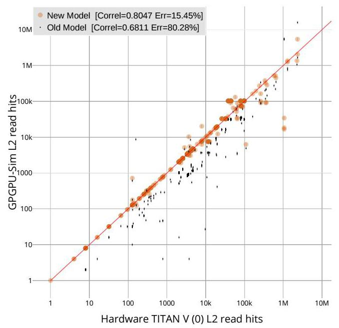

Fig. 11: L2 read hit transaction correlation with NVIDIA TITAN V.

> 
图 11：L2 读命中事务 (read hit transaction) 与 NVIDIA TITAN V 的相关性。


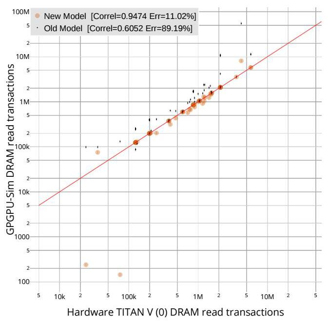

Fig. 12: DRAM read transactions correlation versus NVIDIA TITAN V.

> 
图 12：DRAM 读事务与 NVIDIA TITAN V 的相关性对比。


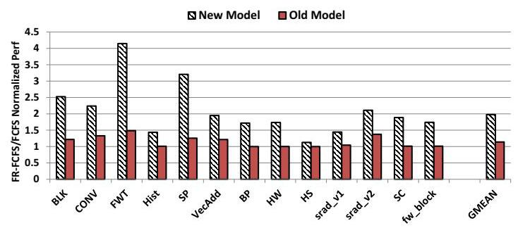

Fig. 13: FR_FCFS performance normalized to the FCFS in both old and new model.

> 
图 13：在旧模型和新模型中，FR_FCFS 的性能均以 FCFS 为基准进行归一化。


## D. Correlating DRAM

Finally, Figure 12 plots the correlation of DRAM read accesses. The error rate here is 15% (v.s. 89% for the old model). As expected, small errors in the upper levels of memory propagate into larger errors at the lower levels. The new model DRAM read correlation remains high and is again more accurate for larger kernels. Interestingly, the reason for the massive error in the old model was dues to its per-cacheline fetch on write policy (detailed in Section III-B). The end result of that policy was that every write to the writeback L2 fetched 4 32-byte memory values from DRAM, which is why the DRAM reads of the old model consistently are consistently overestimated. Our updated model has eliminated this problem by sectoring the cache and implementing a more intelligent write policy, explained in Section III-B. We note that we only collect data here for kernels that have at least 1000 dram accesses, as we found the counter values from hardware tended to be inconsistent at such small numbers and both the new and old model resulted in massive amounts of error due to being off by relatively few memory accesses.

> 
图 12 绘制了 DRAM 读取访问 (read access) 的相关性 (correlation)。这里的错误率 (error rate) 为 15%（旧模型为 89%）。正如预期，存储器层次中较高层 (upper levels) 的小误差会传播为较低层 (lower levels) 的更大误差。新模型的 DRAM 读取相关性仍然很高，并且对于更大规模的内核 (kernel) 依然更为准确。有趣的是，旧模型中巨大误差的原因在于其按缓存行 (per-cacheline) 的写时取回 (fetch-on-write) 策略（详见第 III-B 节）。该策略的最终结果是，每次对写回式 (writeback) L2 的写操作都会从 DRAM 取回 4 个 32 字节的存储值 (memory value)，这就是旧模型的 DRAM 读取量 (DRAM reads) 一直被高估的原因。我们更新后的模型通过对缓存进行扇区化 (sectoring) 并实现更智能的写策略 (write policy) 消除了这个问题，详见第 III-B 节。我们注意到，这里仅对至少具有 1000 次 DRAM 访问 (DRAM access) 的内核收集数据，因为我们发现来自硬件的计数器值 (counter value) 在如此小的数量下往往不一致，并且由于仅相差相对较少的内存访问 (memory access)，新模型和旧模型都会产生大量误差。


## V. DESIGN DECISION CASE STUDY

This section presents the effect of inaccurate memory system modeling on architectural design decisions. An inaccurate architecture model may lead to unrealistic issues or incorrect conclusions that are not relevant to state-of-the-art designs already being used in industry. This section demonstrates how our more accurate GPU model removes the well-studied bottleneck of L1 cache throughput and opens up new research opportunities in more advanced memory access scheduling.

> 
本节介绍不准确的内存系统建模 (memory system modeling) 对体系结构设计决策 (architectural design decisions) 的影响。不准确的体系结构模型 (architecture model) 可能导致不现实的问题或错误结论，而这些与工业界已在使用的最先进设计 (state-of-the-art designs) 无关。本节展示我们更准确的 GPU 模型 (GPU model) 如何消除已被充分研究的 L1 缓存吞吐量 (L1 cache throughput) 瓶颈，并在更高级的内存访问调度 (memory access scheduling) 方面开辟新的研究机会。


DRAM scheduler: Throughput-oriented GPGPU workloads are often sensitive to memory bandwidth. Thus, the DRAM memory scheduler plays an important role to efficiently utilize the memory bandwidth and improve the performance of memory-sensitive workloads. Figure 13 shows the sensitivity of GPGPU workloads for two memory scheduling policies: the naïve first-come first-serve scheduling (FCFS) and the advanced out-of-order First-row-ready first-come first-serve scheduling (FR_FCFS) [35]. The data is shown for FR_FCFS performance normalized to the FCFS in both old and new model. As shown in figure, the memory scheduling policy seems to be more important in the new model than the old model. In the old model, some workloads are insensitive or show little difference between the two scheduling policies. On average, 20% performance increase was observed when applying FR_FCFS in the old model. Yet, in the new model, the memory scheduling policy seems to be more critical. Applying FR_FCFS in the new model improves the performance by $2\mathrm{X}$ on average. This is due to updating the model to use the NVIDIA Volta memory access coalescing rules and modeling sectored and advanced write allocation policies in the L2 cache. Further, with the new features and capabilities of the GDDR5X and HBM such as dual-bus interface [12], pseudoindependent accesses [36] and per-bank refresh command [13], memory scheduling will become a more critical issue to investigate. This experiment demonstrates how accurately modeling contemporary GPU hardware reveals performance issues obscured using a less accurate simulation.

> 
DRAM 调度器 (DRAM scheduler)：吞吐量导向的 GPGPU 工作负载 (throughput-oriented GPGPU workloads) 通常对内存带宽 (memory bandwidth) 敏感。因此，DRAM 内存调度器在高效利用内存带宽并提升对内存敏感的工作负载 (memory-sensitive workloads) 的性能方面发挥着重要作用。图 13 展示了 GPGPU 工作负载对两种内存调度策略 (memory scheduling policies) 的敏感性：朴素的先来先服务调度 (naïve first-come first-serve scheduling, FCFS) 和先进的乱序首行就绪先来先服务调度 (out-of-order First-row-ready first-come first-serve scheduling, FR_FCFS) [35]。图中给出了在旧模型和新模型中，FR_FCFS 性能相对于 FCFS 归一化后的数据。如图所示，内存调度策略在新模型中似乎比在旧模型中更重要。在旧模型中，一些工作负载对两种调度策略不敏感，或表现出很小的差异。平均而言，在旧模型中应用 FR_FCFS 时观察到 20% 的性能提升。然而，在新模型中，内存调度策略似乎更为关键。在新模型中应用 FR_FCFS 平均可将性能提升 $2\mathrm{X}$。这是由于更新了模型，使其使用 NVIDIA Volta 内存访问合并规则 (memory access coalescing rules)，并在 L2 缓存 (L2 cache) 中对分扇区 (sectored) 和高级写分配策略 (advanced write allocation policies) 进行建模。此外，随着 GDDR5X 和 HBM 具备诸如双总线接口 (dual-bus interface) [12]、伪独立访问 (pseudoindependent accesses) [36] 和逐存储体刷新命令 (per-bank refresh command) [13] 等新特性与能力，内存调度将成为更值得研究的关键问题。该实验表明，准确地对当代 GPU 硬件进行建模，能够揭示使用较不准确的仿真时所掩盖的性能问题。


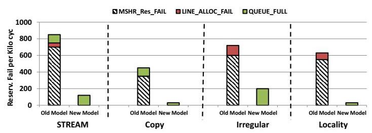

Fig. 14: L1 cache reservation fails per kilo cycles for some microbenchmarks.

> 
图 14：某些微基准测试 (microbenchmark) 中每千周期 (per kilo cycles) 的 L1 缓存 (L1 cache) 预留失败次数。


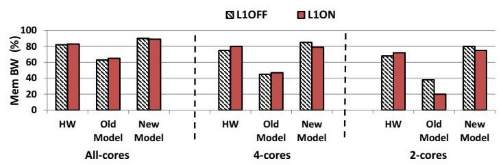

Fig. 15: BW utilization of STREAM workload for TITANV HW, Old Model and New Model when L1 cache is turned On and Off.

> 
图 15：当 L1 缓存 (L1 cache) 开启和关闭时，STREAM 工作负载 (STREAM workload) 在 TITAN V 硬件 (HW)、旧模型 (Old Model) 和新模型 (New Model) 上的带宽利用率 (BW utilization)。


L1 cache throughput: The L1 cache throughput bottleneck for GPUs has been well studied in literature [37]-[40]. Due to massive multithreading, GPGPU L1 caches can suffer from severe resource contention (e.g. miss status handling registers (MSHRs) and cache line allocation [37]). However, contemporary GPUs are designed such that the L1 cache is not a throughput bottleneck. The new GPUs employ advanced architecture techniques to improve L1 cache throughput, such as sectored, banked and streaming L1 caches (as discussed in section III-C). The new L1 cache eliminates the excessive L1 cache throughput contention. Figure 14 depicts the L1 cache reservation fails per kilo cycles for the new vs old model. The new L1 model eliminates reservation fails and the L1 cache is no longer a throughput bottleneck. Figure 15 demonstrates the bandwidth utilization when we run a highly streaming application (STREAM) on the new and old models vs the hardware. The figure plots results with the L1 cache on and off as we scale down the number of active cores, while keeping memory bandwidth the same. As shown in figure, the hardware is able to achieve 82%, 75% and 68% of the theoretical bandwidth when we run the workload on all SM cores, 4 and 2 cores respectively. The old model is not able to achieve the same bandwidth utilization due to the L1 cache bottleneck and inaccurate L2 cache replacement policy (as discussed in section III-B). Furthermore, the L1 cache is a clear bottleneck in the old model, as turning the cache on severely decreases memory utilization. Turning the L1 cache on in the new model has no effect on bandwidth utilization and very closely matches the performance of the hardware.

> 
L1 缓存吞吐量 (L1 cache throughput)：GPU 的 L1 缓存吞吐量瓶颈已在文献 [37]-[40] 中得到充分研究。由于大规模多线程，GPGPU L1 缓存可能遭受严重的资源争用（例如缺失状态处理寄存器 (miss status handling registers, MSHRs) 与缓存行分配 (cache line allocation) [37]）。然而，当代 GPU 的设计使 L1 缓存不再是吞吐量瓶颈。新的 GPU 采用先进架构技术来提高 L1 缓存吞吐量，例如分扇区 (sectored)、分体 (banked) 和流式 (streaming) 的 L1 缓存（如第 III-C 节所述）。新的 L1 缓存消除了过度的 L1 缓存吞吐量争用。图 14 展示了新模型与旧模型每千周期的 L1 缓存预留失败 (reservation fails) 次数。新的 L1 模型消除了预留失败，且 L1 缓存不再是吞吐量瓶颈。图 15 展示了在新模型和旧模型以及硬件上运行高度流式应用 (STREAM) 时的带宽利用率。该图给出了在保持内存带宽不变的情况下，随着活动核心数减少，开启和关闭 L1 缓存时的结果。如图所示，当分别在所有 SM 核心、4 个核心和 2 个核心上运行该工作负载时，硬件能够达到理论带宽的 82%、75% 和 68%。由于 L1 缓存瓶颈和不准确的 L2 缓存替换策略 (L2 cache replacement policy)（如第 III-B 节所述），旧模型无法达到相同的带宽利用率。此外，在旧模型中，L1 缓存是一个明显的瓶颈，因为开启该缓存会严重降低内存利用率。在新模型中开启 L1 缓存对带宽利用率没有影响，并且与硬件性能非常接近。


## VI. RELATED WORK

There are quite a few GPU simulators and instrumentation tools that are found in literature. Xun et al. [41] model GPU Kepler architecture [42] that is integrated with Multi2sim simulation infrastructure [43]. The new simulator was validated using few CUDA SDK applications. Barrio et al. [44] propose ATTILA which is a trace-driven GPU simulator that models the old GT200 architecture. Raghuraman et al. [45] propose Miaow, an open source RTL implementation of the AMD Southern Islands GPGPU ISA. Jason et al. [46] propose gem-gpu simulator in which they integrate GPGPU-sim with the well-known CPU simulator GEM5. The GPGPU-Sim memory system was replaced with GEM5 memory infrastructure. Beckmann [47], [48] proposed gem5s GPU, which models AMD GCN architecture. Kim et al. [49] proposed Mac-sim a trace-driven fermi-based GPU simulator based on Ocelot [50]. Stephenson et al. [51] introduce SASSI, a low-level assembly-language instrumentation tool for GPUs. Numerous works tried to demystify GPU architecture and memory system details through micro-benchmarks [4]-[7].

> 
文献中已有相当多的 GPU 模拟器 (simulator) 和插桩工具 (instrumentation tool)。Xun 等 [41] 对与 Multi2sim 仿真基础设施 (simulation infrastructure) [43] 集成的 GPU Kepler 架构 (Kepler architecture) [42] 进行建模。该新模拟器 (simulator) 使用少量 CUDA SDK 应用 (application) 进行了验证。Barrio 等 [44] 提出 ATTILA，这是一种跟踪驱动 (trace-driven) 的 GPU 模拟器 (GPU simulator)，对较旧的 GT200 架构 (architecture) 进行建模。Raghuraman 等 [45] 提出 Miaow，这是 AMD Southern Islands GPGPU ISA 的开源 (open source) RTL 实现 (RTL implementation)。Jason 等 [46] 提出 gem-gpu 模拟器 (simulator)，其中将 GPGPU-sim 与知名 CPU 模拟器 (CPU simulator) GEM5 集成。GPGPU-Sim 内存系统 (memory system) 被替换为 GEM5 内存基础设施 (memory infrastructure)。Beckmann [47], [48] 提出 gem5s GPU，对 AMD GCN 架构 (architecture) 进行建模。Kim 等 [49] 提出 Mac-sim，这是一种基于 Ocelot [50] 的跟踪驱动 (trace-driven)、基于 Fermi 的 (Fermi-based) GPU 模拟器 (GPU simulator)。Stephenson 等 [51] 介绍 SASSI，这是一种面向 GPU 的低级汇编语言 (assembly-language) 插桩工具 (instrumentation tool)。大量工作试图通过微基准测试 (micro-benchmark) [4]-[7] 揭示 GPU 架构 (architecture) 和内存系统 (memory system) 的细节。


Previous works have studied the deficiencies of GPGPU-Sim infrastructure. Nowatzki et al. [52] show that GPGPU-Sim is very inaccurate in modeling some in-core parameters and connection delays. Hongwen et al. [53] argue that GPGPU-Sim has a very weak L1 cache model and they suggest few enhancement to improve the L1 cache throughput. Also, Nugteren [5] validate GPGPU-Sim against real Fermi hardware and find that the simulator does not accurately model the L1 cache throughput, especially the number of miss status holding registers. There have been many works in literature that claim they model Kepler, Maxwell and Pascal architectures by scaling the Fermi resource, however none of these works correlate their new model against real hardware. A recent work [3] shows that there is a huge gap in GPGPU-Sim memory system modeling when correlated against Pascal hardware.

> 
已有工作研究了 GPGPU-Sim 基础设施 (infrastructure) 的缺陷。Nowatzki 等人 [52] 表明，GPGPU-Sim 在对某些核内参数 (in-core parameters) 和连接延迟 (connection delays) 建模时非常不准确。Hongwen 等人 [53] 认为 GPGPU-Sim 的 L1 缓存 (L1 cache) 模型非常薄弱，并提出了一些增强措施以提升 L1 缓存吞吐率 (L1 cache throughput)。此外，Nugteren [5] 对照真实 Fermi 硬件验证 GPGPU-Sim，发现该模拟器无法准确建模 L1 缓存吞吐率，尤其是未命中状态保持寄存器 (miss status holding registers) 的数量。文献中有许多工作声称通过缩放 Fermi 资源 (Fermi resource) 来建模 Kepler、Maxwell 和 Pascal 架构，但这些工作均未将其新模型与真实硬件进行关联验证。近期工作 [3] 表明，当与 Pascal 硬件进行关联验证时，GPGPU-Sim 的存储系统建模 (memory system modeling) 存在巨大差距。


Our new simulator demystifies and models the latest Volta architecture and shows a high correlation with real hardware, especially in memory system, on a wide range GPGPU workloads. To the best of our knowledge, this is the first work that accurately models a GPU Volta architecture in details. There are other few works [54], [55] that claim they use in-house closed-source modern Pascal simulator in their experiments, however, our new simulator is open-source.

> 
我们的新模拟器 (simulator) 揭开了最新 Volta 架构 (Volta architecture) 的细节并对其建模，在广泛的 GPGPU 工作负载 (GPGPU workloads) 上表现出与真实硬件 (real hardware) 的高度相关性，尤其是在存储系统 (memory system) 方面。据我们所知，这是首个在细节层面准确建模 GPU Volta 架构 (GPU Volta architecture) 的工作。另有少数工作 [54], [55] 声称在其实验中使用了内部闭源 (closed-source) 的现代 Pascal 模拟器 (Pascal simulator)，但我们的新模拟器 (simulator) 是开源的 (open-source)。


## VII. CONCLUSION

This paper presents the most accurate open-source model of a contemporary GPU to date. Our detailed hardware characterization and modeling effort decreases the execution time error in GPGPU-Sim, the most popular GPU simulator in use today, by $2.5 \times$ when running a comprehensive suite of contemporary workloads. Through our detailed micro-benchmarking and remodeling, we have uncovered a number of important design decisions made in the GPU memory system that no previous work has identified and no open-source simulator has attempted to model.

> 
本文提出了迄今为止最准确的当代 GPU 开源模型 (open-source model)。我们详细的硬件表征 (hardware characterization) 与建模工作 (modeling effort)，在运行一套全面的当代工作负载 (contemporary workloads) 时，将当今最流行的 GPU 模拟器 (GPU simulator) GPGPU-Sim 中的执行时间误差 (execution time error) 降低了 $2.5 \times$。通过细致的微基准测试 (micro-benchmarking) 与重新建模 (remodeling)，我们发现了 GPU 存储器系统 (GPU memory system) 中若干重要的设计决策 (design decisions)；此前没有任何工作识别出这些决策，也没有任何开源模拟器 (open-source simulator) 尝试对其建模。


The paper goes on to concretely demonstrates the effect this memory system error has on design decisions. Specifically, we show that error in the less detailed memory system model discounts the performance effects of out-of-order memory access scheduling, hampering potential research on the topic. Conversely, the less detailed model over-estimates the impact of L1 cache contention, as the throughput of the L1 cache is no longer a bottleneck to the memory system in contemporary GPUs.

> 
论文进一步具体展示了这种内存系统 (memory system) 误差对设计决策 (design decisions) 的影响。具体而言，我们表明，较不详细的内存系统 (memory system) 模型中的误差会低估乱序内存访问调度 (out-of-order memory access scheduling) 对性能的影响，从而阻碍该主题的潜在研究。相反，较不详细的模型会高估 L1 缓存争用 (L1 cache contention) 的影响，因为在当代 GPU 中，L1 缓存 (L1 cache) 的吞吐量 (throughput) 已不再是内存系统 (memory system) 的瓶颈 (bottleneck)。


In the process of creating our detailed model, we created the Correlator simulation and correlation infrastructure that can be easily used to validate new modeling efforts as new hardware and simulation models are created. We hope that releasing all the infrastructure used to perform this validation, along with the more detailed model itself, will help facilitate the continued development of simulation models that keep up with changes in contemporary industrial designs so that academics can more accurately study what should comes next.

> 
在创建我们的详细模型的过程中，我们构建了 Correlator 仿真与相关性分析 (correlation) 基础设施；随着新硬件和仿真 (simulation) 模型的产生，该基础设施可方便地用于验证新的建模 (modeling) 工作。我们希望，发布用于执行这一验证的全部基础设施以及更详细的模型本身，将有助于促进仿真模型的持续开发，使其跟得上当代工业设计的变化，从而使学术界能够更准确地研究接下来应当做什么。


## REFERENCES

[1] J. L. Hennessy and D. A. Patterson, Computer architecture: a quantitative approach. 2018.

> 
[1] J. L. Hennessy 和 D. A. Patterson，计算机体系结构：一种定量方法。2018年。


[2] T. M. Aamodt, W. W. Fung, I. Singh, A. El-Shafiey, J. Kwa, T. Hether-ington, A. Gubran, A. Boktor, T. Rogers, and A. Bakhoda, "GPGPU-Sim 3. x manual." http://gpgpu-sim.org/manual/index.php/Main_Page, 2016. Accessed June 29, 2016.

> 
[2] T. M. Aamodt、W. W. Fung、I. Singh、A. El-Shafiey、J. Kwa、T. Hether-ington、A. Gubran、A. Boktor、T. Rogers 和 A. Bakhoda，“GPGPU-Sim 3. x 手册 (manual)。” http://gpgpu-sim.org/manual/index.php/Main_Page，2016年。访问于2016年6月29日。


[3] A. Jain, M. Khairy, and T. G. Rogers, "A quantitative evaluation of contemporary gpu simulation methodology," Proceedings of the ACM on Measurement and Analysis of Computing Systems, vol. 2, no. 2, p. 35, 2018.

> 
[3] A. Jain、M. Khairy 和 T. G. Rogers，“当代 GPU 仿真方法学的定量评估 (A quantitative evaluation of contemporary GPU simulation methodology)，”《ACM 测量与分析计算系统论文集》(Proceedings of the ACM on Measurement and Analysis of Computing Systems)，第 2 卷，第 2 期，第 35 页，2018 年。


[4] H. Wong, M.-M. Papadopoulou, M. Sadooghi-Alvandi, and A. Moshovos, "Demystifying gpu microarchitecture through microbenchmarking," in Performance Analysis of Systems & Software (ISPASS), 2010 IEEE International Symposium on, pp. 235-246, IEEE, 2010.

> 
[4] H. Wong, M.-M. Papadopoulou, M. Sadooghi-Alvandi, and A. Moshovos, “通过微基准测试揭开 GPU 微架构 (Demystifying gpu microarchitecture through microbenchmarking),” in Performance Analysis of Systems & Software (ISPASS), 2010 IEEE International Symposium on, pp. 235-246, IEEE, 2010.


[5] C. Nugteren, G.-J. van den Braak, H. Corporaal, and H. Bal, "A detailed gpu cache model based on reuse distance theory," in High Performance Computer Architecture (HPCA), 2014 IEEE 20th International Symposium on, pp. 37-48, IEEE, 2014.

> 
[5] C. Nugteren、G.-J. van den Braak、H. Corporaal 和 H. Bal，“一种基于重用距离理论的详细 GPU 缓存模型”，载于《高性能计算机体系结构 (HPCA)，2014 年 IEEE 第 20 届国际研讨会论文集》，第 37-48 页，IEEE，2014。


[6] X. Mei and X. Chu, "Dissecting gpu memory hierarchy through microbenchmarking," IEEE Transactions on Parallel and Distributed Systems, vol. 28, no. 1, pp. 72-86, 2017.

> 
[6] X. Mei 和 X. Chu，“通过微基准测试 (microbenchmarking) 剖析 GPU 内存层次结构 (memory hierarchy)，” IEEE Transactions on Parallel and Distributed Systems，第 28 卷，第 1 期，第 72-86 页，2017 年。


[7] Z. Jia, M. Maggioni, B. Staiger, and D. P. Scarpazza, "Dissecting the nvidia volta gpu architecture via microbenchmarking," arXiv preprint arXiv:1804.06826, 2018.

> 
[7] Z. Jia、M. Maggioni、B. Staiger 和 D. P. Scarpazza，“通过微基准测试剖析 NVIDIA Volta GPU 架构”，arXiv 预印本 arXiv:1804.06826，2018。


[8] A. Bakhoda, G. L. Yuan, W. W. Fung, H. Wong, and T. M. Aamodt, "Analyzing cuda workloads using a detailed gpu simulator," in Performance Analysis of Systems and Software, 2009. ISPASS 2009. IEEE International Symposium on, pp. 163-174, IEEE, 2009.

> 
[8] A. Bakhoda、G. L. Yuan、W. W. Fung、H. Wong 和 T. M. Aamodt，“使用详细的 GPU 模拟器分析 CUDA 工作负载”，载于《系统与软件性能分析，2009。ISPASS 2009。IEEE 国际研讨会》，第 163-174 页，IEEE，2009。


[9] Nvidia, "Volta V100 White paper." http://images.nvidia.com/content/volta-architecture/pdf/volta-architecture-whitepaper.pdf, 2017.

> 
[9] Nvidia，《Volta V100 白皮书》。http://images.nvidia.com/content/volta-architecture/pdf/volta-architecture-whitepaper.pdf，2017。


[10] J. Choquette, O. Giroux, and D. Foley, "Volta: Performance and programmability," IEEE Micro, vol. 38, no. 2, pp. 42-52, 2018.

> 
[10] J. Choquette、O. Giroux 和 D. Foley，“Volta：性能与可编程性，”IEEE Micro，第 38 卷，第 2 期，第 42-52 页，2018 年。


[11] C. Nvidia, "Programming guide," 2018.

> 
[11] C. Nvidia，“编程指南 (Programming guide)”，2018。


[12] M. O?Connor, "Highlights of the high-bandwidth memory (hbm) standard," in Memory Forum Workshop, 2014.

> 
[12] M. O?Connor，《高带宽内存（high-bandwidth memory, hbm）标准的要点》，载于 Memory Forum Workshop，2014。


[13] J. Standard, "High bandwidth memory (hbm) dram," JESD235, 2013.

> 
[13] J. Standard, “高带宽内存 (High Bandwidth Memory, HBM) DRAM,” JESD235, 2013.


[14] nvidia, "Fermi." http://www.nvidia.com/content/PDF/fermi_white_papers/P.Glaskowsky_NVIDIA's_Fermi-The_First_Complete_GPU_ Architecture.pdf, 2012.

> 
[14] NVIDIA，“Fermi。”http://www.nvidia.com/content/PDF/fermi_white_papers/P.Glaskowsky_NVIDIA's_Fermi-The_First_Complete_GPU_ Architecture.pdf，2012。


[15] Nvidia, "Volta TITANV." https://www.nvidia.com/en-us/titan/titan-v/, 2017.

> 
[15] 英伟达 (Nvidia)，“Volta TITANV.” https://www.nvidia.com/en-us/titan/titan-v/, 2017.


[16] Paulius Micikevicius, "Kepler Architecture." http://on-demand.gputechconf.com/gtc/2013/presentations/S3466-Programming-Guidelines-GPU-Architecture.pdf, 2013.

> 
[16] Paulius Micikevicius，《Kepler 架构 (Kepler Architecture)》。http://on-demand.gputechconf.com/gtc/2013/presentations/S3466-Programming-Guidelines-GPU-Architecture.pdf，2013。


[17] A. M. Aji, M. Daga, and W.-c. Feng, "Bounding the effect of partition camping in gpu kernels," in Proceedings of the 8th ACM International Conference on Computing Frontiers, p. 27, ACM, 2011.

> 
[17] A. M. Aji、M. Daga 和 W.-c. Feng，“界定 GPU 内核 (kernel) 中分区露营 (partition camping) 的影响”，载于《第 8 届 ACM 国际计算前沿会议论文集》，第 27 页，ACM，2011。


[18] Y. Liu, X. Zhao, M. Jahre, Z. Wang, X. Wang, Y. Luo, and L. Eeckhout, "Get out of the valley: power-efficient address mapping for gpus," in 2018 ACM/IEEE 45th Annual International Symposium on Computer Architecture (ISCA), pp. 166-179, IEEE, 2018.

> 
[18] Y. Liu、X. Zhao、M. Jahre、Z. Wang、X. Wang、Y. Luo 和 L. Eeckhout，<“走出低谷：面向 GPU 的高能效地址映射 (Get out of the valley: power-efficient address mapping for gpus)”>，载于 2018 ACM/IEEE 第45届计算机体系结构国际研讨会 (Annual International Symposium on Computer Architecture, ISCA)，第 166-179 页，IEEE，2018。


[19] J. Stuecheli, D. Kaseridis, D. Daly, H. C. Hunter, and L. K. John, "The virtual write queue: Coordinating dram and last-level cache policies," in ACM SIGARCH Computer Architecture News, vol. 38, pp. 72-82, ACM, 2010.

> 
[19] J. Stuecheli、D. Kaseridis、D. Daly、H. C. Hunter 和 L. K. John，“虚拟写队列 (virtual write queue)：协调 DRAM 与末级缓存 (last-level cache) 策略”，载于 ACM SIGARCH Computer Architecture News，第 38 卷，第 72–82 页，ACM，2010 年。


[20] C. J. Lee, V. Narasiman, E. Ebrahimi, O. Mutlu, and Y. N. Patt, "Dram-aware last-level cache writeback: Reducing write-caused interference in memory systems," 2010.

> 
[20] C. J. Lee、V. Narasiman、E. Ebrahimi、O. Mutlu 和 Y. N. Patt，“DRAM感知 (DRAM-aware) 的最后一级缓存写回 (last-level cache writeback)：减少内存系统 (memory systems) 中由写操作引起的干扰 (Reducing write-caused interference in memory systems)，” 2010。


[21] N. Chatterjee, M. O'Connor, G. H. Loh, N. Jayasena, and R. Bala-subramonian, "Managing dram latency divergence in irregular gpgpu applications," in Proceedings of the International Conference for High Performance Computing, Networking, Storage and Analysis, pp. 128- 139, IEEE Press, 2014.

> 
[21] N. Chatterjee, M. O'Connor, G. H. Loh, N. Jayasena, and R. Bala-subramonian, “管理不规则 GPGPU 应用中的 DRAM 延迟差异 (Managing DRAM Latency Divergence in Irregular GPGPU Applications),” 载于 Proceedings of the International Conference for High Performance Computing, Networking, Storage and Analysis, pp. 128-139, IEEE Press, 2014.


[22] S. Che, M. Boyer, J. Meng, D. Tarjan, J. W. Sheaffer, S.-H. Lee, and K. Skadron, "Rodinia: A benchmark suite for heterogeneous computing," in Workload Characterization, 2009. IISWC 2009. IEEE International Symposium on.

> 
[22] S. Che, M. Boyer, J. Meng, D. Tarjan, J. W. Sheaffer, S.-H. Lee, and K. Skadron，“Rodinia：用于异构计算 (heterogeneous computing) 的基准测试套件 (benchmark suite)”，载于 Workload Characterization, 2009. IISWC 2009. IEEE International Symposium on.


[23] NVIDIA, "CUDA C/C++ SDK Code Samples." http://developer.nvidia.com/cuda-cc-sdk-code-samples, 2015.

> 
[23] NVIDIA，“CUDA C/C++ SDK 代码示例 (Code Samples)”。http://developer.nvidia.com/cuda-cc-sdk-code-samples，2015。


[24] J. A. Stratton, C. Rodrigues, I.-J. Sung, N. Obeid, L.-W. Chang, N. Anssari, G. D. Liu, and W. Hwu, "Parboil: A revised benchmark suite for scientific and commercial throughput computing," Center for Reliable and High-Performance Computing, 2012.

> 
[24] J. A. Stratton、C. Rodrigues、I.-J. Sung、N. Obeid、L.-W. Chang、N. Anssari、G. D. Liu 和 W. Hwu，“Parboil：面向科学与商业吞吐计算 (throughput computing) 的修订基准套件 (benchmark suite)，”可靠与高性能计算中心 (Center for Reliable and High-Performance Computing)，2012。


[25] S. Che, B. M. Beckmann, S. K. Reinhardt, and K. Skadron, "Pannotia: Understanding irregular gpgpu graph applications," in Workload Characterization (IISWC), 2013 IEEE International Symposium on, pp. 185- 195, IEEE, 2013.

> 
[25] S. Che、B. M. Beckmann、S. K. Reinhardt 和 K. Skadron，*“Pannotia：理解不规则 GPGPU 图应用 (Understanding irregular gpgpu graph applications)”*，载于《工作负载表征 (Workload Characterization, IISWC)》，2013 IEEE 国际研讨会 (2013 IEEE International Symposium on)，第 185–195 页，IEEE，2013。


[26] M. Burtscher, R. Nasre, and K. Pingali, "A quantitative study of irregular programs on gpus," in Workload Characterization (IISWC), 2012 IEEE International Symposium on, pp. 141-151, IEEE, 2012.

> 
[26] M. Burtscher、R. Nasre 和 K. Pingali，“GPU 上不规则程序的定量研究 (A quantitative study of irregular programs on GPUs)”，载于 2012 IEEE 国际工作负载特征化研讨会 (Workload Characterization, IISWC)，第 141–151 页，IEEE，2012。


[27] A. Danalis, G. Marin, C. McCurdy, J. S. Meredith, P. C. Roth, K. Spaf-ford, V. Tipparaju, and J. S. Vetter, "The scalable heterogeneous computing (SHOC) benchmark suite," in Proceedings of the 3rd Workshop on General-Purpose Computation on Graphics Processing Units, 2010.

> 
[27] A. Danalis、G. Marin、C. McCurdy、J. S. Meredith、P. C. Roth、K. Spaf-ford、V. Tipparaju 和 J. S. Vetter，“可扩展异构计算 (SHOC) 基准测试套件”，载于《第 3 届图形处理器通用计算研讨会论文集》，2010 年。


[28] LLNL, “LULESH.” https://computation.llnl.gov/projects/codesign/lulesh, 2017.

> 
[28] LLNL，“LULESH。” https://computation.llnl.gov/projects/codesign/lulesh，2017。


[29] nvidia, "Nvidia Profiler 8.0," 2017.

> 
[29] nvidia，《Nvidia 性能分析器 (Profiler) 8.0》，2017 年。


[30] J. Liptay, "Structural aspects of the system/360 model 85," Readings in computer architecture, p. 373, 2000.

> 
[30] J. Liptay，〈System/360 Model 85 的结构方面〉(Structural aspects of the system/360 model 85)，《计算机体系结构读本》(Readings in computer architecture)，第 373 页，2000 年。


[31] A. Seznec, "Decoupled sectored caches: conciliating low tag implementation cost," in ACM SIGARCH Computer Architecture News, vol. 22, pp. 384-393, IEEE Computer Society Press, 1994.

> 
[31] A. Seznec，“解耦分扇区缓存 (Decoupled sectored caches)：协调低标签实现成本，”载于 ACM SIGARCH Computer Architecture News，第 22 卷，第 384–393 页，IEEE Computer Society Press，1994 年。


[32] N. P. Jouppi, Cache write policies and performance, vol. 21. ACM, 1993.

> 
[32] N. P. Jouppi，缓存写策略与性能 (Cache write policies and performance)，第21卷。ACM，1993。


[33] Nvidia, "Volta Cache." http://on-demand.gputechconf.com/gtc/2017/presentation/s7798-luke-durant-inside-volta.pdf, 2017.

> 
[33] Nvidia，“Volta 缓存 (Volta Cache)。” http://on-demand.gputechconf.com/gtc/2017/presentation/s7798-luke-durant-inside-volta.pdf，2017。


[34] J. Tuck, L. Ceze, and J. Torrellas, "Scalable cache miss handling for high memory-level parallelism," in Proceedings of the 39th Annual IEEE/ACM International Symposium on Microarchitecture, pp. 409-422, IEEE Computer Society, 2006.

> 
[34] J. Tuck、L. Ceze 和 J. Torrellas，“面向高内存级并行 (high memory-level parallelism) 的可扩展缓存缺失处理 (scalable cache miss handling)，”载于第39届IEEE/ACM微架构国际研讨会 (Annual IEEE/ACM International Symposium on Microarchitecture) 论文集，第409-422页，IEEE Computer Society，2006年。


[35] S. Rixner, W. J. Dally, U. J. Kapasi, P. Mattson, and J. D. Owens, "Memory access scheduling," in ACM SIGARCH Computer Architecture News, vol. 28, pp. 128-138, ACM, 2000.

> 
[35] S. Rixner、W. J. Dally、U. J. Kapasi、P. Mattson 和 J. D. Owens，“内存访问调度 (Memory access scheduling)，”载于 ACM SIGARCH Computer Architecture News，第 28 卷，第 128-138 页，ACM，2000。


[36] J. Standard, "Gddr5x," JESD232A, 2013.

> 
[36] J. Standard，“Gddr5x，”JESD232A，2013。


[37] W. Jia, K. A. Shaw, and M. Martonosi, "Mrpb: Memory request prioriti-zation for massively parallel processors," in High Performance Computer Architecture (HPCA), 2014 IEEE 20th International Symposium on, pp. 272-283, IEEE, 2014.

> 
[37] W. Jia、K. A. Shaw 和 M. Martonosi，“Mrpb：面向大规模并行处理器的内存请求优先级排序 (Memory request prioritization for massively parallel processors)”，载于《高性能计算机体系结构 (High Performance Computer Architecture, HPCA)》，2014 年 IEEE 第 20 届国际研讨会，第 272-283 页，IEEE，2014。


[38] A. Sethia, D. A. Jamshidi, and S. Mahlke, "Mascar: Speeding up gpu warps by reducing memory pitstops," in High Performance Computer Architecture (HPCA), 2015 IEEE 21st International Symposium on, pp. 174-185, IEEE, 2015.

> 
[38] A. Sethia、D. A. Jamshidi 和 S. Mahlke，《Mascar：通过减少内存中途停顿来加速 GPU 线程束 (warp)》，载于《2015 年 IEEE 第 21 届高性能计算机体系结构国际研讨会 (HPCA) 论文集》，第 174-185 页，IEEE，2015 年。


[39] K. H. Kim, R. Boyapati, J. Huang, Y. Jin, K. H. Yum, and E. J. Kim, "Packet coalescing exploiting data redundancy in gpgpu architectures," in Proceedings of the International Conference on Supercomputing, p. 6, ACM, 2017.

> 
[39] K. H. Kim、R. Boyapati、J. Huang、Y. Jin、K. H. Yum 和 E. J. Kim，“利用 GPGPU 架构中的数据冗余 (data redundancy) 进行分组合并 (packet coalescing)，”载于 Proceedings of the International Conference on Supercomputing，第 6 页，ACM，2017。


[40] G. Koo, Y. Oh, W. W. Ro, and M. Annavaram, "Access pattern-aware cache management for improving data utilization in gpu," in Proceedings of the 44th Annual International Symposium on Computer Architecture, pp. 307-319, ACM, 2017.

> 
[40] G. Koo、Y. Oh、W. W. Ro 和 M. Annavaram，“面向访问模式感知 (access pattern-aware) 的缓存管理 (cache management) 以提高 GPU 中的数据利用率 (data utilization)，”载于《第44届计算机体系结构 (computer architecture) 国际研讨会论文集》，第307–319页，ACM，2017。


[41] X. Gong, R. Ubal, and D. Kaeli, "Multi2sim kepler: A detailed architectural gpu simulator," in Performance Analysis of Systems and Software (ISPASS), 2017 IEEE International Symposium on, pp. 269-278, IEEE, 2017.

> 
[41] X. Gong、R. Ubal 和 D. Kaeli，“Multi2sim kepler：详细的架构级 GPU 模拟器 (A detailed architectural GPU simulator)”，载于系统与软件性能分析 (Performance Analysis of Systems and Software, ISPASS)，2017 IEEE 国际研讨会，第 269–278 页，IEEE，2017。


[42] nvidia, "Kepler." https://www.nvidia.com/content/PDF/kepler/NVIDIA-Kepler-GK110-Architecture-Whitepaper.pdf, 2012.

> 
[42] 英伟达 (NVIDIA)，"开普勒 (Kepler)"。https://www.nvidia.com/content/PDF/kepler/NVIDIA-Kepler-GK110-Architecture-Whitepaper.pdf，2012。


[43] R. Ubal, B. Jang, P. Mistry, D. Schaa, and D. Kaeli, "Multi2sim: a simulation framework for cpu-gpu computing," in Parallel Architectures and Compilation Techniques (PACT), 2012 21st International Conference on, pp. 335-344, IEEE, 2012.

> 
[43] R. Ubal、B. Jang、P. Mistry、D. Schaa 和 D. Kaeli，“Multi2sim：面向 CPU-GPU 计算的仿真框架 (a simulation framework for cpu-gpu computing)”，见《并行体系结构与编译技术 (PACT)》，2012 年第 21 届国际会议，第 335-344 页，IEEE，2012。


[44] V. M. Del Barrio, C. González, J. Roca, A. Fernández, and E. Espasa, "Attila: a cycle-level execution-driven simulator for modern gpu architectures," in Performance Analysis of Systems and Software, 2006 IEEE International Symposium on, pp. 231-241, IEEE, 2006.

> 
[44] V. M. Del Barrio、C. González、J. Roca、A. Fernández 和 E. Espasa，“Attila：面向现代 GPU 架构的周期级执行驱动模拟器 (cycle-level execution-driven simulator)，” 载于《系统与软件性能分析，2006 IEEE 国际研讨会论文集》(Performance Analysis of Systems and Software, 2006 IEEE International Symposium on)，第 231-241 页，IEEE，2006。


[45] R. Balasubramanian, V. Gangadhar, Z. Guo, C.-H. Ho, C. Joseph, J. Menon, M. P. Drumond, R. Paul, S. Prasad, P. Valathol, et al., "Miaow-an open source rtl implementation of a gpgpu," in Low-Power and High-Speed Chips (COOL CHIPS XVIII), 2015 IEEE Symposium in, pp. 1-3, IEEE, 2015.

> 
[45] R. Balasubramanian, V. Gangadhar, Z. Guo, C.-H. Ho, C. Joseph, J. Menon, M. P. Drumond, R. Paul, S. Prasad, P. Valathol, 等, "Miaow——一个GPGPU的开源寄存器传输级 (RTL) 实现," 于低功耗与高速芯片 (COOL CHIPS XVIII) 2015年IEEE研讨会, 第1-3页, IEEE, 2015.


[46] J. Power, J. Hestness, M. S. Orr, M. D. Hill, and D. A. Wood, "gem5- gpu: A heterogeneous CPU-GPU simulator," Computer Architecture Letters, 2014.

> 
[46] J. Power、J. Hestness、M. S. Orr、M. D. Hill 和 D. A. Wood，《gem5-gpu：一种异构 CPU-GPU 模拟器 (A heterogeneous CPU-GPU simulator)》，《Computer Architecture Letters》，2014。


[47] B. Beckmann and A. Gutierrez, "The amd gem5 apu simulator: Modeling heterogeneous systems in gem5," in Tutorial at the Intl Symp. on Microarchitecture (MICRO), 2015.

> 
[47] B. Beckmann 与 A. Gutierrez，〈amd gem5 apu 模拟器 (simulator)：在 gem5 中对异构系统 (heterogeneous systems) 建模〉，载于《微架构国际研讨会 (MICRO) 教程 (Tutorial)》，2015。


[48] A. Gutierrez, B. M. Beckmann, A. Dutu, J. Gross, M. LeBeane, J. Kalamatianos, O. Kayiran, M. Poremba, B. Potter, S. Puthoor, et al., "Lost in abstraction: Pitfalls of analyzing gpus at the intermediate language level," in High Performance Computer Architecture (HPCA), 2018 IEEE International Symposium on, pp. 608-619, IEEE, 2018.

> 
[48] A. Gutierrez、B. M. Beckmann、A. Dutu、J. Gross、M. LeBeane、J. Kalamatianos、O. Kayiran、M. Poremba、B. Potter、S. Puthoor 等，“迷失在抽象中：在中间语言 (intermediate language) 层面分析 GPU 的陷阱，”载于《高性能计算机体系结构 (High Performance Computer Architecture, HPCA)》，2018 年 IEEE 国际研讨会，第 608-619 页，IEEE，2018。


[49] H. Kim, J. Lee, N. B. Lakshminarayana, J. Sim, J. Lim, and T. Pho, "Macsim: A cpu-gpu heterogeneous simulation framework user guide," Georgia Institute of Technology, 2012.

> 
[49] H. Kim、J. Lee、N. B. Lakshminarayana、J. Sim、J. Lim 和 T. Pho，《Macsim：CPU-GPU 异构仿真框架用户指南》，佐治亚理工学院，2012。


[50] G. Diamos, A. Kerr, S. Yalamanchili, and N. Clark, "Ocelot: A dynamic compiler for bulk-synchronous applications in heterogenous systems," in 19th International Conference on Parallel Architecture and Compilation Techniques (PACT-19), 2010.

> 
[50] G. Diamos、A. Kerr、S. Yalamanchili 和 N. Clark，题为“Ocelot：异构系统 (heterogenous systems) 中批量同步 (bulk-synchronous) 应用的动态编译器”，载于第19届并行架构与编译技术国际会议 (PACT-19)，2010年。


[51] M. Stephenson, S. K. Sastry Hari, Y. Lee, E. Ebrahimi, D. R. Johnson, D. Nellans, M. O'Connor, and S. W. Keckler, "Flexible software profiling of gpu architectures," in ACM SIGARCH Computer Architecture News, vol. 43, pp. 185-197, ACM, 2015.

> 
M. Stephenson, S. K. Sastry Hari, Y. Lee, E. Ebrahimi, D. R. Johnson, D. Nellans, M. O'Connor, and S. W. Keckler, “GPU 架构的灵活软件剖析 (Flexible software profiling of gpu architectures),” in ACM SIGARCH Computer Architecture News, vol. 43, pp. 185-197, ACM, 2015.


[52] T. Nowatzki, J. Menon, C.-H. Ho, and K. Sankaralingam, "gem5, gpgpusim, mcpat, gpuwattch," your favorite simulator here" considered harmful," 2014.

> 
[52] T. Nowatzki、J. Menon、C.-H. Ho 和 K. Sankaralingam，“gem5、gpgpusim、mcpat、gpuwattch，‘你最喜欢的模拟器 (simulator) 在此’被认为有害，”2014。


[53] H. Dai, C. Li, Z. Lin, and H. Zhou, "The demand for a sound baseline in gpu memory architecture research," 2017.

> 
[53] H. Dai、C. Li、Z. Lin 和 H. Zhou，《GPU内存架构 (GPU memory architecture) 研究中对可靠基线 (sound baseline) 的需求》，2017。


[54] N. Chatterjee, M. O?Connor, D. Lee, D. R. Johnson, S. W. Keckler, M. Rhu, and W. J. Dally, "Architecting an energy-efficient dram system for gpus," in High Performance Computer Architecture (HPCA), 2017 IEEE International Symposium on, pp. 73-84, IEEE, 2017.

> 
[54] N. Chatterjee, M. O?Connor, D. Lee, D. R. Johnson, S. W. Keckler, M. Rhu, and W. J. Dally, “为图形处理器 (GPU) 构建节能的动态随机存取存储器 (DRAM) 系统，” 载于《高性能计算机体系结构 (High Performance Computer Architecture, HPCA)》，2017 年 IEEE 国际研讨会，第 73-84 页，IEEE，2017。


[55] M. O'Connor, N. Chatterjee, D. Lee, J. Wilson, A. Agrawal, S. W. Keckler, and W. J. Dally, "Fine-grained dram: energy-efficient dram for extreme bandwidth systems," in Proceedings of the 50th Annual IEEE/ACM International Symposium on Microarchitecture, pp. 41-54,

> 
[55] M. O'Connor、N. Chatterjee、D. Lee、J. Wilson、A. Agrawal、S. W. Keckler 和 W. J. Dally，“细粒度动态随机存取存储器 (fine-grained DRAM)：面向极端带宽系统的高能效动态随机存取存储器 (energy-efficient DRAM)，”载于第 50 届 IEEE/ACM 微架构国际研讨会（Annual IEEE/ACM International Symposium on Microarchitecture）论文集，第 41–54 页，


ACM, 2017.

> 
ACM，2017。
