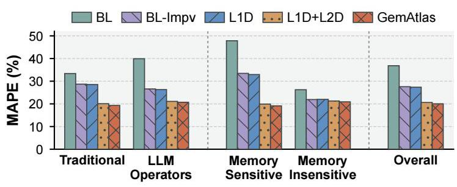
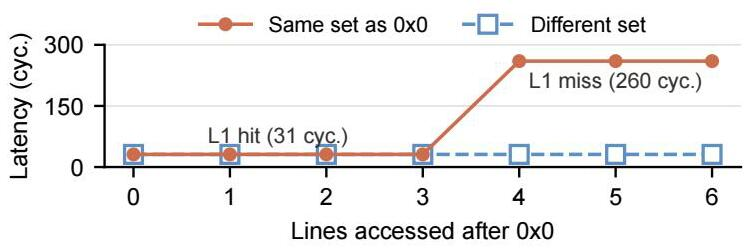
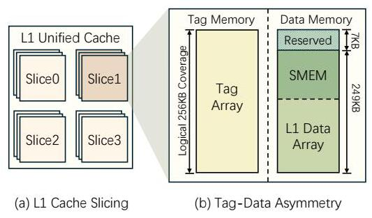
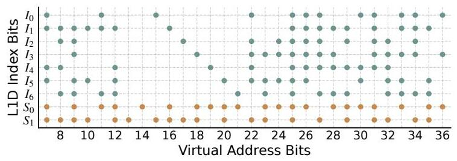
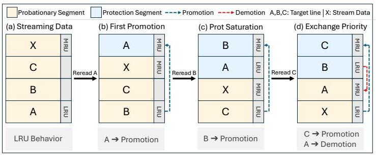
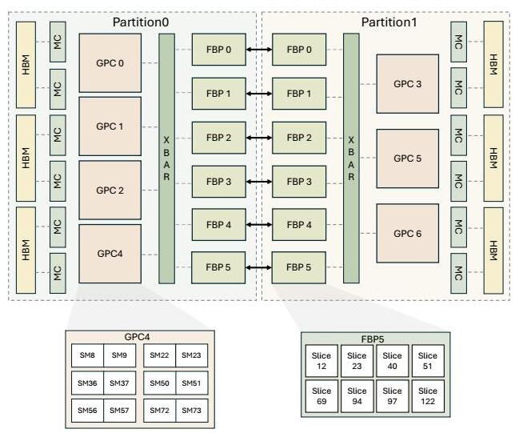
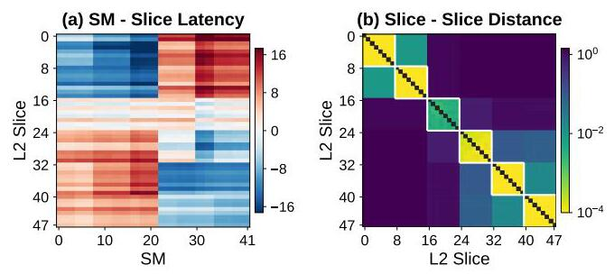
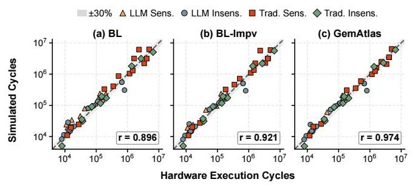

# Uncovering the Memory Hierarchy of Modern NVIDIA GPUs for Accurate Simulation — GemAtlas 深度解读

> **作者**：Ziwen Wang、Jiapeng Zhou、Changxi Liu、Dongsheng Wang、Yun Chen；香港科技大学（广州）、清华大学。  
> **发表信息**：arXiv 预印本，2026，本文依据 `2611.13860v1.pdf`；所读版本未标明已录用会议。  
> **一句话总结**：GemAtlas 用直接控制 GPU 机器指令的微基准，将现代 NVIDIA GPU 的缓存切片、地址路由、替换与跨分区复制机制转化为可验证的模拟模型，使四款 GPU 的平均执行周期预测 MAPE 从 31.69% 降至 22.24%。  
> **阅读范围**：完整正文 I–X、表 I–VI、图 1–8 和参考文献；此版本无附录。下文区分实验观察、作者推断及尚未解决的机制；中文全文见同目录 [translated.md](translated.md)。

## 一、问题定义（Problem）

### 先建立背景：容量相同的缓存，行为也可能完全不同

GPU 的线程块被分配到 Streaming Multiprocessor（SM），SM 又归属于 Graphics Processing Cluster（GPC）。一个 SM 内的 L1 data cache 与程序显式管理的 shared memory（SMEM）共用一块存储资源；多个 SM 通过片上互连访问分布式 L2，L2 后面才是 HBM 等显存。常量加载还有专门的 constant-memory 路径，不能全部当作普通 L1 数据访问。

理解本文至少需要分清三种划分。**Partition** 决定一个 SM 到 L2 的访问是本地还是跨分区；**slice** 是可独立寻址、处理请求的缓存切片；**set** 则是 slice 内决定哪些缓存行彼此争夺有限 way 的集合。Frame Buffer Partition（FBP）位于 partition 和 slice 之间，聚合若干 slice 并连接存储控制器。仅知道“L2 有 60 MiB”无法知道并行服务能力，也无法判断两个地址是否发生冲突。

传统组相联缓存通常让 tag（缓存行身份信息）和 data（实际内容）一一对应。本文发现，现代 GPU 的 L1 tag 数量可以固定，而 data 容量随着 SMEM 分配变化。因此“目标 set 还有空位”不代表“这条数据一定能直接放入”：同一 slice 的数据空间可能已经耗尽，需要驱逐别的 set 中的内容。这正是容量模型无法表达的行为。

### 本文解决的是已有问题中的机制缺口

这是一项**改进并系统整合已有方向的工作**，不是首次研究 GPU 缓存。前人已经测过容量、行大小、延迟和部分相联度，也研究过 NoC 与 NUMA 拓扑；Accel-Sim 等模拟器亦能运行真实程序。但现代硬件的 set 映射、slice 路由、替换状态机、跨 partition 副本行为仍缺少统一描述，模拟器常以旧硬件结构配上新容量数字继续使用。

后果并非只是某个参数不准确：若模拟器把 96 个并行 slice 建成 48 个，会低估并发服务能力；若把所有 L2 命中当成同一种延迟，又会忽略跨分区成本。LLM 的 attention、KV-cache 管理、归一化、量化和 MoE 算子有不同的访存模式，单靠 GEMM 不能暴露这些错误。

**图 7 提前放在这里，是因为它直接支撑问题的必要性。**H20 上旧基线 BL 的 LLM 算子 MAPE 为 39.91%，将公开容量和带宽等参数改正确后的 BL-Impv 仍有 26.59%；加入恢复的机制后降至 20.69%。内存敏感负载的 BL-Impv 误差为 33.46%，GemAtlas 为 19.12%，说明机制缺口有可观测的影响。注意：39.91% 是 H20 的旧基线口径，不能与摘要中的四 GPU、已校准基线平均值 34.04% 混用。

**动机评估。**动机扎实：作者既给出微观冲突与延迟证据，也给出实际算子的模拟误差。不过 BL 保留 RTX A6000 的不少参数，对 H20 本就不合适，因此主要应看与 BL-Impv 的差距。另一个边界是这里评估单个 kernel 的冷缓存执行，不能直接声称同样改善了完整 LLM 服务系统的端到端预测。

**核心 Insight。**先把地址送往哪个物理位置与该位置如何替换数据分开，再通过受控的访问序列恢复两者，才能建立可迁移的机制模型。SASS 保证探针确实按预期执行；驱逐集合把冲突限制在单个 set；路由 hash 则把大规模搜索限制在单个 slice。它们形成相互验证的链条，而不是只对整体运行时间做参数拟合。

## 二、相关工作（Related Work）

原文第 IX 节按“测量方法—架构发现—模拟器影响”组织比较，同时穿插从 GT200、Volta/Turing、Ampere 到 Hopper 的演进。可将研究脉络归为三条。

**第一条是组件级微基准。**Wong 等、Mei 与 Chu、Jia 等以及后来的 Hopper 测量和 MT4G，逐步给出缓存容量、行大小、延迟、拓扑等信息。这些成果提供了基本参数，但高层 CUDA/PTX 测量会混入编译器重排、依赖指令或冷失效成本；不规则的地址映射又容易与替换行为混淆。GemAtlas 的贡献是通过原生 SASS 和单 set 实验，将这两类因素拆开。例如前人在 H20 上报告 38 或 41 周期 L1 命中，本文给出只计目标加载的 31 周期。

**第二条是地址映射和驱逐集合方法。**本文继承 group elimination、bit-flip hash recovery，以及用指令取指驱逐统一常量缓存的方法，并非从零发明这些工具。新的关键组合是：先得到 slice 路由，再在对应 partition 的 SM 上、仅用目标 slice 的地址做 group elimination。这解决了大型分区式 L2 中候选池过大以及跨分区复制干扰的问题。

**第三条是周期级模拟器和硬件建模。**GPGPU-Sim、Accel-Sim、gem5 GPU 模型与 MGPUSim 都需要合理的存储层次模型；Huerta 等近期工作主要推进现代 GPU 核心建模。GemAtlas 将这种细化延伸到存储系统，并扩充真实 LLM 算子覆盖。它没有证明所有 GPU 模拟器都得到相同收益，实证对象是基于 Huerta 等扩展的 Accel-Sim v1.3.0。

原文表 I 对“新发现”“改进已有测量”和“未覆盖”作了区分，这一点比“首次系统逆向”的宣传语更有用：L1 四 slice、tag/data 非对称、SLRU 和常量缓存 Tree-PLRU 属于核心新增发现；GCC 容量等则有前人基础；**L2 set-index hash、GCC 的确切替换策略仍未恢复**。报告中不应把“系统性”误读为“每个层级都完全破解”。

## 三、技术挑战（Challenges）

1. **探针执行本身不可随意假定。**CUDA/PTX 会经过后端优化，且现代 NVIDIA GPU 用指令中的 scoreboard 控制字段管理依赖；访问序列或计时边界改变，就可能把编译器行为误判成硬件行为。
2. **同一次失效存在多个解释。**目标 set 满、slice 的 data 空间满、另一 partition 的复制流量，都可能改变命中结果；必须用同 set/不同 set、同 slice/不同 slice 等对照逐层排除。
3. **逻辑地址目的地不等于物理资源数。**H20 的路由先产生 128 个逻辑目的地，再折叠到 96 个物理 slice；按均匀分布假设估计资源数甚至会得到 85.333 这样的非整数。
4. **物理地址不可见，搜索空间又大。**L2 使用物理地址索引，用户只看到虚拟地址；60 MiB L2 的驱逐集合搜索还容易积累噪声。因此“恢复全部物理地址 hash”不是用户态测量可以无条件完成的事。
5. **不同接口可能共享缓存，缓存又可能共享内容类型。**MOV、ULDC、LDC 延迟不同，并不意味着对应三块物理缓存；GCC 同时容纳指令和常量，而 CUDA 可见常量空间只有 64 KiB，单用常量数据无法测满 128 KiB GCC。
6. **机制正确不代表每个程序误差都下降。**多个模拟误差可能互相抵消；需要公开参数校准基线、逐级消融、多 GPU 和逐负载结果，而不能只展示总体相关系数。

## 四、解决方案（Solution）

### 整体思路与贯穿示例

GemAtlas 包括参数化 SASS 微基准、自动推断流水线，以及读取恢复参数的 Accel-Sim 扩展。作者称，对支持的目标架构指定架构后即可自动运行探测、推断与配置；推广到未来架构仍需相应 SASS ISA 和工具支持，本文没有测试 Blackwell。

贯穿下面各项设计的例子是：**某个 attention kernel 中，一个 SM 反复读 KV 数据块 A、B、C，同时流式读一次性数据 X、Y、Z，并读取缩放系数。**为便于解释，暂时选择 A、B、C、X、Y、Z 中相互冲突的缓存行；这是说明机制的人工序列，不是论文声称真实 attention 的每个地址都如此。我们依次问：哪些行真的冲突，反复访问的行会不会受到保护，失效请求去哪个 L2 分区，缩放系数走哪条路径？

### 1. 用 SASS 把“访问后计时”变成可控实验

作者扩展 cuAssembler 的 ELF 解析和打包，将其 Ampere SM86 支持延伸到 Hopper SM90。探针遵循 prime–evict–probe：先把 A 放入缓存，再访问候选地址，最后测量重新访问 A 的延迟。每条加载分配 W0 依赖，后继指令等待 B0；计时使用 SR_CLOCKLO，并通过依赖链确保计时确实覆盖目标加载。

图 1 每个点取 400 次运行的中位数。前三条冲突行没有驱逐 A，第四条使其失效，最小驱逐集合大小为 4，从而支持四路相联。不同 set 的对照说明变化来自组冲突，而非“访问任何四条数据都会变慢”。这里失效后约 260 周期是该图的实验现象，不应代替后面特定路径下约 276 周期的本地 L2 命中测量。

### 2. L1：先解决行放在哪里，再解决数据空间和淘汰优先级

**四个 slice 和固定的 tag 空间。**H20 的 L1 有 4 个 slice，每个有 128 个 set，每 set 4 way，行大小 128 B，分成四个 32 B sector；tag 可覆盖 256 KiB。逐 set 填充时，某个 slice 会在全 L1 尚未满时先发生失效，且受害者只来自同一组四分之一的 set，由此恢复 slice 边界。

图 2 解释了为何给 attention kernel 多分配 SMEM 会减少可缓存的 KV 数据，却不必改变地址映射。原文表 II 的九种配置均满足 `L1 data + SMEM = 249 KiB`，不是标称 256 KiB。

| 分配/保留的 SMEM | 可用 L1 data | 每 slice 数据行数 |
|---:|---:|---:|
| 8 KiB | 241 KiB | 482 |
| 32 KiB（默认） | 217 KiB | 434 |
| 100 KiB | 149 KiB | 298 |
| 164 KiB | 85 KiB | 170 |
| 228 KiB | 21 KiB | 42 |

即使 kernel 不请求 SMEM，默认仍保留 32 KiB；“不使用 shared memory 就得到 256 KiB L1”在这一平台不成立。图中 7 KiB 的保留区是容量差额的示意，其具体用途没有被证实。

**XOR 路由避免把容量当作映射。**地址被映射成 2 位 slice 编号和 7 位 set 编号，使用虚拟地址位的 XOR，而不是简单取连续低位。

图 3 中同一行的点表示哪些地址位共同 XOR 成一个输出位；128 B 行内偏移 b0–b6 不参与。作者在 H20 地址范围内恢复 b7–b36 的关系，并用全部 512 个 set 的 15,873 个驱逐集合地址验证，每个地址均落在目标 slice/set。对贯穿例子而言，A 与 X 是否冲突必须通过这种映射判断，不能仅看它们相隔多少 KiB。

**tag/data 分离引入跨 set 驱逐。**新行有三种情况：目标 set 已满时按本 set 策略替换；set 和 slice data 都有空位时正常分配；set 尚有 tag 空位但 slice data 已满时，从同 slice 的另一个 set 驱逐一行，再给目标 set 分配数据空间。最后一种情况解释了“未填满目标 set 却发生容量失效”。跨 set 受害组选择尚未完全恢复：默认配置重复 13,500 次，最先填入的 27 个 set 被选中概率约为最后 27 个的 2.5 倍，说明既非固定受害组，也不能简单假定均匀随机。

**组内采用 SLRU。**新行先进入 Probationary（试用）段，重访后进入 Protected（保护）段；保护段最多两行，溢出时把其 LRU 行降到试用段 MRU，实际淘汰发生在试用段 LRU。

对例子中的 A、B、C，只访问一次时它们与 X、Y、Z 一样竞争试用空间；重读 A、B 后，两者可承受流式数据压力；再重读 C，则 A 被降级，但先于 A 进入试用段的 X 会先淘汰。图 4 的价值在于给出了能区分普通 LRU 和 SLRU 的受害者顺序，而不是只观察最终命中率。作者还通过长延迟和重复访问次数控制，说明保护依赖重访与最近性，而非访问次数累积。

### 3. L2：先恢复空间拓扑，再在正确的位置测冲突

**直接读亲和关系，单独测远近路径。**SR_AFFINITY 给出 SM 所属 GPC；SR_SW_SCRATCH 用于分辨 partition。H20 的 78 个 SM 被划为 42 和 36 个，分别连接四个和三个 GPC。本地/远端 L2 命中约为 276/446 周期，HBM 访问约为 530–570/700–750 周期，跨 partition 都增加约 170 周期。

图 5 的两侧是 SM 所处的访问位置，不是“两块完全独立的 L2”。对应 FBP 之间存在跨分区复制关系；因此我们的 KV 数据即使已在 L2，也仍可能因为访问 SM 所处的位置不同而付出不同代价。

**用原子操作冲突发现非均匀路由。**原子操作在目标 slice 上执行，同 slice 的并发操作争用，而不同 slice 可以并行。作者对 128 KiB 范围的 1,024 个行地址做全部有序地址对测试，发现 12,288 对冲突。若错误地假定所有 slice 被均匀命中，会得到：

\[
S_{\rm apparent}=1024^2/12288=85.333.
\]

正确解释是 128 个逻辑目的地映射到 96 个物理 slice，其中 64 个各接收一个逻辑编号，32 个各接收两个。于是碰撞概率为 `64×(1/128)² + 32×(2/128)² = 3/256`，恰好解释上述非整数。每个 partition 有 48 个 slice，单 slice 容量 640 KiB。

**用延迟变化的相关性恢复 FBP。**单次绝对延迟混有 slice 相对互连的位置，不能直接分组。作者测一个 partition 内 42 个 SM 到 48 个 slice 的延迟，按 SM 去均值，再比较不同 slice 的跨 SM 延迟向量。

图 6(b) 对角线出现六个 8×8 簇，支持“每 partition 六个 FBP、每 FBP 八个 slice”。这是一种利用多视角共同变化恢复共享路径的方法。两 partition 对应 FBP 的远端与复制后本地延迟相关性大于 0.95，差值约 178 周期，进一步支持一一对应的镜像拓扑；这是测量支持的拓扑推断，不是芯片物理版图证明。

**路由 hash 加旋转折叠。**路由产生一个 partition 位 p、三个逻辑 FBP 位 f、三个 slice 位 s。例如：

\[
p=PA[12]\oplus PA[13]\oplus PA[15]\oplus PA[17]\oplus PA[19].
\]

在一个页的首个 128 KiB，逻辑 FBP 0–5 直接映射，6、7 折叠到物理 0、1，同时 slice 编号变成 `s XOR 4`。后续每 128 KiB，额外负载依次轮换到物理 FBP 对 2–3、4–5；因此 128 KiB 窗口可不均衡，连续 384 KiB 才实现这种折叠负载的均衡。

这里必须保留原文第 V-C 节的限定：作者在 128 MiB 虚拟窗口内恢复用于实验的映射，公开的硬件公式仅报告常见 2 MiB 大页中虚实地址相同的低 21 位。**它不是任意分配、任意物理页上的完整物理 hash，更不是 L2 set-index 函数。**模拟模型需要面对的未恢复部分仍存在。

**hash 指导驱逐集合搜索。**只保留目标 slice 的候选地址，并从同 partition 的 SM 测量，既减少搜索量，又降低复制流量干扰。在 120 MiB 候选池的 983,040 行中，目标 slice 只剩 10,542 行，约缩小 93 倍。最终每个 L2 set 为 16 way；900 轮随机重访顺序实验中，新增行总驱逐最久未使用者，支持标准 LRU。

**跨 partition 复制保留 set 冲突关系，但替换状态独立。**同一个 set 的 16 条行复制到另一 partition 后，仍竞争一个对应 set，且允许 16 条全部是远端副本，没有额外的副本 way 配额。远端读取在 home partition 相当于一次命中并提升到 MRU，在副本端相当于插入 MRU；一边的驱逐不会直接驱逐另一边或改变其 LRU 顺序。对我们的 KV 数据，这同时影响命中延迟、后续驻留和副本占用的容量。论文所谓“set-level coherence”指这些组映射与状态关系，不能解读成一次访问复制整个 set。

### 4. 常量层次：通过交叉访问确认共享，再用指令测满 GCC

缩放系数等常量可能通过 MOV、ULDC 或 LDC 取出。三种路径命中延迟分别为 2、15、25 周期，但 MOV 预热的数据能被 ULDC 命中，两者也能相互驱逐；它们与 LDC 的交叉预热则不成立。因此 IMC 与 DCC 对应同一物理缓存，而 IDC 独立。

| 本文层级称呼 | 主要路径/位置 | 几何与策略 | 命中延迟 |
|---|---|---|---:|
| L0 constant | MOV/ULDC；推测在 SMSP | 2 KiB、64 B 行、8 set×4 way、Tree-PLRU | 2/15 周期 |
| L1 constant | LDC；跨 warp 实验证实 SM 共享 | 2 KiB、64 B 行、8 set×4 way、Tree-PLRU | 25 周期 |
| GCC，L1.5 | 同 GPC 的 SM 共享，常量与指令统一 | 128 KiB、256 B 行、64 set×8 way | 57 周期 |

L0 和 L1 的组索引均为 `(offset/64) mod 8`。填满 A、B、C、D 后重访 A，再插入 E，LRU 应淘汰 B，但实测淘汰 C；更多序列吻合四路、三位二叉树 Tree-PLRU。**L0 位于 SMSP 是作者基于 2 周期延迟作出的推测**，受汇编工具限制未直接验证，不能当作与 L1 的 SM 共享位置同等强度的证据。

GCC 的难点是 64 KiB 用户常量不足以填满它。作者用固定间距分支链访问映射到同一 GCC set 的指令行，与常量行一起占位：八行时不淘汰，第九行必然淘汰，从而确定八路相联，结合 64 set 和 256 B 行得 128 KiB。GCC 替换行为不符合标准 LRU、FIFO 或 Tree-PLRU，详细策略留待后续研究。

### 与已有方案的对比和实现边界

GemAtlas 的优势是“可控制的探针—可定位的冲突—能解释结果的结构模型”贯通：比单纯 pointer chasing 更能区分组冲突与容量不足，比全局候选集消除更适合大容量 L2，比只调容量带宽的模型更能解释并行性和数据位置。不过它仍依赖架构相关 SASS 支持；L2 完整物理映射、跨 set 受害组选择、GCC 替换、L0 精确位置并未全部解决。原文声称完整配置纳入所有恢复机制，但对这些未知部分采用何种近似没有同样详细的说明，这是复现时需要检查的接口。

## 五、实验评估（Experiments）

### 实验设定：比较的到底是什么

硬件为 H20、H100（Hopper）、A800（Ampere）、RTX 4090（Ada），使用 CUDA 12.8 与扩展后的 cuAssembler。GemAtlas-Bench 有 53 个负载：25 个传统 GPU benchmark，加上 28 个来自 vLLM、PyTorch、FlashAttention-3 的 LLM 算子；张量尺寸依据 Qwen3-30B-A3B 配置。它们覆盖 attention、归一化、激活、KV-cache 管理、token 处理、量化、MoE，但不是完整模型的端到端训练或服务测试。

实机使用 Nsight Compute 采集 kernel 周期，锁定时钟、每次 kernel 前清缓存，重复五次取均值；模拟器同样从冷缓存开始。主要指标是周期误差的 MAPE：

\[
\operatorname{MAPE}=\frac{100}{N}\sum_i\frac{|C_i^{sim}-C_i^{hw}|}{C_i^{hw}}.
\]

它按负载等权，不能读成整个应用总运行时间的误差。作者还报告有符号逐负载误差、Pearson 相关性和 ±30% 误差带内的负载数。

BL 使用扩展 Accel-Sim 的 RTX A6000 模型，只改目标 GPU 的 SM 数、时钟及 SMEM 等；例如仍保留 6 MiB L2。BL-Impv 再按公开资料将 H20 的 L2 改成 60 MiB、显存带宽改成 4 TB/s，但仍保留单 partition、48 slice、IPOLY 路由等简化。随后依次替换 L1D、L2D 和常量层次。**真正隔离逆向发现贡献的比较是 GemAtlas 对 BL-Impv。**

### 主要结果与消融

| GPU | BL-Impv MAPE | +L1D | +L1D+L2D | 完整 GemAtlas |
|---|---:|---:|---:|---:|
| H20 | 27.6% | 27.4% | 20.6% | 20.0% |
| H100 | 37.7% | 37.4% | 21.9% | 21.3% |
| A800 | 32.5% | 32.3% | 29.3% | 28.0% |
| RTX 4090 | 29.0% | 28.5% | 20.2% | 19.7% |
| 四 GPU 平均（原文表 V 舍入值） | 31.7% | 31.4% | 23.0% | 22.2% |

原文未舍入的总体平均为 31.69%→22.24%，下降 **9.45 个百分点**，相对下降约 **29.8%**。LLM 算子平均为 34.04%→23.98%，内存敏感负载平均为 36.33%→20.61%。这不是程序本身获得约 30% 加速，而是模拟误差缩小。

**H20 的细粒度消融指向 L2 并行性。**总体 MAPE 依次为 27.58%→27.36%→20.62%→20.04%。在 L2 内继续拆分：48 改 96 slice 后降至 22.14%，再换路由 hash 降至 21.83%，最后加 partition 亲和、远近延迟及复制模型降至 20.62%。slice 数贡献最大，说明只改 L2 容量会保留严重的服务并行度错误。作者将 partition 相关机制打包，因为只加入其中一部分不对应实际硬件；这也意味着无法独立分离每项复制或延迟机制的贡献。

**真实算子的收益有分布差异。**图 7 中传统负载从 28.69% 降至 19.31%，LLM 从 26.59% 降至 20.69%。作者把相邻模型配置周期变化至少 5% 的负载定义为内存敏感，共 26 个，余下 27 个不敏感；前者 MAPE 33.46%→19.12%，后者 21.91%→20.91%。这支持存储层次是敏感组的重要误差来源，但“敏感”由本次模型改动定义，不是完全独立的硬件分类。

**常量层次总体占比小，但对特定 kernel 很重要。**加入常量层次使总体 MAPE 20.62%→20.04%；53 个负载中 52 个到达 L2 的常量请求减少，总量减少 71.15%。parboil-mri-q 的常量访问占 L2 请求 6.16%，GCC 将此类请求减少 95.35%，周期误差从 +18.70% 改为 +2.24%。

图 8 显示相关系数从 BL 的 0.896、BL-Impv 的 0.921 提升到 0.974；误差带内负载数从 34、37 增至 42。对数坐标方便观察不同规模 kernel，但高相关性并不保证每个短 kernel 准确，还需结合 MAPE 和原文表 VI。

**跨代结构验证也有具体差异。**四 GPU 的 L1 都有四 slice、XOR 映射和 SLRU，但 H20/H100 每 slice 为 128 set×4 way，A800 为 64×6，RTX 4090 为 64×4；L2 分别为 `2×6×8`、`2×5×8`、`2×5×4`、`1×6×6` 个 partition×FBP×slice。RTX 4090 只有一个 partition，不能套用 H20 的跨分区结论；其 FBP 折叠轮换间距也由 128 KiB 变为 32 KiB。

### 结论支撑性与不足

这组实验相当有力地支持“详细存储机制可以改善现代 GPU 模拟”，尤其 L2 slice 数和 partition 模型的增量验证给出了原因，四款 GPU 则降低了只对 H20 调参的疑虑。但还不能支持“模型已经普遍准确”：A800 总体仍有 28.0% MAPE；H20 的 vllm-rmsnorm 仍高估 93.95%，paged-attn-v2 仍高估 59.78%，torch-ffn-gate 仍低估 62.91%。

并非每个负载都变好：torch-softmax-vocab 从 BL-Impv 的 +2.39% 变为 +19.24%，lonestar-bfs 从 +19.77% 变为 +30.10%。这些反例说明改正某部分硬件模型可能打破原来的误差抵消，不能用总体均值替代逐负载判断。

复现和外推还有三处边界。第一，冷缓存单 kernel 测量没有覆盖连续 kernel 的缓存继承、多进程干扰或完整 LLM 运行期。第二，微基准对关键机制有数百到上万次重复，但主性能表未给出误差条和跨运行方差；L2 驱逐集合的 93 倍是候选空间缩减，不是已测得的总运行时间加速。第三，第 VII-E 节给 parboil-stencil 的局部消融示例为 −29.3%→−10.9%，表 VI 的阶段模型则是 L1D −14.30%→L1D+L2D −10.87%；前者应按 L2 内部消融语境理解，不应当作表 VI 同一基线的直接比较。

## 六、附加洞察（Side Findings）

**结论 1：本组负载里，L1 建模的总体收益小，往往是数据复用距离不足以区分两种组织，而不是细节无关紧要。**  
*出处：第 VII-D 节。* 作者先测到 53 个负载中 22 个全局加载的 L1 命中率低于 10%；另 21 个中，旧模型和新模型都与硬件命中率相差不超过两个百分点。继续查看 trace 后，其中 20 个的重访 sector 有超过 99% 在不到 64 KiB 的其他数据访问后就再次访问，两种缓存组织都容易保留。唯一明显依赖组织的 polybench-gesummv 有 16 KiB stride、64–128 KiB 复用距离，XOR 映射减少冲突，命中率由 86.10% 提至 90.22%。推理链条将总体小收益解释为工作负载的局部性分布，而不是否定恢复 L1 机制的价值；该归纳仍局限于本文样本。

**结论 2：L1 少掉的 7 KiB 不能用组内替换策略解释。**  
*出处：第 VIII 节和第 IX 节对 Jia 等工作的比较。* 前人在 Volta/Turing 观察到类似缺口并猜测与新替换策略有关；本文逐行填充时，在任何 set 超过四路之前就出现 data 容量不足，且九种 SMEM 配置下缺口固定。因此作者排除了“组内达到相联度后按新策略替换”这一解释。这里能确定的是该解释不成立；作者进一步猜测 7 KiB 用于缓存尚未完成跨 set 驱逐的入站行，尚无直接证据，不能把猜测升格为已知硬件用途。

**结论 3：恢复的 L2 路由不仅用于模拟，也能指导一次真实的数据放置优化。**  
*出处：第 VIII 节 L2-aware data placement。* 知道数据的 home partition 和访问 SM 的亲和关系后，作者让 H20 vLLM paged-attention decode 的数据尽量放在本地 partition，消除 99% 的跨分区请求，并让更多 KV 数据留在 L2，实测 kernel 加速 1.10–1.12 倍。论证链是“匹配位置→减少远端访问和副本占用→降低运行时间”。这是一个落地案例，但并未分别量化延迟减少和容量回收的独立贡献；将热点扩散到 384 KiB 以均衡 FBP 则只是作者提出的建议，不是另一个已验证结果。

## 七、总结与个人评价（Wrap-up）

GemAtlas 最有价值的贡献，是把“现代 GPU 缓存是黑盒”拆成了可以验证的问题：地址怎样路由、相互冲突的行如何替换、远端副本落在哪里，然后将答案放入模拟器检验其影响。四 GPU 平均 MAPE 从 31.69% 降至 22.24%，其中 L2 并行度与分区结构是最大的精度收益来源。

最大的亮点是因果隔离：SASS 控制、驱逐集合、延迟相关性和逐层消融互相补强；最大的不足是“较完整的框架”仍包含多个未确定机制，且剩余模拟误差对部分关键 LLM 算子依然很大。后续最值得推进的是公布未知机制的模型近似及其敏感性，并在跨 kernel 的真实 LLM 执行中验证缓存驻留、数据放置和端到端收益。

## 八、章节脉络与段落速览（Structure Map）

下列 ¶ 编号在各节/小节内重新计数，按正文自然段划分；嵌入段内的公式、代码和列表并入所属段，图注与独立表格单列定位而不计自然段。

- **Abstract**：概述机制缺口、逆向框架与模拟精度收益。
  - ¶1 新兴 AI 负载使旧存储模型的失真更突出。
  - ¶2 GemAtlas 用 SASS 探针恢复多层缓存的细粒度行为。
  - ¶3 将发现集成到模拟器后改善四 GPU 与 LLM 算子的预测。
- **I. INTRODUCTION**：从 GPU 工作负载演进引出系统性存储逆向的必要性。
  - ¶1 GPU 应用不断扩展，而存储性能进步相对滞后。
  - ¶2 LLM 参数和 KV-cache 增加容量与带宽压力。
  - ¶3 现有逆向偏重 SM 核心，存储发现仍零散。
  - ¶4 GemAtlas 统一恢复并验证多级缓存机制，随后列出五项贡献。
  - 表 I：区分各层机制的新发现、改进与未覆盖项。
- **II. BACKGROUND AND MOTIVATION**：解释硬件层次和既有模拟工作的缺口。
  - ¶1 *GPU Architecture and Memory Hierarchy* 介绍 GPC、SM、常量路径及分布式 L2。
  - ¶2 *Undocumented Memory Hierarchy Details* 说明高层参数无法支持确定性的访存优化。
  - ¶3 既有模拟器结构简化且真实 LLM 算子覆盖不足。
  - ¶4 旧模型在 LLM 和其中的敏感算子上出现较高预测误差。
  - ¶5 系统逆向与建模共同构成本文动机。
- **III. REVERSE ENGINEERING METHODOLOGY**：说明自动框架与可控探针。
  - **A. The GemAtlas Framework**：把微基准、推断和模拟配置串联。
    - ¶1 三组件流水线自动生成各层参数并配置模拟器。
    - ¶2 *Test Platform* 说明四款 GPU、CUDA 和汇编工具。
  - **B. SASS-Level Microbenchmarking**：解释必须控制原生指令的原因。
    - ¶1 CUDA/PTX 编译和 scoreboard 机制影响测量确定性。
    - ¶2 SASS 提供依赖控制与固定代码布局，并需扩展 cuAssembler 以支持 Hopper。
  - **C. Case Study: L1 Eviction Set Construction**：用 L1 驱逐集合演示方法。
    - ¶1 group elimination 与时延对照确定稳定的四地址冲突集合。
    - ¶2 Listing 1 的 prime–evict–probe 与依赖链实现受控计时。
    - 图 1、Listing 1：分别给出结果和探针实现。
- **IV. L1 DATA CACHE**：恢复 L1 结构、映射及替换。
  - ¶1 本节概括四 slice、固定 tag 和 SLRU 的发现。
  - **A. Physical Organization and Tag-Data Asymmetry**：将逻辑 tag 与物理数据容量分开。
    - ¶1 确定行、sector、相联度及命中延迟。
    - ¶2 *Accurate Capacity Measurement* 按行测出不同 SMEM 配置下的实际容量。
    - ¶3 *The 4-Slice Topology* 从局部容量驱逐恢复四 slice。
    - ¶4 *Address Indexing and XOR Hash* 将地址映射定义为九位逻辑索引。
    - ¶5 bit-flip 分析恢复参与各索引位的地址位。
    - ¶6 用所有 set 的驱逐集合验证映射。
    - ¶7 *Hardware Asymmetry: Tag Array vs. Data Array* 说明固定 tag 与缩小 data 的不一致。
    - ¶8 三种分配情况及重复填充实验揭示跨 set 驱逐与受害组偏好。
    - 表 II、图 2–3：对应容量、组织及 XOR 映射。
  - **B. L1 Cache Set Replacement Policy**：逐步识别 SLRU 状态转移。
    - ¶1 引入试用段和保护段。
    - ¶2 Listing 2 用选择性重访与流式插入测驻留。
    - ¶3 *Streaming-only baseline* 无重访时表现为试用段内 LRU。
    - ¶4 *Stepwise promotion into Protected* 重访的两条行可共同得到保护。
    - ¶5 *Priority exchange on protected overflow* 第三次晋升暴露两行保护容量和降级位置。
    - ¶6 *Immediate promotion on re-access* 排除等待时间与访问次数累计解释。
    - ¶7 *Final replacement policy* 汇总完整 SLRU 规则。
    - 图 4、Listing 2：呈现状态转移和访问序列。
- **V. Distributed L2 Cache**：从拓扑与路由推进到组级复制行为。
  - ¶1 概括 H20 的分区式 L2 和本节分析路径。
  - **A. Partition-Level Topology and SM Affinity**：确定计算位置与远近访问代价。
    - ¶1 *Mapping SMs to GPCs and Partitions* 用特殊寄存器恢复 SM、GPC 与 partition 关系。
    - ¶2 *SM-to-Partition Latency* 对比本地和远端 L2/HBM 延迟。
    - 图 5：汇总拓扑。
  - **B. L2 Slice and FBP Organization**：利用争用和相关性分层识别物理资源。
    - ¶1 *Determining the Number of Physical L2 Slices* 用原子操作争用区分相同 slice。
    - ¶2 对全部有序地址对测碰撞并建立均匀分布估计式。
    - ¶3 非整数估计揭示 128 个逻辑目的地向 96 个 slice 的折叠。
    - ¶4 *Identifying FBP Groupings via Cross-SM Correlation* 从跨 SM 延迟向量恢复六组八 slice。
    - ¶5 *Cross-Partition FBP Correspondence* 远端与本地延迟相关性支持 FBP 镜像关系。
    - 图 6：给出相对延迟矩阵和相关距离簇。
  - **C. Complete Memory Interleave Hash Recovery**：恢复有限可观察地址范围内的路由与折叠。
    - ¶1 说明物理地址不可见的限制并列出页内路由公式。
    - ¶2 七位逻辑目的地需要 remap，首次窗口的折叠保留 partition 位。
    - ¶3 折叠目标每窗口轮换以平衡 FBP，且重现测得碰撞数。
  - **D. Slice-Constrained Eviction-Set Construction**：缩小搜索并排除跨分区干扰。
    - ¶1 大容量和 coherence 使既有消除算法失效。
    - ¶2 先按 slice 筛选再在本地 partition 运行消除算法。
    - ¶3 最小驱逐集合和随机重访实验支持十六路 LRU。
  - **E. Cross-Partition Coherence at Cache-Set Granularity**：识别副本映射和两侧替换状态。
    - ¶1 副本保留 set 冲突关系且不另设副本容量限额。
    - ¶2 两侧独立维护 LRU，复制分别表现为源端命中与目的端插入。
- **VI. CONSTANT MEMORY HIERARCHY**：恢复三层常量缓存及跨 GPU 参数。
  - ¶1 概括 L0、L1 与 GPC 共享 GCC。
  - **A. The Intra-SM Hierarchy: L0 and L1 Constant Caches**：通过指令与 warp 交叉探测识别结构。
    - ¶1 介绍 IMC、DCC、IDC 路径及不同指令延迟。
    - ¶2 *DCC and IMC Share a Single Physical Cache* 交叉预热与驱逐支持物理统一。
    - ¶3 *Cache Placement and Structural Parameters* 确认 IDC 的 SM 共享并说明 L0 位置仍属推测。
    - ¶4 测得 L0/L1 的相同几何和线性 set 索引。
    - ¶5 *Tree-PLRU Replacement Policy* 用受害者反例区别 LRU 与 Tree-PLRU。
    - ¶6 三位二叉树状态解释观察到的替换序列。
    - Listing 3：给出选择性重访探针。
  - **B. The GPC-Level Unified Cache (GCC)**：利用指令与数据共享结构测出完整容量。
    - ¶1 跨 SM 命中确认 GCC 为 GPC 共享层。
    - ¶2 *Extracting GCC Characteristics via Instruction Insertion* 先测行大小与 set 索引。
    - ¶3 常量容量限制迫使探针通过分支链引入同 set 指令行。
    - ¶4 第九行引发驱逐从而确定八路与总容量。
    - ¶5 *Non-Standard Replacement Policy* 观察排除常见策略但尚未恢复完整状态机。
  - **C. Reverse Engineering Other GPUs**：比较四款 GPU 的共有机制与参数差异。
    - ¶1 相同探针适用于另外三 GPU，RTX 4090 的单 partition 和折叠间距不同。
    - 表 III：列出跨 GPU 的结构参数。
- **VII. MODELING AND EVALUATION**：将恢复机制加入模拟器并检验预测。
  - ¶1 指明采用的 Accel-Sim 版本与 Huerta 等扩展。
  - **A. Supporting Real-World LLM Benchmarks**：扩充多类 LLM 算子覆盖。
    - ¶1 说明 25 个传统负载及 28 个 LLM 算子的来源和配置。
  - **B. Evaluation Methodology**：建立硬件测量、基线和增量配置。
    - ¶1 *Hardware measurement* 对齐锁频、冷缓存和五次均值。
    - ¶2 *Baselines* 区分旧 A6000 结构基线与公开参数校准基线。
    - ¶3 *Configurations* 依次加入 L1、L2 和常量模型。
    - 表 IV：展示 H20 模型参数差异。
  - **C. Performance Accuracy**：比较总体、分组、相关性和跨 GPU 精度。
    - ¶1 所有负载的逐级 MAPE 下降中 L2 贡献最大。
    - ¶2 传统、LLM、敏感与不敏感组呈现不同收益。
    - ¶3 Pearson 相关性和误差带内负载数改善。
    - ¶4 *Other GPUs* 另外三款 GPU 同样获得总体精度提升。
    - 表 V、图 7–8：分别呈现跨 GPU、分组及相关性结果。
  - **D. Impact of L1D Modeling**：用命中率和复用距离解释总体收益较小。
    - ¶1 大多数负载不能区分两种 L1，而 gesummv 暴露映射影响。
  - **E. Impact of Distributed L2 Modeling**：进一步拆解 L2 的精度贡献。
    - ¶1 slice 数、路由和 partition 机制逐步改善模型，其中 slice 并行度最关键。
    - 表 VI：列出全部 H20 负载的硬件周期及各配置误差。
  - **F. Impact of Constant-Memory Modeling**：定位 GCC 的总体和个例作用。
    - ¶1 常量请求总体占比较低，但 mri-q 从 GCC 明显获益。
- **VIII. DISCUSSION**：讨论软件优化案例和硬件设计启发。
  - ¶1 逆向发现还可用于模拟之外的优化。
  - ¶2 *L2-aware data placement* 本地放置带来 decode 加速并启发 FBP 均衡布局。
  - ¶3 *Decoupled L1 tags and data* 讨论固定 tag、容量缺口猜测与可变行设计建议。
- **IX. RELATED WORK**：将本文方法和发现放回既有研究。
  - ¶1 既有 GPU 组件、互连及现代拓扑研究尚未统一到 set 级。
  - ¶2 区分继承方法与五项方法改进。
  - ¶3 按 L1、L2、常量缓存解释对先前测量的修正和扩展。
  - ¶4 总结新增机制并重新解释此前的部分现象。
  - ¶5 多类模拟器仍缺少忠实的存储机制建模。
- **X. CONCLUSION**：归纳机制恢复及四 GPU 模拟精度收益。
  - ¶1 汇总 SASS 方法、多层缓存发现和整体结果。
- **REFERENCES**：57 条参考文献覆盖硬件逆向、缓存算法、模拟器、GPU 工具与 LLM 负载来源。

*图像均来自原论文并保留原编号，表格摘录和计算值在正文标明口径；本报告没有将作者的后续工作或猜测作为已验证结果。*
